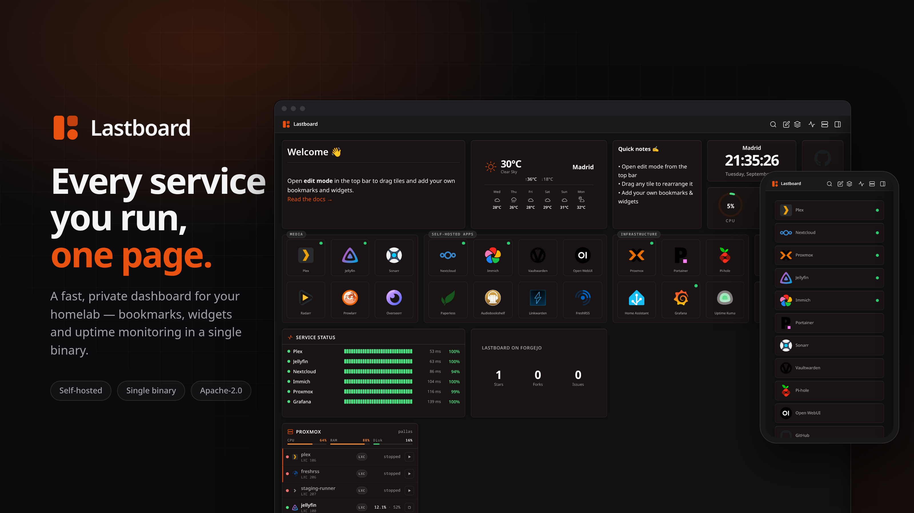

<div align="center">
  <br />
  
  <br /><br />

  <h1>Lastboard</h1>
  <p><strong>The personal dashboard you actually want to open every day.</strong></p>

  <p>
    <a href="https://lb-demo.codigosh.com">
      
    </a>
    &nbsp;
    
    &nbsp;
    
  </p>

  <br />

  

  <br /><br />

</div>

---

<div align="center">


</div>

---

📖 **[Read the Official Documentation](https://codigosh.com/docs/lastboard/)** for detailed guides on installation, configuration, security, and widget usage.

---

## Why Lastboard

Most self-hosted dashboards are either too heavy, too ugly, or too complex to maintain. Lastboard was built with a simple rule: **nothing ships unless it's fast and looks good doing it.**

It is **one static Go binary** and **one SQLite file**. No database server, no Redis, no Node runtime, no YAML to hand-edit before you see a screen, and no account anywhere. The first run is a three-step wizard in the browser. It fits comfortably on a Raspberry Pi or a 512 MB LXC container, and it ships **zero runtime JavaScript dependencies** on the frontend and a pure-Go SQLite driver on the backend — nothing to compile, nothing to keep in step.

| | |
| :--- | :--- |
| **Shape** | Single static binary (`linux/amd64`, `linux/arm64`) or Docker image |
| **Storage** | One SQLite file — `cp lastboard.db` is a complete backup |
| **Setup** | A browser wizard. Zero configuration files |
| **Languages** | 20, hand-translated, with full RTL support |
| **Licence** | Apache-2.0 |
| **Telemetry** | None. Ever |

---

## Features

### The board

- **A native drag-and-drop grid**, written from scratch in plain JavaScript — no grid library, no framework. Drag tiles anywhere, resize them a cell at a time from the corner. A live outline shows where a tile will land and turns **red** when the target is occupied: nothing is ever pushed aside behind your back, and a drop onto a taken cell is refused rather than guessed at.
- **Bookmarks** with an icon, a label you can place above, below, inside or hide entirely, a border colour and width of their own, and an optional **status dot** in any corner that says whether the service is answering.
- **Sections** — containers that group bookmarks under a title. Drop tiles inside and they travel together; move the section to another dashboard and its contents follow.
- **Multiple independent dashboards per user**, each with its own layout and items, switched from the top bar, reorderable by drag, with one marked as the one that opens first.
- **Move items between dashboards** — one at a time from a tile's menu, or many at once with the selection mode. Arrivals are auto-placed and briefly highlighted so you can see where they landed.
- **Live search** filters the board by label as you type.
- **A mobile layout with an order of its own** — which bookmarks appear on a phone, and in what sequence, is set independently of the desktop grid from a bottom sheet that only commits when you save.
- **Grid density** from 3 to 16 columns, per user.

### Widgets (9)

| Widget | Description |
| :--- | :--- |
| **Clock** | The time and date for any city you search for, on that city's time zone — one dashboard, several clocks |
| **Server Health** | CPU, RAM and temperature as ring gauges: of the host with no agent and no exporter, or of another server through Glances, Netdata or a JSON endpoint |
| **Weather** | Current conditions and an optional multi-day forecast from Open-Meteo. No API key, no registration |
| **Notepad** | A rich-text scratchpad with a real toolbar: headings, colours, lists, checklists, links and images |
| **Markdown** | A Markdown block rendered on the board, with a source/preview toggle and a lock |
| **Monitoring** | Every monitored service on a tile: status dot, heartbeat, latency and 24-hour uptime |
| **Docker** | Containers from one or many hosts, with live CPU/RAM and start/stop/restart |
| **Proxmox** | Your hypervisor's node health and the machines behind your bookmarks, with start and shutdown |
| **API** | Any JSON endpoint on a tile — 16 guided presets for common self-hosted services, or a fully custom request |

The **API widget** is the escape hatch for everything without a dedicated widget. Sixteen presets — AdGuard Home, Paperless-ngx, Immich, Jellyfin, Sonarr, Radarr, SABnzbd, Tautulli, Overseerr/Jellyseerr, Bazarr, Prowlarr, Home Assistant, Uptime Kuma, Forgejo/Gitea, Speedtest Tracker and Nextcloud — ask you for one to three fields and compose the rest. Anything else goes in Advanced: URL, method, headers, JSON field paths, list or metric layout, and number/bytes/percent formatting. The request runs **on the server**, so it reaches private IPs and accepts self-signed certificates that a browser would refuse.

### Uptime monitoring, built in

Give a bookmark a URL and a status position and Lastboard watches it. No second tool to deploy.

- **Two modes** — *tab mode* checks while somebody has Lastboard open (live dots, nothing stored); **24/7 mode** runs a server-side scheduler that keeps probing whether or not anyone is looking.
- **Check interval** of 1, 5, 10 or 30 minutes, with **30 days of history**, pruned daily.
- **A searchable status page** with every service's state, a strip of recent checks and its 24-hour uptime.
- **Per-service detail** over 24 hours, 7 days or 30 days: uptime percentages, current and average response time, a latency chart with a hover crosshair, a heartbeat strip, and an outage table with durations and recoveries.
- **Alerts down and up** via **ntfy**, **Gotify** or a **webhook**, with a failure threshold (1, 2, 3 or 5 consecutive failures) so a blip doesn't wake you, and a *Send test* button to prove delivery before you rely on it.
- **Private services just work** — the probe runs from your server, so `10.x`, `192.168.x`, `.local` and self-signed certificates need no extra configuration.

### Docker

- **Three ways to connect**: local socket, remote **TCP** or **TLS**, or the [Lastboard Agent](https://git.codigosh.com/CodigoSH/lastboard-agent) — a tiny token-authenticated bridge, so you never expose the Docker daemon over the network.
- **Many hosts, one list.** Tick the containers you care about on each host; they appear together, each row naming where it runs.
- **Live state and resource use**, and **start / stop / restart** from the row for administrators.
- **A container's name is a link**, resolved from what you typed, then a `lastboard.url` or `homepage.href` label, then its first published port — so containers already labelled for another dashboard work here unchanged.
- **A host that stops answering** doesn't make its containers vanish: they stay, greyed out, with the host line saying it isn't responding.

### Proxmox VE

- **Read your hypervisors with an API token** — read-only if you want. Nodes with CPU, memory, disk, load average and uptime; every storage with how full it is; every VM and container as a tile with a 24-hour CPU trend, and every node foldable so a cluster stays readable.
- **More than one cluster is fine.** Connect as many as you run, each with its own token and certificate policy. The page then opens on a short summary — a card each, and the bookmarked services that are down across *all* of them — and you go into whichever you want.
- **Machines are tied to your bookmarks automatically**, by name and by the icon a bookmark wears, with filing prefixes (`15-myspeed`) stripped and a strict *only when exactly one bookmark fits* rule. Measured on a real host of 29 containers and 55 bookmarks with nothing configured: **16 matched, none wrongly.**
- **That is the point of it.** A stopped container doesn't just say *stopped* — it says **which service it takes with it**: every stopped tile turns a soft red, the ones serving a bookmark carry its mark in the corner, and the summary names the service by name.
- **Start and shut down** a machine with confirmation, only on the hypervisors you connected, and only when the token really carries `VM.PowerMgmt` — which Lastboard asks the host rather than assuming. **Nodes can never be powered off from Lastboard**, deliberately.
- **Nothing is written to your database**: no machine names, no figures, no history. Only the connection (the token secret is never sent back to a browser) and the icons you choose for machines.

### Yours to keep

- **Full backup and restore** from the browser — every user, every dashboard, every setting and **every stored icon**, in one file, optionally sealed under a password so nothing in it can be read without it.
- **Export as open, documented YAML**: readable, editable, version-controllable.
- **Import from Homepage** (`services.yaml`, `bookmarks.yaml`), **from Dashy** (`conf.yml`), or from a Lastboard export. Import always *adds* dashboards and never overwrites, and tells you how many items it will create first.
- **Icons are downloaded once and served from your own server.** Loading your board reports nothing to a public CDN — not your address, and not which services you run. Boards built before this existed are brought in automatically on startup.

### Personal, multi-user and multilingual

- **Multi-user** with per-user boards, preferences, avatar and password. Exactly one administrator — the account the wizard creates.
- **Real dark/light mode** with dedicated colour token sets per theme, not a CSS filter — plus a **System** option that follows the device and changes with it.
- **Accent colour**, a **background image** per user, and **your own panel name and logo** in the tab and top bar.
- **Metric or imperial units**, applied across every widget that shows one.
- **20 languages, hand-translated** — Arabic, Bengali, Chinese, Dutch, English, Farsi, French, German, Greek, Hindi, Indonesian, Italian, Japanese, Korean, Polish, Portuguese, Russian, Spanish, Turkish, Urdu — with **full right-to-left layout** for Arabic, Farsi and Urdu. The language is applied on the server for the first paint, so even the login page arrives in your language instead of flashing English.
- **Installable as an app** on Android, iOS and the desktop.

### Operations

- **A web updater** that downloads, verifies the signature and the checksum, extracts, installs and restarts — showing each step as it happens, and putting the old binary back if the swap fails.
- **Beta channel**, opt-in per user.
- **One-line install** on Linux with a systemd unit, `--uninstall` and `--purge`, and a timestamped copy of your database taken before every upgrade.
- **Runs unprivileged** on request (`PUID`/`PGID`), fixing data-directory ownership itself before dropping privileges.
- **Structured logging** (`LOG_FORMAT=json`) and a `/api/health` endpoint.

### Security

Lastboard is built with defense-in-depth from the ground up:

- **Sessions** as HMAC-SHA256 signed tokens with strict expiry, tied to the account and ended by a password change; passwords hashed with **Argon2id**, at most two at a time so a flood of sign-ins cannot exhaust a small server; constant-time verification.
- **CSRF protection** on every state-changing method, plus a `Sec-Fetch-Site` check the page cannot forge.
- **A strict Content-Security-Policy with a per-request nonce**, so injected markup cannot execute as script — alongside HSTS, `nosniff`, `X-Frame-Options` and `Referrer-Policy`.
- **Rate limiting** at 20 req/s (burst 50) per IP, and a lockout after 5 failed attempts — at sign-in, and per account wherever the password is asked for again (changing it, deleting an account, resetting the instance). Behind a proxy the client IP is read from the entry **your** proxy appended, not the one the caller sent, so the lockout cannot be evaded with a forged header.
- **Signature-verified updates**: `checksums.txt` is signed with **Ed25519** and the public half is embedded in the binary as a list; a missing or invalid signature aborts the update.
- **Optional unprivileged execution** via `PUID`/`PGID`, with the data directory fixed up automatically before privileges are dropped.
- **Authorization declared route by route**, not by a list of public path prefixes inside the middleware — so nothing becomes reachable without a session by accident of its URL, including anything that falls through to the app shell. Stored icons are served with their own sandboxed CSP.

For the full breakdown, see the [Security Overview](https://codigosh.com/docs/lastboard/security/overview/).

Remote Docker hosts are reached through [Lastboard Agent](https://git.codigosh.com/CodigoSH/lastboard-agent), a tiny token-authenticated bridge, so you never have to expose the Docker daemon over TCP.

---

## Installation Methods

### Quick Start with Docker (Recommended)
The easiest way to get started is using Docker. Images are automatically built and published to our Forgejo registry.

**Using Docker Compose:**
```yaml
services:
  lastboard:
    image: git.codigosh.com/codigosh/lastboard:latest
    container_name: lastboard
    ports:
      - "8080:8080"
    environment:
      - TZ=America/New_York
      # - TRUST_PROXY=true   # Uncomment if running behind a reverse proxy
    volumes:
      - ./data:/var/lib/lastboard
    restart: unless-stopped
    logging:
      driver: "json-file"
      options:
        max-size: "10m"
        max-file: "3"
```

**Using Docker CLI:**
```bash
# Note: Add `-e TRUST_PROXY=true \` before the image name if running behind a reverse proxy.
docker run -d \
  --name lastboard \
  -p 8080:8080 \
  -e TZ=America/New_York \
  -v $(pwd)/data:/var/lib/lastboard \
  --restart unless-stopped \
  git.codigosh.com/codigosh/lastboard:latest
```

For advanced configuration options, environment variables, and data backups, please refer to the [Configuration Guide](https://codigosh.com/docs/lastboard/getting-started/configuration/).

---

### Quick Install (Linux)
Run this command to install or update Lastboard automatically:

```bash
curl -fsSL https://git.codigosh.com/CodigoSH/Lastboard/raw/branch/main/install.sh | sudo bash
```

For more details on building from source, check the [Development Guide](https://codigosh.com/docs/lastboard/contributing/development/).

---

## Updates

Updates come straight from the official repository, with no proxy or intermediary in between, and are verified against a signed checksum file before anything is installed.

For detailed updating instructions, visit the [Updates Guide](https://codigosh.com/docs/lastboard/getting-started/updating/), or see our [Security Policy](./SECURITY.md) for how update delivery works.

---

## Support & Recognition

We are an open-source initiative managed through [Open Collective Europe](https://opencollective.com/codigosh).

### Financial Support
If you find our tools useful, consider supporting our infrastructure through an unconditional donation.

[](https://opencollective.com/codigosh)

### Acknowledgments
Special thanks to everyone supporting our mission. 
<a href="https://opencollective.com/codigosh">
  
</a>

### Organizations
We appreciate the organizations that support us as a gesture of goodwill to help maintain our infrastructure.
<a href="https://opencollective.com/codigosh">
  
</a>

---

## Credits

- **Interface icons**:
  - Feather Icons (MIT - https://github.com/feathericons/feather)
  - Material Design Icons (Apache 2.0 - https://github.com/google/material-design-icons)
- **Icon set in the picker** (CC BY 4.0, searched on jsDelivr and then stored by your own instance, not bundled):
  - Selfhst Icons (CC BY 4.0 - https://github.com/selfhst/icons)
- **Weather data**: Open-Meteo (CC BY 4.0 - https://open-meteo.com)

Full attribution, including the Go modules compiled into the binaries, lives in [NOTICE](NOTICE).

---

A project by [CodigoSH](https://git.codigosh.com/CodigoSH) — built to last.

