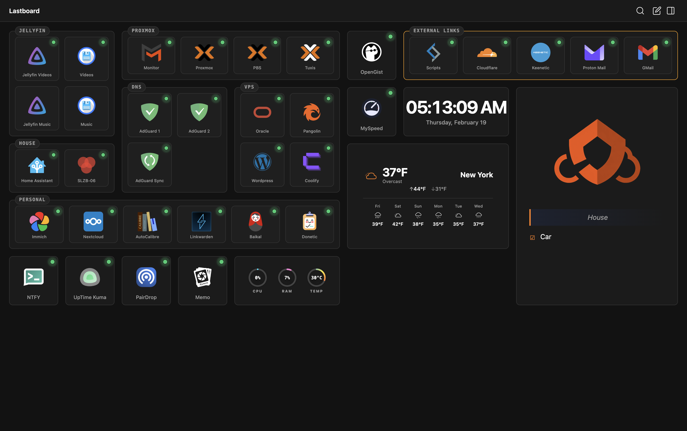

<div align="center">
  <br />
  
  <br /><br />

  <h1>Lastboard</h1>
  <p><strong>The personal dashboard you actually want to open every day.</strong></p>

  <p>
    <a href="https://lb-demo.codigosh.com">
      
    </a>
    &nbsp;
    
    &nbsp;
    
    &nbsp;
    
  </p>

  <br />

  

  <br /><br />

</div>

---

<div align="center">


</div>

---

📖 **[Read the Official Documentation](./docs/README.md)** for detailed guides on installation, configuration, security, and widget usage.

---

## Why Lastboard

Most self-hosted dashboards are either too heavy, too ugly, or too complex to maintain. Lastboard was built with a simple rule: **nothing ships unless it's fast and looks good doing it.**

- **Built-in drag & drop grid** — written from scratch in native JS. No framework overhead, silky smooth on any device.
- **Real dark/light mode** — dedicated color token sets per theme, not just a CSS filter.
- **Go backend** — small memory footprint, concurrent by default. Runs fine on a Raspberry Pi.
- **Peace of mind** — Backup and restore directly from the website.
- **Single SQLite file** — your entire dashboard state in one portable file. Backup = `cp lastboard.db`.
- **Guided setup wizard** — first run walks you through everything. Zero config files to touch.
- **Multi-user support** — per-user dashboards, preferences, and password management.
- **Global readiness** — Fully translated into 20 languages.
- **Real-time telemetry** — server stats (CPU, RAM, disk) streamed over WebSocket.

---

## Security & Widgets

### Security

Lastboard is built from the ground up with defense-in-depth principles, including strict CSP headers, CSRF protection, secure session tokens, and aggressive rate limiting.

For a detailed breakdown of our security measures, please refer to our [Security Overview](./docs/security/overview.md).

### Widgets (6)

| Widget | Description |
| :--- | :--- |
| **Clock** | Analog/digital clock with configurable timezone and seconds display |
| **Notepad** | Persistent per-user text notepad |
| **Telemetry** | Real-time server metrics (CPU, RAM, disk) via WebSocket |
| **Weather** | Current conditions and forecast via Open-Meteo |
| **Markdown** | Freeform Markdown renderer for notes and links |
| **Docker** | Live monitoring and lifecycle management (Start/Stop/Restart) of your containers |

---

## Installation Methods

### Quick Start with Docker (Recommended)
The easiest way to get started is using Docker. Images are automatically built and published to GHCR.

**Using Docker Compose:**
```yaml
services:
  lastboard:
    image: ghcr.io/codigosh/lastboard:latest
    container_name: lastboard
    ports:
      - "8080:8080"
    environment:
      - TZ=America/New_York
      # - TRUST_PROXY=true   # Uncomment if running behind a reverse proxy
    volumes:
      - ./data:/var/lib/lastboard
    restart: unless-stopped
    logging:
      driver: "json-file"
      options:
        max-size: "10m"
        max-file: "3"
```

**Using Docker CLI:**
```bash
docker run -d \
  --name lastboard \
  -p 8080:8080 \
  -e TZ=America/New_York \
  # -e TRUST_PROXY=true \   # Uncomment if running behind a reverse proxy
  -v $(pwd)/data:/var/lib/lastboard \
  --restart unless-stopped \
  ghcr.io/codigosh/lastboard:latest
```

For advanced configuration options, environment variables, and data backups, please refer to the [Configuration Guide](./docs/getting-started/configuration.md).

---

### Quick Install (Linux)
Run this command to install or update Lastboard automatically:

```bash
curl -fsSL https://raw.githubusercontent.com/CodigoSH/Lastboard/main/install.sh | sudo bash
```

For more details on manual installations or building from source, check our [Development Guide](./docs/contributing/development.md).

---

## Updates

Lastboard updates are handled securely via a dedicated proxy to guarantee performance and protect our infrastructure. 

For detailed updating instructions, visit the [Updates Guide](./docs/getting-started/updating.md), or see our [Security Policy](./SECURITY.md) for info about our proxy infrastructure.

---

## Support & Recognition

We are an open-source initiative managed through [Open Collective Europe](https://opencollective.com/codigosh).

### Financial Support
If you find our tools useful, consider supporting our infrastructure through an unconditional donation.

[](https://opencollective.com/codigosh)

### Acknowledgments
Special thanks to everyone supporting our mission. 
<a href="https://opencollective.com/codigosh">
  
</a>

### Organizations
We appreciate the organizations that support us as a gesture of goodwill to help maintain our infrastructure.
<a href="https://opencollective.com/codigosh">
  
</a>

---

## Credits

- **Icons**: 
  - Tabler Icons (MIT License - https://github.com/tabler/tabler-icons)
  - Homarr Labs Dashboard Icons (Apache 2.0 - https://github.com/homarr-labs/dashboard-icons)
  - Selfhst Icons (MIT License - https://github.com/selfhst/icons)
  - Homelab SVG Assets (MIT License - https://github.com/loganmarchione/homelab-svg-assets)
  - Simple Icons (CC0 - https://github.com/simple-icons/simple-icons)
  - Papirus Icon Theme (GPL-3.0 - https://github.com/PapirusDevelopmentTeam/papirus-icon-theme)
- **Design Inspiration**: Homarr Dashboard (Apache 2.0 - https://github.com/homarr-labs/homarr)

---

<div align="center">
  <sub>Built with ❤️ by the CodigoSH Team</sub>
</div>

