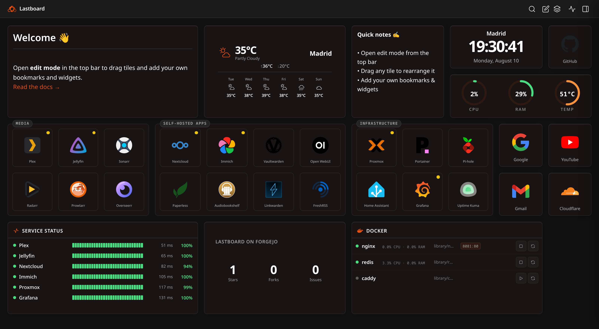

# Lastboard Documentation

Lastboard is a self-hosted dashboard and homelab startpage: bookmarks with live up/down
indicators, widgets, 24/7 uptime monitoring with alerts, Docker container control and a
Proxmox VE view — in **one Go binary** with **one SQLite file** beside it. No database server,
no message broker, no external cloud, no account anywhere.

New here? Go to **[Installation](getting-started/installation.md)**. This page is the map of
everything Lastboard does and where each part is documented.

## What Lastboard is

| | |
| :--- | :--- |
| **Shape** | One static binary (`linux/amd64`, `linux/arm64`) or one Docker image |
| **Storage** | A single SQLite file — back it up by copying it |
| **Dependencies** | None to install. The frontend ships **zero runtime JavaScript dependencies**; the backend links a pure-Go SQLite driver, so there is no CGO and no system library to match |
| **Footprint** | Small enough for a Raspberry Pi or a 512 MB LXC container |
| **First run** | A three-step wizard in the browser. There is no configuration file to write |
| **Licence** | Apache-2.0, free and open source |
| **Data leaving your server** | Nothing, by default. See [Security Overview](security/overview.md) |

## The board

The dashboard itself: a grid you arrange, and the tiles on it.

- **A native drag-and-drop grid**, written from scratch — no grid library. Drag a tile
  anywhere, resize it from its bottom-right corner a cell at a time. An outline shows where it
  will land and turns red when the target is occupied: nothing is ever pushed aside behind your
  back, and a drop onto a taken cell is simply refused.
- **Bookmarks** — a tile that launches a service, with an icon, a label you can place above,
  below, inside or hide entirely, a border colour and width of its own, and an optional
  **status dot** in any corner that says whether the service answers.
- **Sections** — a container that groups bookmarks under a title. Drop tiles inside and they
  travel with it: move the section to another dashboard and its contents go too.
- **Widgets** — nine of them, listed below, each resizable and configurable in place.
- **Multiple dashboards per user**, each with its own layout and items, switched from the top
  bar, reorderable, and with one marked as the one that opens first.
- **Move items between dashboards** — one at a time from a tile's menu, or many at once with
  the selection mode in the top bar. Items are auto-placed on arrival and briefly highlighted
  so you can see where they landed.
- **Live search** in the top bar filters the board by label as you type.
- **A mobile layout with an order of its own.** Phones get a simplified touch layout, and which
  bookmarks appear there — and in what order — is set independently of the desktop grid, from a
  bottom sheet that only commits when you tap *Save changes*.
- **Grid density** from 3 to 16 columns, per user.

→ [Bookmarks](getting-started/bookmarks.md) · [Dashboards](using/dashboards.md)

## Widgets

Nine widgets ship in the box. Each one has a **Personalize** tab with a border colour and
border width, on top of its own options.

| Widget | What it does | Configuration |
| :--- | :--- | :--- |
| **[Clock](widgets/clock.md)** *(Time)* | The time and date for a city you search for, on that city's time zone. Several clocks, several cities | 12/24 h, date, city, seconds |
| **[Telemetry](widgets/telemetry.md)** *(Server Health)* | CPU, RAM and temperature of the machine Lastboard runs on, as ring gauges. No agent, no exporter | Which gauges, redraw rate |
| **[Weather](widgets/weather.md)** | Current conditions and an optional multi-day forecast from Open-Meteo. No API key | Coordinates, forecast days |
| **[Notepad](widgets/notepad.md)** | A rich-text scratchpad with a toolbar: headings, colours, lists, checklists, links, images | None — you write in it |
| **[Markdown](widgets/markdown.md)** | A Markdown block rendered on the board, with a source/preview toggle | None — you write in it |
| **[Monitoring](widgets/monitoring.md)** | Your monitored services on a tile: status dot, heartbeat, latency, 24-hour uptime | Which services, refresh |
| **[Docker](widgets/docker.md)** | Containers from one or many hosts, with live CPU/RAM and start/stop/restart | Hosts, which containers, refresh |
| **[Proxmox](widgets/proxmox.md)** | The busiest node's health and the machines that need attention, with start/shutdown | Title, node health, refresh |
| **[API](widgets/api.md)** | Any JSON endpoint as a tile — as big metric numbers or as a scrolling list | Preset or fully manual |

The **API widget** is the escape hatch: **17 guided presets** (AdGuard Home, Paperless-ngx,
Immich, Jellyfin, Sonarr, Radarr, SABnzbd, Tautulli, Overseerr/Jellyseerr, Bazarr, Prowlarr,
Proxmox VE, Home Assistant, Uptime Kuma, Forgejo/Gitea, Speedtest Tracker, Nextcloud) where you
fill one to three fields, and an **Advanced** mode for anything else: URL, method, headers,
field paths and number/bytes/percent formatting. The request runs on the Lastboard server, so
it reaches private IPs and accepts self-signed certificates.

## Uptime monitoring

Built in, not bolted on. Give a bookmark a URL and a status position and Lastboard probes it.

- **Two modes.** *Tab mode* (the default) checks while somebody has Lastboard open — live dots,
  nothing recorded. **24/7 mode** runs a server-side scheduler that keeps probing whether or
  not anyone is looking, which is what makes history and alerts possible.
- **Check interval** of 1, 5, 10 or 30 minutes.
- **History kept for 30 days**, pruned daily.
- **A status page** listing every monitored service with its state, a strip of recent checks and
  its 24-hour uptime, searchable, opened from the top bar.
- **Per-service detail** over 24 hours, 7 days or 30 days: uptime percentages, current and
  average response time, a latency chart with a hover crosshair, a heartbeat strip, and a table
  of outages with duration and whether the service recovered.
- **Alerts on the way down and on the way back up**, via **ntfy**, **Gotify** or a **webhook**,
  with a configurable failure threshold (1, 2, 3 or 5 consecutive failures) so a blip does not
  wake you, and a *Send test* button to prove delivery before you rely on it.
- **Private services just work** — the probe runs from your server, so `10.x`, `192.168.x` and
  `.local` addresses and self-signed certificates need no extra configuration.

→ [Monitoring & Uptime](monitoring/overview.md) · [Monitoring widget](widgets/monitoring.md)

## Docker

- **Three ways to connect**: the local socket (native install or a mounted socket in Docker),
  **remote TCP or TLS**, or the **[Lastboard Agent](https://git.codigosh.com/CodigoSH/lastboard-agent)** —
  a tiny token-authenticated bridge, so you never have to expose the Docker daemon on the network.
- **Many hosts in one widget**: tick the containers you care about on each host and they all
  appear in one list, each row naming the host it runs on.
- **Live state and resource use**, with the same status dot the Monitoring widget uses.
- **Start, stop and restart** from the row — administrators only.
- **A container's name is a link.** The address is worked out from what you typed, then from a
  `lastboard.url` or `homepage.href` label on the container, then from its first published
  port — so containers already labelled for another dashboard work here unchanged.
- **A host that stops answering** does not make its containers vanish: they stay, greyed out,
  and the host line says it is not responding.

→ [Docker widget](widgets/docker.md)

## Proxmox VE

Lastboard reads your hypervisor with a **read-only API token** (power control is optional) and
shows it beside the services it runs.

- **As many hypervisors as you run.** Each is connected on its own terms, with its own token
  and certificate policy. With more than one, the page opens on a short summary — a card each,
  and the bookmarked services that are down across all of them — and you go into whichever you
  want.
- **A full page** per hypervisor: node CPU/memory/disk with load average and uptime, every
  storage with how full it is, and every virtual machine and container as a tile with a
  24-hour CPU trend line. Each node folds away, which is what keeps a cluster readable.
- **Machines are tied to bookmarks automatically**, by name and by the icon a bookmark wears,
  with the leading ordinal (`15-myspeed`) stripped and a strict "only when exactly one bookmark
  fits" rule — measured on a real host of 29 containers and 55 bookmarks: 16 matched, none
  wrongly. Where no rule should guess, you name the machine on the bookmark itself.
- **That is the point of it**: a stopped container does not just say *stopped*, it says
  **which service it takes with it** — every stopped tile turns a soft red, the ones serving a
  bookmark carry its mark in the corner, and the summary names the service.
- **Start and shut down** a machine, with confirmation — administrators only, and only when the
  token actually carries `VM.PowerMgmt`, which Lastboard asks the host rather than assuming.
  **Nodes can never be powered off from Lastboard**, deliberately.
- **An icon for machines that will never have a bookmark** — the runners, the tunnel, the
  container Lastboard itself runs on — chosen from the same picker the bookmarks use and
  stored on your own server.
- **Nothing is written to your database**: no machine names, no figures, no history. Only the
  connection itself is stored, and the token secret is never sent back to a browser.

→ [Proxmox](proxmox/overview.md) · [Proxmox widget](widgets/proxmox.md)

## Users and personalization

- **Multi-user** with per-user boards, preferences, avatar and password. Exactly one
  administrator — the account the wizard creates; everyone added afterwards is a Member.
- **Theme**: Dark, Light, or **System**, which follows the device and changes with it.
- **Accent colour** from presets or a colour picker.
- **A background image** per user, resized in the browser before it is stored.
- **Your own panel name and logo** in the browser tab and the top bar.
- **Measurement units**, metric or imperial, applied across every widget that shows one.
- **20 languages**, hand-translated: Arabic, Bengali, Chinese, Dutch, English, Farsi, French,
  German, Greek, Hindi, Indonesian, Italian, Japanese, Korean, Polish, Portuguese, Russian,
  Spanish, Turkish and Urdu — with **full right-to-left support** for Arabic, Farsi and Urdu.
  The language is set on the server for the first paint, so the login page arrives already in
  your language rather than flashing English first.
- **Installable as an app** (web app manifest) on Android, iOS and the desktop.

→ [Preferences](using/preferences.md)

## Your data stays yours

- **One SQLite file** holds everything. `cp lastboard.db` is a complete backup.
- **Full backup and restore** from the browser: every user, every dashboard, every setting and
  **every stored icon**, as one file.
- **Export your dashboards as open, documented YAML** — readable, editable, version-controllable.
- **Import from Homepage** (`services.yaml` and `bookmarks.yaml`), **from Dashy** (`conf.yml`)
  or from a Lastboard YAML file. Import always *adds* dashboards; it never overwrites what you
  already have, and it tells you how many items it will create before it creates any.
- **Icons are downloaded once and served from your own server.** Loading your board reports
  nothing to a CDN — neither your address nor, from the icons requested, which services you
  run. Boards built before this existed are brought in automatically when the server starts.

→ [Import, Export & Backup](using/import-export.md)

## Security

- Sessions as **HMAC-SHA256 signed tokens**, passwords hashed with **bcrypt**, constant-time
  verification.
- **CSRF protection** on every state-changing method, and a `Sec-Fetch-Site` check on top.
- A strict **Content-Security-Policy with a per-request nonce**, plus HSTS, `nosniff`,
  `X-Frame-Options` and `Referrer-Policy`.
- **Rate limiting** at 20 req/s with a burst of 50 per IP, and a login lockout after 5 failed
  attempts. Behind a proxy, the client IP is read from the entry **your** proxy appended, so
  the lockout cannot be evaded by forging a header.
- **Signed releases.** `checksums.txt` is signed with **Ed25519**; the public half is embedded
  in the binary as a list, and a missing or invalid signature aborts an update.
- **Optional unprivileged execution** with `PUID`/`PGID`.
- **No telemetry, no analytics, no account.** Lastboard never reports usage anywhere. Every
  outbound request it makes is one you asked for: probing *your* services, reading *your*
  Docker or Proxmox host, fetching an icon you picked, and checking our Forgejo for a new
  release — which goes straight there, with no intermediary.

→ [Security Overview](security/overview.md) · [Headers](security/headers.md) · [Release Signing](security/release-signing.md)

## Table of Contents

- **Getting Started**
  - [Installation](getting-started/installation.md)
  - [Configuration](getting-started/configuration.md)
  - [Bookmarks](getting-started/bookmarks.md)
  - [Updating](getting-started/updating.md)
- **Using Lastboard**
  - [Dashboards](using/dashboards.md)
  - [Preferences](using/preferences.md)
  - [Import, Export & Backup](using/import-export.md)
- **Widgets**
  - [Clock](widgets/clock.md)
  - [Telemetry](widgets/telemetry.md)
  - [Weather](widgets/weather.md)
  - [Notepad](widgets/notepad.md)
  - [Markdown](widgets/markdown.md)
  - [Monitoring](widgets/monitoring.md)
  - [Docker](widgets/docker.md)
  - [Proxmox](widgets/proxmox.md)
  - [API](widgets/api.md)
- **Monitoring**
  - [Monitoring & Uptime](monitoring/overview.md)
- **Proxmox**
  - [Proxmox](proxmox/overview.md)
- **Security**
  - [Overview](security/overview.md)
  - [Headers](security/headers.md)
  - [Release Signing](security/release-signing.md)
- **Help**
  - [Troubleshooting](help/troubleshooting.md)
- **Contributing**
  - [Development Guide](contributing/development.md)

---
[Live Demo](https://lb-demo.codigosh.com) | [Forgejo](https://git.codigosh.com/CodigoSH/Lastboard) | [Report a Bug](https://git.codigosh.com/CodigoSH/Lastboard/issues)
