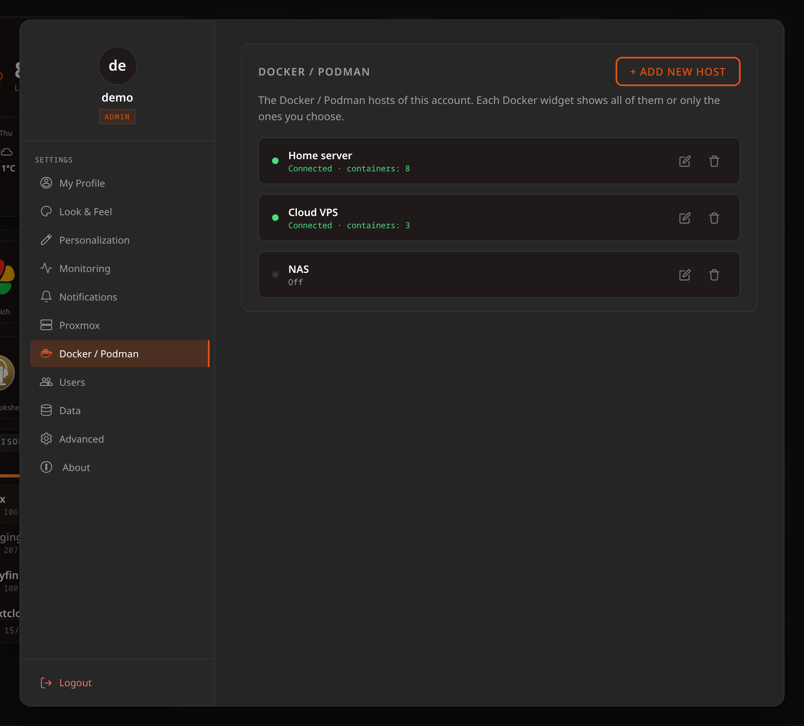
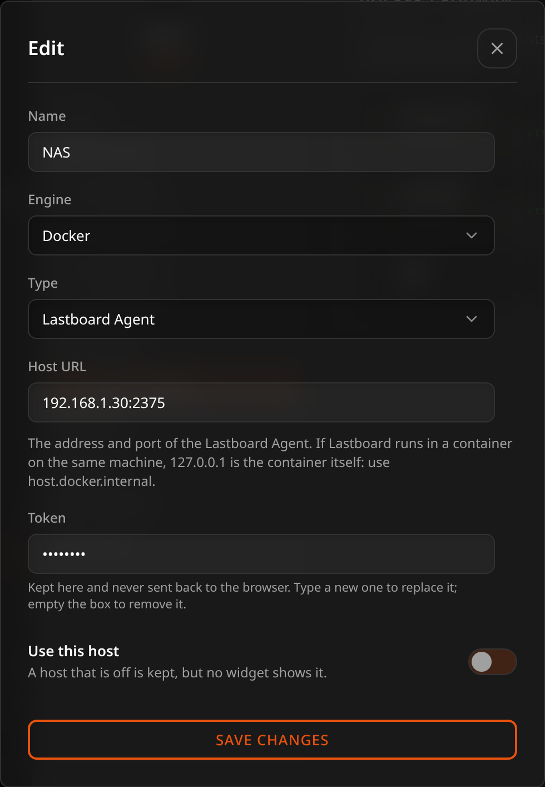
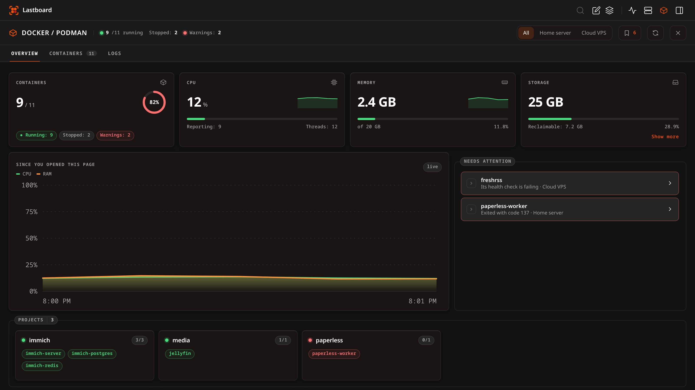
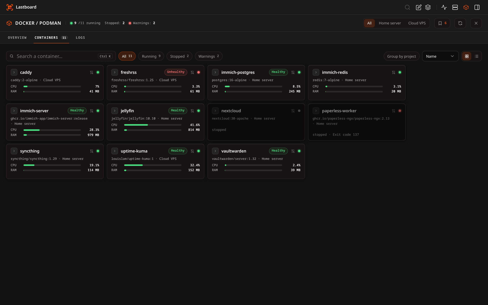
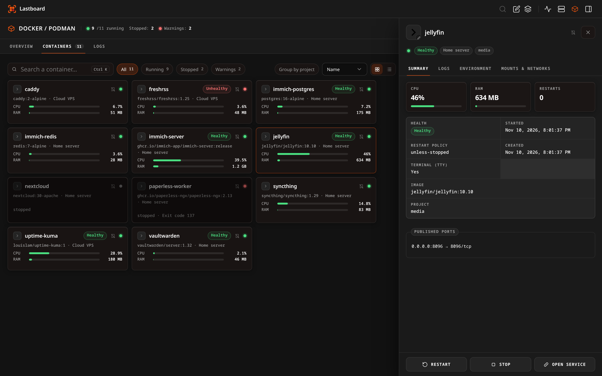
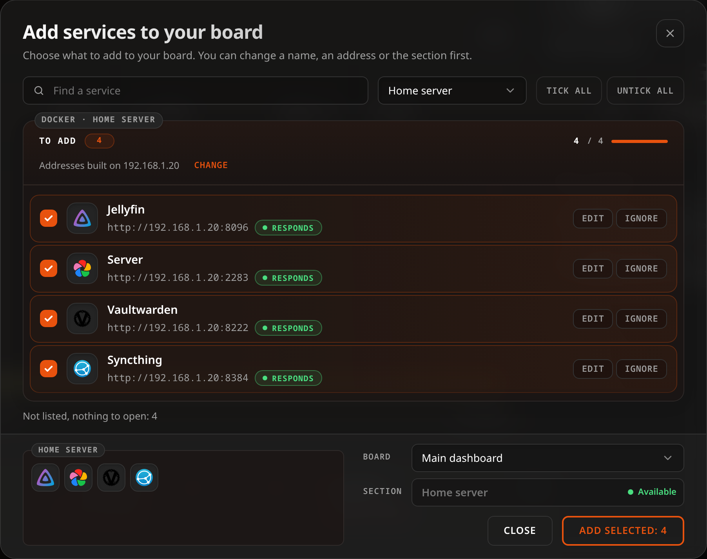

# Docker and Podman

Lastboard can read the Docker of your server and of the other machines you run, and show it beside the services it serves: every container of every host in one list, with its state and resource use and, for one container, how it is set up and what it prints. An account allowed to control Docker can also start, stop and restart them. Podman answers the same API, so everything here works with it too: you say which of the two a host runs when you add it, and the [Podman guide](../podman/overview.md) has the settings it needs.

The tile that puts the list on your board is described in the [Docker widget](../widgets/docker.md) guide; this page is about connecting Docker or Podman, who can use what, and the Docker / Podman page.

## Prerequisites

To monitor Docker instances, Lastboard needs access to the Docker daemon.

## Connection Modes

You can connect Lastboard to Docker environments in three ways. The same three work with Podman, with the settings on its [own page](../podman/overview.md):

### 1. Local Socket (Native Install)
When running Lastboard natively on Linux, it can access `/var/run/docker.sock` directly (ensure the `lastboard` user has permission to read the socket, often by adding it to the `docker` group). If the socket is somewhere else, give its path in the host's settings.

### 2. Local Socket (Docker Install)
When running Lastboard as a Docker container, uncomment the socket volume mount in the `docker-compose.yml` file to grant it access.
```yaml
    volumes:
      - ./data:/var/lib/lastboard
      - /var/run/docker.sock:/var/run/docker.sock:ro
```

`:ro` makes the socket file read-only, not what is said through it: Lastboard can still start, stop and restart containers over a socket mounted this way, and so can anything else that reaches it. Access to the Docker socket is control over Docker — and, through it, over the host. That is the same whether Lastboard is installed natively in the `docker` group or runs as a container with the socket mounted. For a Docker on another machine, use the Lastboard Agent: it answers only the few calls the widget makes.

### 3. Remote via Lastboard Agent
For remote servers, you can use the official Lastboard Agent to securely proxy Docker API calls with an authorization token, over HTTP or — behind a reverse proxy — HTTPS.

Running **Podman** instead of Docker? Every mode above works with it through Podman's socket. Two settings that Docker does not need, and Quadlet files to run Lastboard as a service, are in the [Podman guide](../podman/overview.md).

## Lastboard Agent

The Lastboard Agent is a lightweight proxy that exposes specific Docker endpoints.

### Quick Start

**Using Docker Compose (Recommended):**
```yaml
services:
  lastboard-agent:
    image: git.codigosh.com/codigosh/lastboard-agent:latest
    container_name: lastboard-agent
    ports:
      - "2375:2375"
    environment:
      - TOKEN=your_secure_random_token
    volumes:
      - /var/run/docker.sock:/var/run/docker.sock:ro
    restart: unless-stopped
```

**Using Docker CLI:**
```bash
docker run -d \
  --name lastboard-agent \
  -p 2375:2375 \
  -e TOKEN=your_secure_random_token \
  -v /var/run/docker.sock:/var/run/docker.sock:ro \
  --restart unless-stopped \
  git.codigosh.com/codigosh/lastboard-agent:latest
```

### Environment Variables
| Variable | Description |
| :--- | :--- |
| `TOKEN` | Required: The Bearer token used to authenticate requests. |
| `PORT` | The port the agent binds to (default: `2375`). |
| `SOCKET_PATH` | Path to Docker socket (default: `/var/run/docker.sock`). |

### Health Check Endpoint
The agent provides a public, unauthenticated `/health` endpoint to verify connectivity. Since v1.1.0 it also reports the agent's version there, and the Docker settings show it next to each agent host — so you can tell which release each machine runs without logging into it. An agent older than v1.1.0 reports none and is shown as `< v1.1.0`; one that does not answer shows nothing.

### Using with a Reverse Proxy
If securing the agent behind a reverse proxy (like Pangolin or Cloudflare Zero Trust), enter its address in the host's settings **with `https://`** — `https://agent.example.com` — and Lastboard reaches the agent over HTTPS. Without the scheme it speaks plain HTTP, which is what an agent on your own network answers.

The proxy must forward the `Authorization` header containing the Bearer token intact. As with the Remote TLS type, the certificate is not checked, so a self-signed one or an internal CA works; the connection is still encrypted, and the token no longer crosses the network in the clear.

## Docker hosts

Hosts belong to your account, as Proxmox hypervisors do: you set them up once in **Settings → Docker / Podman**, and every Docker widget reads the same list. Each row says how the host is doing (*Connected · containers: 12*, or why it isn't), and the version for an agent. Add a host with **+ Add New Host**, change one with the pencil, remove it with the bin, and switch one off to keep it without any widget showing it.



Each host has a name, an **Engine** — Docker or Podman — a **Type**, and an address. Pick the engine first and the type next; the fields below change to match, and so does the hint under them.

The types begin with the agent, which is what a new host starts on:

| Type | What to enter | Engines |
| :--- | :--- | :--- |
| **Lastboard Agent** | `192.168.1.100:2375`, plus the agent's token in its own field. `2375` is the default port, or whatever you set in the agent's `PORT`. | Docker, Podman |
| **Local socket** | The path of the socket, or nothing for the engine's usual one (`/var/run/docker.sock`). Administrator only. | Docker, Podman |
| **Remote TCP** | `192.168.1.100:2375` — an unencrypted Docker daemon. | Docker |
| **Remote TLS** | `192.168.1.100:2376` — a TLS Docker daemon. | Docker |

Podman is not offered on a network port: its API has no authentication of its own, so it is reached through the agent or through its socket.

Enter the host and port on their own — Lastboard adds the scheme the type needs. The one scheme kept is `https://` on an agent, which means *reach it over HTTPS* (see the reverse proxy section above). An address pasted with a scheme already on it, such as `tcp://10.0.0.5:2375` from `DOCKER_HOST`, is understood as written. The path of a socket must be absolute, with no `..` and no double slashes.

**The engine you pick is a guide, and the host has the last word.** Once it answers, Lastboard asks it which engine it runs and, if that is not what you picked, corrects the host, and shows the engine it found in its row and on the page. An agent that is too old to say keeps what you chose.

### An agent on the same machine as Lastboard

When Lastboard itself runs in a container and the agent runs on the same machine, `127.0.0.1` is the Lastboard container, not the machine. Reach the machine by the name the engine gives it: `host.docker.internal` with Docker, which on Linux needs `extra_hosts: ["host.docker.internal:host-gateway"]` in the container's definition, and `host.containers.internal` with Podman. A native Lastboard, on the machine itself, can use `127.0.0.1`.

### When a host does not answer

The row says why, and the same words show on the Docker / Podman page:

| It says | It means |
| :--- | :--- |
| *There is no socket at that path* | Nothing is at the path. Check it, and that the engine is running. |
| *Lastboard is not allowed to open the socket* | The socket exists and its permissions keep Lastboard's user out. Give that user access, or use the agent. |
| *The connection was refused* | Nothing listens there: the engine or the agent is stopped, or the port is wrong. |
| *The host did not answer in time* | The address is wrong, or a firewall drops the connection. |
| *Token rejected* | The agent answered and refused the token. |



There is no `?token=` to type: the token has its own field, which appears only for the agent. It is a secret: once saved it shows as dots and is never shown again — type a new one to replace it, or empty the box to remove it. The token is kept on the Lastboard server with your account and never travels to your browser, and a dashboard export leaves it out; a full [backup](../using/import-export.md) does carry it, so give the backup a password if it will leave your server.

### Who can use which kind of host

- **The administrator** can use every type.
- **A member** connects to Docker or Podman through a **Lastboard Agent**, with the agent's token. The local socket, Remote TCP and Remote TLS reach Docker by being the server, without any credential, so they are the administrator's: a member's account doesn't offer them. To let someone see the server's own containers, run an agent on it and give them its token.
- Whether a member has Docker at all, and whether it may start and stop containers, is one of the permissions the administrator sets for that account.

### Coming from an earlier version

Hosts used to be set up inside each widget. The first time the new version starts, they move to the account that owns the widget: the same host configured in two widgets becomes one host, agent tokens come with it, and what each widget had set on its containers — hidden, names, addresses, order — follows the host. A widget that showed every host keeps showing every host. A member who had the server's own socket in a widget keeps it in the list, marked as one only the administrator can use.

## The Docker page

The widget is a list you glance at. For the whole picture — what is running, what needs a look, and one container in detail — open the **Docker page**: the Docker icon in the top bar, beside the Proxmox one. It is there for an account that may look at Docker and has at least one host that is switched on and that it can use; with none, there is no icon. While the page is open the rest of the top bar is locked and the same icon (or **Esc**, or the browser's Back button) closes it, as with the Proxmox and status pages. Like them it has an address, `/?view=docker&tab=containers`, that follows the tab and the container in the panel, so reloading keeps you where you were. Back walks through the page before it leaves it: each tab and each container you opened is a step, so Back returns to the tab or the panel you came from, and one more leaves the page for your board.



The header says how many containers are running, how many are stopped and how many have warnings. With more than one host there is a selector beside it to look at all of them or at one; a button asks for a fresh reading at once. Everything refreshes every ten seconds while the page is open and the browser tab is visible. If the browser asks to save data (Data Saver, or a connection marked as limited) the refresh that runs by itself pauses; the refresh button, and opening the page, still read. A refresh never starts while the one before is still on its way. CPU and memory are read from Docker without waiting for it: the daemon answers a one-shot reading at once (Docker 20.10, API 1.41, or later), the CPU is worked out against the reading ten seconds before, and the first time a second reading a second later gives it, for all the containers of a host together. A host's readings are shared for a few seconds, so the page, the widget on the board and a second tab ask the daemon once between them. Through the Lastboard Agent this needs the release that passes `one-shot` on; with an older agent, or an older Docker, the readings come as they always did, a second for each eight containers. The page has three tabs: **Overview**, **Containers** and **Logs**.

### Overview

Four indicators:

- **Containers** — a ring with the share that is running, and how many are stopped or have warnings.
- **CPU** — the CPU of the running containers added up, as a share of what the hosts have: `0.8 cores in use of 16` reads as 5 %. The host's own size comes from Docker (`/info`), through the Lastboard Agent from the release that added that call; an older agent says nothing, and then the figure is in cores in use with a bar read against the top of the chart — a relative scale, said as such on the card. Under the bar the card says how many containers reported and the host's **threads** — and, from Lastboard Agent v1.4.0, its real **cores** as well (*Cores: 14 · Threads: 20*), which the agent reads from the host's own processor list. The cores are said only when every host in view says them, and are left out where the kernel does not list them.
- **Memory** — what the running containers use together, against the memory of the hosts (or, when a host did not say, against the largest limit any container reports, which on a host without limits is its memory).
- **Storage** — what Docker keeps on disk across the hosts in view: its images (each shared layer counted once), what the containers wrote, its volumes and its build cache, with what nothing uses any more as **Reclaimable** — unused images, stopped containers' writes, volumes no container refers to and cache not in use, which is what a prune would give back. Docker cannot say how big the host's disk is, so there is no "free" figure and the bar is the reclaimable share. The daemon takes a while to measure this on a host with a lot of data, so the page asks every five minutes (and when you press refresh) instead of every ten seconds. It needs a Lastboard Agent with the disk call; with an older one the card says to update it, and a host that does not answer is left out of the sum. **Show more** under the card opens a window with each item on its own line — images, volumes, build cache, containers, what is reclaimable and the total.

Under them, a chart of the cores in use **since you opened the page** (hover it to read a value). Lastboard does not store this history: the browser keeps it while the browser tab stays open, and it starts again after a reload. This is on purpose. Docker only reports what a container uses *right now* and keeps no history of its own, so the chart is a live view and not a per-day one (the Proxmox page can show days because Proxmox records them itself, and Lastboard only reads them). For usage over days or weeks, use a monitoring tool that records metrics, such as Prometheus with cAdvisor.

**Needs attention** lists a host that does not answer, then the containers that are failing their own health check, keep restarting, ended with a non-zero exit code, are using 90% or more of their memory limit (the point where the bar on their card turns red) or are paused — the worst first. A container that was stopped on purpose (exit code 0) or has never run is not a warning — unless a bookmark depends on it (see below), in which case it is listed and the line says which service stops responding. Choosing one opens it. When there is nothing to list, the box says everything is running as it should. Below, one box lists the **Projects** with how many of each one's containers are up, and another the **Hosts**; a host that does not answer says why in its own line.

### Containers



Every container of every host that is on, as cards or as a list (the two buttons at the end of the toolbar). Cards show state, CPU and memory for the running ones; the health chip appears only for an image that defines a health check, and a stopped container says how it ended.

- **Search** filters by name, image, project, host or the start of the container id. **Ctrl+K** (**Cmd+K** on macOS) puts the cursor in it from anywhere on the page, taking you to this tab if you are on another.
- **Chips** — *All*, *Running*, *Stopped* and *Warnings* — each with how many it would show.
- **Group by project** gathers the containers of each Compose project under its name; the ones started outside Compose go last.
- **Sort by** name, state, CPU or memory. The view, the sort and the grouping are remembered in this browser.

Choosing a container opens it in a **side panel**. On a wide window the panel pushes the page aside so the list stays in view; on a narrower one it covers the page, and **Esc**, the **×** or the browser's Back button closes it (the panel is a step of its own, so Back from a container returns to the list). On a phone it takes the screen.

A container can have a **face** and a **bookmark**:

- **Face** — the round-cornered icon at the start of its name. Choose one from the panel by pressing the icon beside the container's name (**Choose an icon**); **Remove icon** in the panel's footer goes back to the default. The icon is downloaded and kept by Lastboard like a bookmark's, and the choice belongs to your account. Without a chosen face, the container wears the icon of the bookmark that serves it, if there is one.
- **Bookmark** — in the bookmark's editor, **Runs on → Docker** (shown only when a Docker host answers) says which container runs the service. The card and the panel then show the bookmark's name in an orange pill (a container with no bookmark shows the bookmark icon struck through instead), the panel gets **Open bookmark**, and if the container stops, the page says so: *This stops responding: Plex*. Unlike the Proxmox integration there is no matching by name — the link is only what you set. A container is identified by its host and its **name**, never its id, so updating or recreating it keeps both the face and the bookmark; renaming it loses them.



The panel has four tabs:

- **Summary** — live CPU and memory use and the restart count, then the state, health, when it started, how it ended (the end time and the exit code for a container that is not running, and the exit code alone when it is running again after a non-zero one), its restart policy, when it was created, its image and its Compose project; below that, the published ports.
- **Logs** — see below.
- **Environment** — the **names** of its environment variables.
- **Mounts & networks** — each mount marked read-only or read-write, and the networks with the container's address on each.

**The values of environment variables are never shown.** They often hold passwords and tokens, so only the names leave the server: the values are removed before the answer is sent to your browser.

### Logs

The Logs tab and the panel's Logs tab are the same viewer: the one on the tab reads the container chosen in its selector, and choosing a container anywhere makes it the one both show.

The last 100 lines when you open it, with **Load more lines** to read the last 1,000. Lines the container wrote to its error output are marked with a red tint and a bar; a container started with a terminal (`docker run -t`) does not separate the two, so none of its lines are marked. Color and cursor codes are removed from the text, so a container that paints its output reads as plain text, and what it prints is only ever shown as text, never as markup.

- **Follow** asks for the lines after the last one you have every three seconds, only while a log and the browser tab are visible, and keeps the view at the end only if you were already there — scroll up to read and it stays where you left it. Turn it off to stop asking.
- **Timestamps** shows or hides the time before each line, in your language's format and your browser's time zone. This choice and *Follow* are remembered in this browser.
- **Copy** puts the lines you see on the clipboard as plain text, with the times if they are showing.
- The page keeps at most 2,000 lines; when more arrive, the oldest are dropped. If the log was larger than Lastboard reads at once, or a line was very long, a note says part of it was cut.

### Adding the services of a host to the board

Rather than making one bookmark for each container by hand, ask Lastboard to propose them: the **bookmark** button in the Docker page's header (its tooltip says *Detect services*), or the window that opens by itself when you add a host that answers and has something to offer. If you add several at once it opens once, for the first that has something to add; the others are in the window's list of hosts. When the host answers but everything it has already has a bookmark or is ignored, no window opens and a short notice says the host is connected and there is nothing new to add; the button still opens the window to review it. It needs permission to edit the board.



The window sorts what the host's containers could become into three groups (**Ctrl+K** or **Cmd+K** goes to its search). **To add** is open and is where you work: one row each, with its checkbox, its icon, its name, its address and whether that address answers. A container that runs and has an address is ticked to start with; a stopped one, or one on the host's network whose address you must type, starts unticked. **Already on your board** (what a bookmark already serves) and **Ignored** (what you set aside) are folded, since there is nothing to do with them; press their title to see them. **Tick all** and **Untick all**, beside the search, act on the group to add, and **Only those that answer** (when some do and some do not) ticks just the ones that answer. The head of the group stays in place while the rows scroll, with how many there are and a bar of how many are ticked. At the foot are the board (when your account may use several), the **Section** field and a preview of the section, and then **Close** and **Add selected**.

- **Several hosts:** with more than one Docker host, a dropdown between the search and the tick buttons switches between them. The search and the buttons stay where they are, shaded, while a host loads or has nothing to offer, so you can always move on to another.
- **The address of each row** is the one the container names itself (`lastboard.url`, or `homepage.href`), then the one a reverse proxy puts it on (a Traefik router rule or a `caddy` label), then its published ports, lowest first. When there are several, a selector offers them; you can also type your own. A port is proposed over **https** when either end of it is a TLS port (443, 8443, 9443, 8006 or 10443).
- **The host's address** is what the port-based addresses are built on, and comes filled in: the host part of the host's URL (for a socket on this machine, the one you opened Lastboard by). A line in the head of the list says it — *Addresses built on 192.168.1.5* — and **Change** opens its field there; changing it rewrites every address you have not typed by hand. You only need it when the host is reached by another name than the one Lastboard knows it by.
- **Name and address are text until you edit them.** Hover a row (or tab to it) and **Edit** opens its fields in place: the name, the address, and the menu of the other ways to reach it; **Done** folds them again. They are suggestions, never links nobody has looked at. The name is the container's, made readable (`home-assistant` becomes *Home Assistant*, and Compose's project and number are taken off).
- **What a container says about itself** wins over all of that. The labels `lastboard.name`, `lastboard.icon` and `lastboard.group` (or Homepage's `homepage.name`, `homepage.icon` and `homepage.group`; ours win when both are there) give the bookmark's name, its icon — a library name such as `jellyfin`, or an address — and the section it goes in, however the window groups the rest. They are cut to a length a card can show, and they only suggest: you look them over before anything is made.
- **Section:** by default one for the host. When the containers belong to Compose projects with several services, a switch under the field, *One per Compose project*, makes one section for each (a project with a single service joins the host's). The **Section** field in the footer lets you name it yourself: type a title and everything ticked goes in that one section, whatever the projects or labels say. On its line the window says whether that title is taken on the chosen board — *Already exists* (the bookmarks join it) or *Available* (a new section is made), inside the box of the title — so a section is never made twice by accident; if you do want a second one, give it another title. With the field empty and the services going to more than one section (projects, or labels), it reads *Several, automatic* and the line says *Available* when none of those sections exists yet, *Already exists* when all of them do, and otherwise how many are already there and how many are new. A section that already has the title takes the new bookmarks into its free cells, and grows only when nothing is below it; if it cannot, a new one is made. Under the fields, a **preview** shows the section as the board will show it — its title on the border and a tile for each bookmark — and follows what you tick, rename and change.
- **Left out of the list:** Lastboard's own containers and its agent, and the containers with nothing to open — no published port (or one bound to the machine alone), no label and not on the host's network. The window says how many. A container on the host's network publishes nothing, so it is offered **unticked** and you type its address.
- **The icon** is the one you already chose for the container; otherwise the one a label names, or the library's by the image and the service name, when your account may look icons up on the Internet (the marks of CodigoSH need no permission); otherwise the bookmark gets the default icon. The tile of each row is a button: press it to choose another in the same icon search the bookmark window uses, the marks of CodigoSH included. What you choose beats everything proposed. Icons are stored on this server, like any bookmark's.
- **Does it answer?** When your account may check status, each proposed address is asked as the status dots ask, and the row says **Responds** or **Not answering now** as the answers come in, without holding anything up. Like the dots, it counts a port that accepts a connection as an answer. *Not answering* does not stop you adding it — it only says Lastboard could not open that address, and a line above the list says so while any row is in that state. A row whose address you change stops showing the answer. A console address (Proxmox) is not asked.
- **Ignoring is your choice, row by row.** **Ignore**, on a row to add, sends that container to the *Ignored* group: it stops being proposed and is not counted as left to add. **Stop ignoring**, in that group, brings it back. Leaving a row unticked is not ignoring it: it is still proposed next time. The ignored list is yours alone, goes with the backup, and goes when its host is removed. The **bookmark** button in the page's header shows how many containers are still left to add (those no bookmark serves and you did not ignore); it is counted from what the page already has, and is read again after the window adds something.
- **Already on your board** are the containers a bookmark's **Runs on → Docker** names, and those a bookmark of yours is called after (a container `jellyfin` and a bookmark *Jellyfin*, or one wearing the `jellyfin` icon), so a board you made by hand does not get a second one of each. A bookmark whose address is the one the container is published at (the same host and port) counts too, whatever it is called. Where two bookmarks would fit, nothing is assumed. A name or an address that matches is only a guess, so **Add anyway** on such a row moves it to the group to add.
- **Link** is offered on a row whose bookmark is found only by name or address, tied to no container. It adds the link to that bookmark (the same one **Runs on → Docker** writes) so the board, the Docker page and this window agree from then on, and it changes nothing else about it: its name, address, icon and look stay as they are. **Link all** at the top of the group does it for all of them at once, and the sentence beside it says how many there are. It asks first, and a bookmark you edited elsewhere in the meantime is left untouched and counted in the message. A bookmark that already serves another container is not offered. If you do not want a container tied, **Ignore** on its row (or **Ignore all** at the top of the group) moves it to **Ignored**; until it is tied or ignored it is counted in the badge of the page's bookmark button. A row whose bookmark has an icon shows that icon.
- **Which board:** the one you have open; an account that may use several boards can choose another in the window.

Each bookmark is made as the bookmark editor would make it, tied to its container (so the card and panel show it) and with its status checked when your account may. If the account reaches its limit of items, the window stops, says how many were left out, and keeps what it made. Pressing **Add selected** first asks you to confirm — how many bookmarks, in which section, on which board — and once they are made the window closes and a message says how many were added; if some could not be added, the window stays open and says which. A section the window makes is as big as what goes in it: two bookmarks make one 2 wide by 1 high, three make 3 by 1, four make 4 by 1, and past that the bookmarks wrap onto more rows (five make 3 by 2). A section that was already on the board keeps its width and gains rows when it needs them.

### Permissions and agents

Seeing the page and its logs needs permission to **view** Docker. **Start**, **Restart** and **Stop** at the foot of the panel need permission to **control** it; an account without it sees no buttons. Restart and stop ask for confirmation first, and Stop is switched off for the Lastboard Agent's own container.

Details and logs of a container on an agent host need **Lastboard Agent v1.3.0 or later** on that host. With an older agent the list works as before, and the page names the host and says its agent needs updating, instead of reporting that it could not connect. Hosts of the other types (local socket, TCP, TLS) need nothing.

## Starting and stopping

Containers can be started, stopped or restarted from the foot of a container's panel on the Docker page by an account allowed to control Docker: the administrator on any of its hosts, a member on its own agents. The [widget](../widgets/docker.md) only reads: a click on one of its rows opens that container's panel over the board, with the same buttons. An account that may only look at Docker sees the same containers and their state, without the controls. An agent only accepts the calls it allows, so what it lets through still applies.
