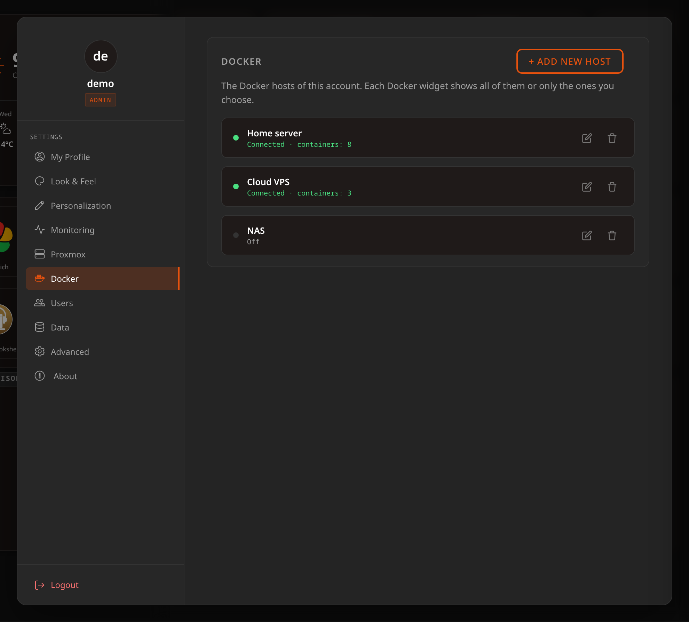
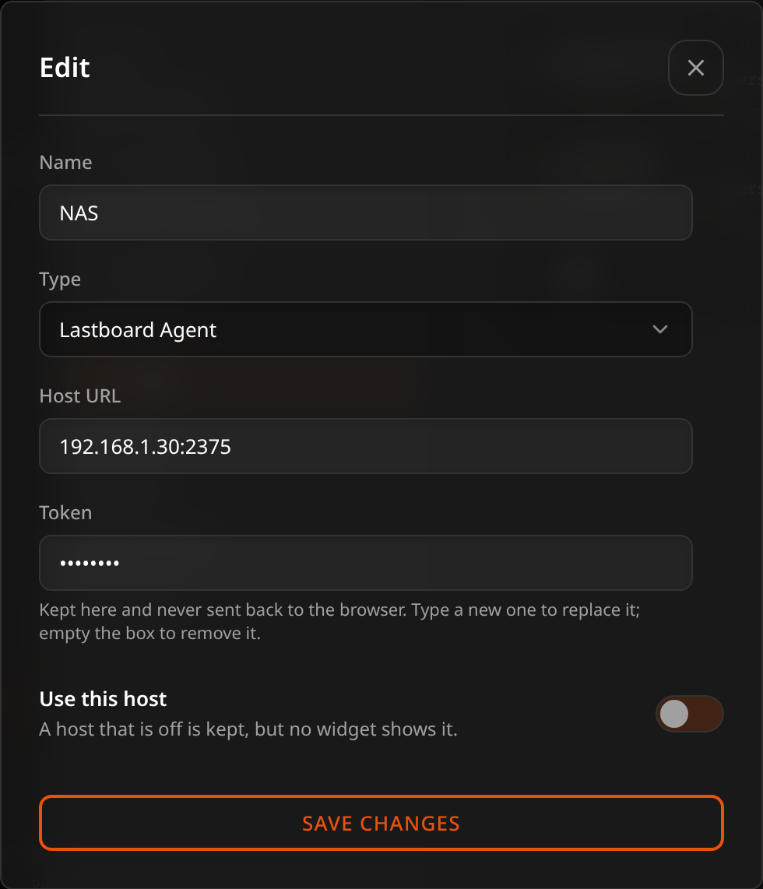
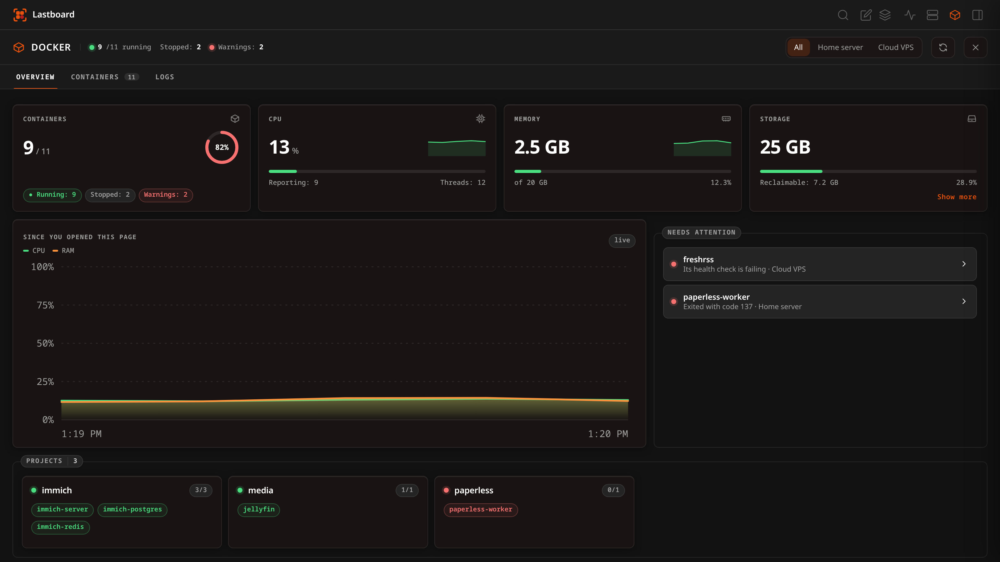
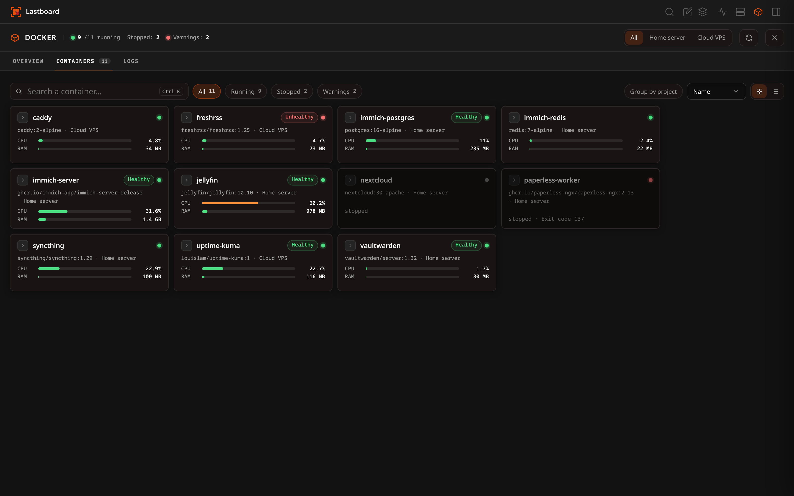
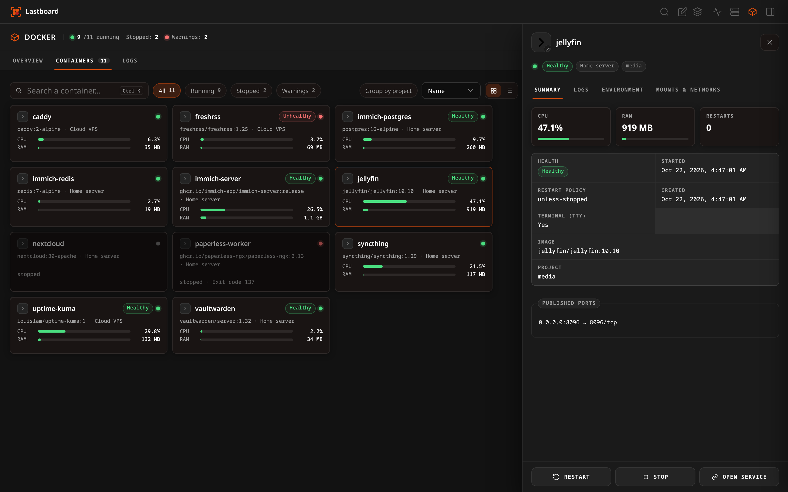

# Docker

Lastboard can read the Docker of your server and of the other machines you run, and show it beside the services it serves: every container of every host in one list, with its state and resource use and, for one container, how it is set up and what it prints. An account allowed to control Docker can also start, stop and restart them. [Podman](../podman/overview.md) answers the same API, so everything here works with it.

The tile that puts the list on your board is described in the [Docker widget](../widgets/docker.md) guide; this page is about connecting Docker, who can use what, and the Docker page.

## Prerequisites

To monitor Docker instances, Lastboard needs access to the Docker daemon.

## Connection Modes

You can connect Lastboard to Docker environments in three ways:

### 1. Local Socket (Native Install)
When running Lastboard natively on Linux, it can access `/var/run/docker.sock` directly (ensure the `lastboard` user has permission to read the socket, often by adding it to the `docker` group).

### 2. Local Socket (Docker Install)
When running Lastboard as a Docker container, uncomment the socket volume mount in the `docker-compose.yml` file to grant it access.
```yaml
    volumes:
      - ./data:/var/lib/lastboard
      - /var/run/docker.sock:/var/run/docker.sock:ro
```

`:ro` makes the socket file read-only, not what is said through it: Lastboard can still start, stop and restart containers over a socket mounted this way, and so can anything else that reaches it. Access to the Docker socket is control over Docker — and, through it, over the host. That is the same whether Lastboard is installed natively in the `docker` group or runs as a container with the socket mounted. For a Docker on another machine, use the Lastboard Agent: it answers only the few calls the widget makes.

### 3. Remote via Lastboard Agent
For remote servers, you can use the official Lastboard Agent to securely proxy Docker API calls with an authorization token, over HTTP or — behind a reverse proxy — HTTPS.

Running **Podman** instead of Docker? Every mode above works with it through Podman's socket. Two settings that Docker does not need, and Quadlet files to run Lastboard as a service, are in the [Podman guide](../podman/overview.md).

## Lastboard Agent

The Lastboard Agent is a lightweight proxy that exposes specific Docker endpoints.

### Quick Start

**Using Docker Compose (Recommended):**
```yaml
services:
  lastboard-agent:
    image: git.codigosh.com/codigosh/lastboard-agent:latest
    container_name: lastboard-agent
    ports:
      - "2375:2375"
    environment:
      - TOKEN=your_secure_random_token
    volumes:
      - /var/run/docker.sock:/var/run/docker.sock:ro
    restart: unless-stopped
```

**Using Docker CLI:**
```bash
docker run -d \
  --name lastboard-agent \
  -p 2375:2375 \
  -e TOKEN=your_secure_random_token \
  -v /var/run/docker.sock:/var/run/docker.sock:ro \
  --restart unless-stopped \
  git.codigosh.com/codigosh/lastboard-agent:latest
```

### Environment Variables
| Variable | Description |
| :--- | :--- |
| `TOKEN` | Required: The Bearer token used to authenticate requests. |
| `PORT` | The port the agent binds to (default: `2375`). |
| `SOCKET_PATH` | Path to Docker socket (default: `/var/run/docker.sock`). |

### Health Check Endpoint
The agent provides a public, unauthenticated `/health` endpoint to verify connectivity. Since v1.1.0 it also reports the agent's version there, and the Docker settings show it next to each agent host — so you can tell which release each machine runs without logging into it. An agent older than v1.1.0 reports none and is shown as `< v1.1.0`; one that does not answer shows nothing.

### Using with a Reverse Proxy
If securing the agent behind a reverse proxy (like Pangolin or Cloudflare Zero Trust), enter its address in the host's settings **with `https://`** — `https://agent.example.com` — and Lastboard reaches the agent over HTTPS. Without the scheme it speaks plain HTTP, which is what an agent on your own network answers.

The proxy must forward the `Authorization` header containing the Bearer token intact. As with the Remote TLS type, the certificate is not checked, so a self-signed one or an internal CA works; the connection is still encrypted, and the token no longer crosses the network in the clear.

## Docker hosts

Hosts belong to your account, as Proxmox hypervisors do: you set them up once in **Preferences → Docker**, and every Docker widget reads the same list. Each row says how the host is doing (*Connected · containers: 12*, or why it isn't), and the version for an agent. Add a host with **+ Add New Host**, change one with the pencil, remove it with the bin, and switch one off to keep it without any widget showing it.



Each host has a name, a **Type**, and — for everything except the local socket — an address. Pick the type first; the fields below it change to match.

| Type | Address to enter | Default port |
| :--- | :--- | :--- |
| **Local socket** | nothing — the address field disappears | — |
| **Lastboard Agent** | `192.168.1.100:2375`, plus the agent's token in its own field | `2375`, or whatever you set in the agent's `PORT` |
| **Remote TCP** | `192.168.1.100:2375` | `2375` — an unencrypted Docker daemon |
| **Remote TLS** | `192.168.1.100:2376` | `2376` — a TLS Docker daemon |

Enter the host and port on their own — Lastboard adds the scheme the type needs. The one scheme kept is `https://` on an agent, which means *reach it over HTTPS* (see the reverse proxy section above). An address pasted with a scheme already on it, such as `tcp://10.0.0.5:2375` from `DOCKER_HOST`, is understood as written.



There is no `?token=` to type: the token has its own field, which appears only for the agent. It is a secret: once saved it shows as dots and is never shown again — type a new one to replace it, or empty the box to remove it. The token is kept on the Lastboard server with your account and never travels to your browser, and a dashboard export leaves it out; a full [backup](../using/import-export.md) does carry it, so give the backup a password if it will leave your server.

### Who can use which kind of host

- **The administrator** can use every type.
- **A member** connects to Docker through a **Lastboard Agent**, with the agent's token. The local socket, Remote TCP and Remote TLS reach Docker by being the server, without any credential, so they are the administrator's: a member's account doesn't offer them. To let someone see the server's own containers, run an agent on it and give them its token.
- Whether a member has Docker at all, and whether it may start and stop containers, is one of the permissions the administrator sets for that account.

### Coming from an earlier version

Hosts used to be set up inside each widget. The first time the new version starts, they move to the account that owns the widget: the same host configured in two widgets becomes one host, agent tokens come with it, and what each widget had set on its containers — hidden, names, addresses, order — follows the host. A widget that showed every host keeps showing every host. A member who had the server's own socket in a widget keeps it in the list, marked as one only the administrator can use.

## The Docker page

The widget is a list you glance at. For the whole picture — what is running, what needs a look, and one container in detail — open the **Docker page**: the Docker icon in the top bar, beside the Proxmox one. It is there for an account that may look at Docker and has at least one host that is switched on and that it can use; with none, there is no icon. While the page is open the rest of the top bar is locked and the same icon (or **Esc**, or the browser's Back button) closes it, as with the Proxmox and status pages. Back walks through the page before it leaves it: each tab and each container you opened is a step, so Back returns to the tab or the panel you came from, and one more leaves the page for your board.



The header says how many containers are running, how many are stopped and how many have warnings. With more than one host there is a selector beside it to look at all of them or at one; a button asks for a fresh reading at once. Everything refreshes every ten seconds while the page is open and the browser tab is visible. If the browser asks to save data (Data Saver, or a connection marked as limited) the refresh that runs by itself pauses; the refresh button, and opening the page, still read. A refresh never starts while the one before is still on its way. CPU and memory are read from Docker without waiting for it: the daemon answers a one-shot reading at once (Docker 20.10, API 1.41, or later), the CPU is worked out against the reading ten seconds before, and the first time a second reading a second later gives it, for all the containers of a host together. A host's readings are shared for a few seconds, so the page, the widget on the board and a second tab ask the daemon once between them. Through the Lastboard Agent this needs the release that passes `one-shot` on; with an older agent, or an older Docker, the readings come as they always did, a second for each eight containers. The page has three tabs: **Overview**, **Containers** and **Logs**.

### Overview

Four indicators:

- **Containers** — a ring with the share that is running, and how many are stopped or have warnings.
- **CPU** — the CPU of the running containers added up, as a share of what the hosts have: `0.8 cores in use of 16` reads as 5 %. The host's own size comes from Docker (`/info`), through the Lastboard Agent from the release that added that call; an older agent says nothing, and then the figure is in cores in use with a bar read against the top of the chart — a relative scale, said as such on the card. Under the bar the card says how many containers reported and the host's **threads** — and, from Lastboard Agent v1.4.0, its real **cores** as well (*Cores: 14 · Threads: 20*), which the agent reads from the host's own processor list. The cores are said only when every host in view says them, and are left out where the kernel does not list them.
- **Memory** — what the running containers use together, against the memory of the hosts (or, when a host did not say, against the largest limit any container reports, which on a host without limits is its memory).
- **Storage** — what Docker keeps on disk across the hosts in view: its images (each shared layer counted once), what the containers wrote, its volumes and its build cache, with what nothing uses any more as **Reclaimable** — unused images, stopped containers' writes, volumes no container refers to and cache not in use, which is what a prune would give back. Docker cannot say how big the host's disk is, so there is no "free" figure and the bar is the reclaimable share. The daemon takes a while to measure this on a host with a lot of data, so the page asks every five minutes (and when you press refresh) instead of every ten seconds. It needs a Lastboard Agent with the disk call; with an older one the card says to update it, and a host that does not answer is left out of the sum. **Show more** under the card opens a window with each item on its own line — images, volumes, build cache, containers, what is reclaimable and the total.

Under them, a chart of the cores in use **since you opened the page** (hover it to read a value). Lastboard does not store this history: the browser keeps it while the browser tab stays open, and it starts again after a reload.

**Needs attention** lists a host that does not answer, then the containers that are failing their own health check, keep restarting, ended with a non-zero exit code, are using 90% or more of their memory limit (the point where the bar on their card turns red) or are paused — the worst first. A container that was stopped on purpose (exit code 0) or has never run is not a warning — unless a bookmark depends on it (see below), in which case it is listed and the line says which service stops responding. Choosing one opens it. When there is nothing to list, the box says everything is running as it should. Below, one box lists the **Projects** with how many of each one's containers are up, and another the **Hosts**; a host that does not answer says why in its own line.

### Containers



Every container of every host that is on, as cards or as a list (the two buttons at the end of the toolbar). Cards show state, CPU and memory for the running ones; the health chip appears only for an image that defines a health check, and a stopped container says how it ended.

- **Search** filters by name, image, project, host or the start of the container id. **Ctrl+K** (**Cmd+K** on macOS) puts the cursor in it from anywhere on the page, taking you to this tab if you are on another.
- **Chips** — *All*, *Running*, *Stopped* and *Warnings* — each with how many it would show.
- **Group by project** gathers the containers of each Compose project under its name; the ones started outside Compose go last.
- **Sort by** name, state, CPU or memory. The view, the sort and the grouping are remembered in this browser.

Choosing a container opens it in a **side panel**. On a wide window the panel pushes the page aside so the list stays in view; on a narrower one it covers the page, and **Esc**, the **×** or the browser's Back button closes it (the panel is a step of its own, so Back from a container returns to the list). On a phone it takes the screen.

A container can have a **face** and a **bookmark**:

- **Face** — the round-cornered icon at the start of its name. Choose one from the panel by pressing the icon beside the container's name (**Choose an icon**); **Remove icon** in the panel's footer goes back to the default. The icon is downloaded and kept by Lastboard like a bookmark's, and the choice belongs to your account. Without a chosen face, the container wears the icon of the bookmark that serves it, if there is one.
- **Bookmark** — in the bookmark's editor, **Runs on → Docker** (shown only when a Docker host answers) says which container runs the service. The card and the panel then show the bookmark's name in an orange pill, the panel gets **Open bookmark**, and if the container stops, the page says so: *This stops responding: Plex*. Unlike the Proxmox integration there is no matching by name — the link is only what you set. A container is identified by its host and its **name**, never its id, so updating or recreating it keeps both the face and the bookmark; renaming it loses them.



The panel has four tabs:

- **Summary** — live CPU and memory use and the restart count, then the state, health, when it started, how it ended (the end time and the exit code for a container that is not running, and the exit code alone when it is running again after a non-zero one), its restart policy, when it was created, its image and its Compose project; below that, the published ports.
- **Logs** — see below.
- **Environment** — the **names** of its environment variables.
- **Mounts & networks** — each mount marked read-only or read-write, and the networks with the container's address on each.

**The values of environment variables are never shown.** They often hold passwords and tokens, so only the names leave the server: the values are removed before the answer is sent to your browser.

### Logs

The Logs tab and the panel's Logs tab are the same viewer: the one on the tab reads the container chosen in its selector, and choosing a container anywhere makes it the one both show.

The last 100 lines when you open it, with **Load more lines** to read the last 1,000. Lines the container wrote to its error output are marked with a red tint and a bar; a container started with a terminal (`docker run -t`) does not separate the two, so none of its lines are marked. Colour and cursor codes are removed from the text, so a container that paints its output reads as plain text, and what it prints is only ever shown as text, never as markup.

- **Follow** asks for the lines after the last one you have every three seconds, only while a log and the browser tab are visible, and keeps the view at the end only if you were already there — scroll up to read and it stays where you left it. Turn it off to stop asking.
- **Timestamps** shows or hides the time before each line, in your language's format and your browser's time zone. This choice and *Follow* are remembered in this browser.
- **Copy** puts the lines you see on the clipboard as plain text, with the times if they are showing.
- The page keeps at most 2,000 lines; when more arrive, the oldest are dropped. If the log was larger than Lastboard reads at once, or a line was very long, a note says part of it was cut.

### Permissions and agents

Seeing the page and its logs needs permission to **view** Docker. **Start**, **Restart** and **Stop** at the foot of the panel need permission to **control** it; an account without it sees no buttons. Restart and stop ask for confirmation first, and Stop is switched off for the Lastboard Agent's own container.

Details and logs of a container on an agent host need **Lastboard Agent v1.3.0 or later** on that host. With an older agent the list works as before, and the page names the host and says its agent needs updating, instead of reporting that it could not connect. Hosts of the other types (local socket, TCP, TLS) need nothing.

## Starting and stopping

Containers can be started, stopped or restarted from the foot of a container's panel on the Docker page by an account allowed to control Docker: the administrator on any of its hosts, a member on its own agents. The [widget](../widgets/docker.md) only reads: a click on one of its rows opens that container's panel over the board, with the same buttons. An account that may only look at Docker sees the same containers and their state, without the controls. An agent only accepts the calls it allows, so what it lets through still applies.
