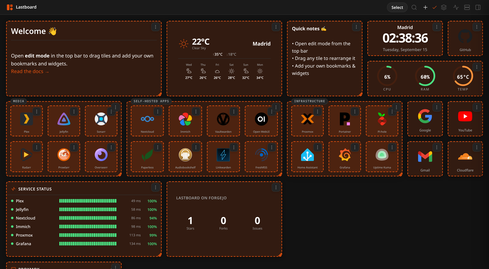
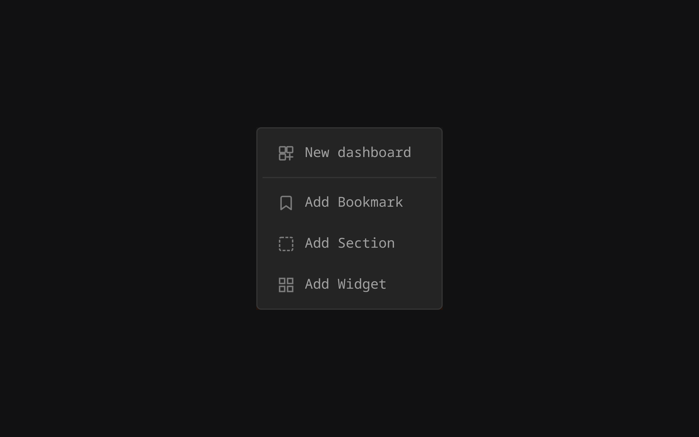
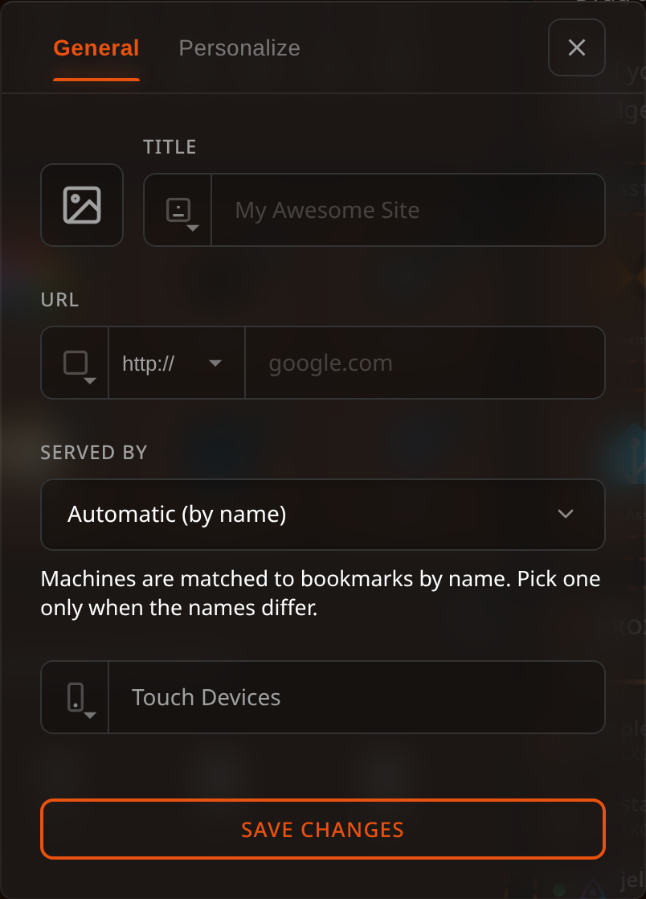
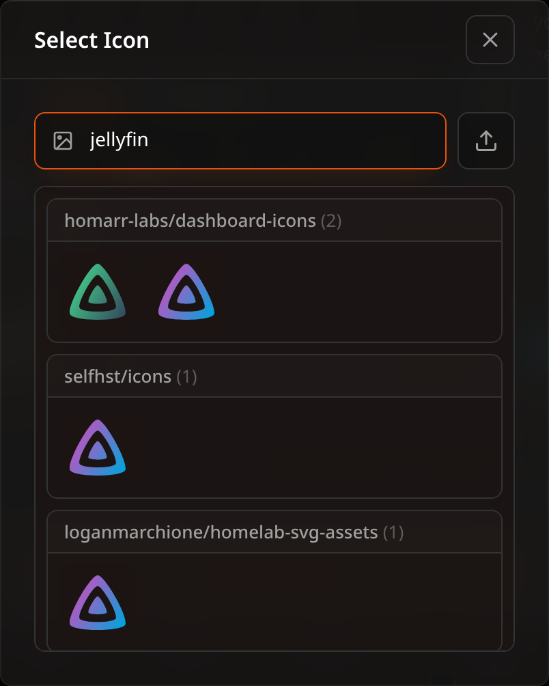
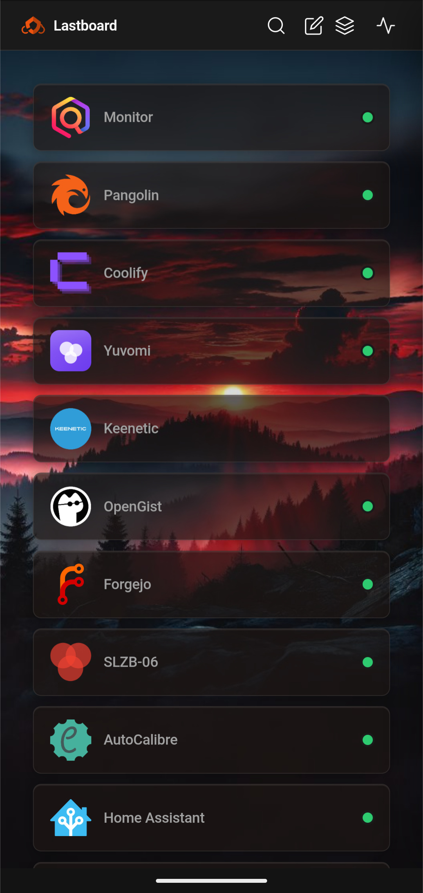

# Bookmarks

Bookmarks are the core of Lastboard: quick-launch tiles that link to your apps, services, and sites. This guide covers creating and customizing them, organizing them into sections, and controlling how they behave on mobile.

## Adding a Bookmark

Enter **Edit Mode** (the pencil/edit toggle in the top bar). Tiles gain a drag handle and a menu of their own, and the **Add (+)** menu appears next to it.

Use **Add (+)** to create a new bookmark.

A dialog opens with two tabs, **General** and **Customization**.

## General Options

| Option | Description |
| :--- | :--- |
| **Icon** | Pick an icon from the built-in icon search, upload your own, or paste a direct image URL. If left empty, the first letter of the label is used as a placeholder. See [Where icons are stored](#where-icons-are-stored). |
| **Title** | The name shown on the tile. |
| **Label Position** | Where the label appears relative to the tile: **Label Below** (default), **Label Above**, **Hidden (No Name)** (icon only), or **Section Style** (renders the label as a section-style header). |
| **URL** | The destination address. A **protocol** dropdown lets you choose `https://` or `http://`. |
| **Status Position** | Set it to a corner and Lastboard periodically checks whether the URL is reachable, showing an up/down indicator there. Pick **Top Left**, **Top Right**, **Bottom Left**, **Bottom Right**, or **Off**. |
| **Touch Devices** | Controls whether the bookmark appears on touch devices. See [Mobile Visibility and Ordering](#mobile-visibility-and-ordering) below. |

## Customization Options

The **Customization** tab controls the tile's appearance:

- **Border Color**: The accent/border color of the tile.
- **Border Width**: How thick the tile's border is — **Thin**, **Regular** or **Thick**.

### Choosing an icon

**Icon** opens a search across several icon sets at once, grouped by provider. Pick one, upload your own image, or paste a direct URL.

## Where icons are stored

Whichever way you choose an icon — provider search, your own upload, or a pasted URL — Lastboard downloads it **once, when you save the bookmark**, and keeps it in your own database. Your dashboard then loads it from your server.

This matters for three situations:

- **Your connection is down.** Your icons still appear, which is exactly when you need the dashboard to reach the services that are still up.
- **Nothing is reported to anyone.** Without this, every dashboard load would tell a public CDN your address and, from the icons requested, which services you run.
- **The remote file disappears or is internal.** An icon hosted only inside your network, or one that gets deleted upstream later, keeps working.

Identical icons are stored once no matter how many bookmarks use them, and an icon stops being kept when nothing points at it any more. Your icons travel inside backups, so restoring on a machine with no internet gives you the board exactly as you left it.

If the download fails, the bookmark is still saved and keeps the original URL — you never lose a bookmark over a picture.

### Boards made before this existed

Nothing to do: when Lastboard starts it brings in any icon that is still fetched from elsewhere, so upgrading is enough. A board of 25 bookmarks takes well under a second, and the log says how many were stored.

**Settings → Data** always says where your icons come from: how many this server hands out, and how many are still fetched from outside. If the machine had no connection when it started, the icons stay as they were, it tries again on the next start, and that panel offers a button to fetch them without waiting.

## Sections

A **Section** is a container that groups related bookmarks together under a title. Create one from the **Add** menu, then drag bookmarks into it to nest them. Sections keep large dashboards organized and can be resized like any other item.

> Bookmarks and sections can also be **moved to another dashboard** — individually or in bulk. See [Dashboards](../using/dashboards.md#moving-items-between-dashboards).

## Reordering & Search

- **Drag to reorder**: In Edit Mode, drag any bookmark (or section) to reposition it on the grid. The layout is saved automatically.
- **Search**: Use the search box in the top bar to filter bookmarks by label in real time.

## Mobile Visibility and Ordering

Lastboard renders a simplified, touch-friendly layout on phones. You have full control over which bookmarks appear there and in what order.

### Hiding a bookmark from mobile (desktop editor)

When editing a bookmark on desktop, the **Touch Devices** control (the phone icon, struck through when off) toggles whether that bookmark appears on touch devices. Bookmarks hidden this way simply don't render on mobile.

### The mobile edit sheet

On a touch device, tapping the **edit** toggle in the top bar opens a bottom sheet that manages both visibility and order. It has two sections:

- **Visible** — the bookmarks currently shown on your phone. Drag the handle (the dots on the right of each row) to reorder them.
- **Hidden** — bookmarks currently hidden from mobile, shown dimmed.

Each row has an **eye** button (to the left of the drag handle):

- Tap the eye on a **visible** row to hide it — it slides down into the **Hidden** section.
- Tap the eye on a **hidden** row to show it again — it moves back to the end of the **Visible** list.

Changes are **deferred**: nothing is saved until you tap **Save changes**. Tapping **Cancel** (or closing the sheet) discards everything. This means you can freely rearrange and toggle visibility, then commit it all at once — or back out with no effect.

> **Note:** The mobile order and desktop grid order are independent. Reordering on mobile does not change your desktop layout, and vice versa.
