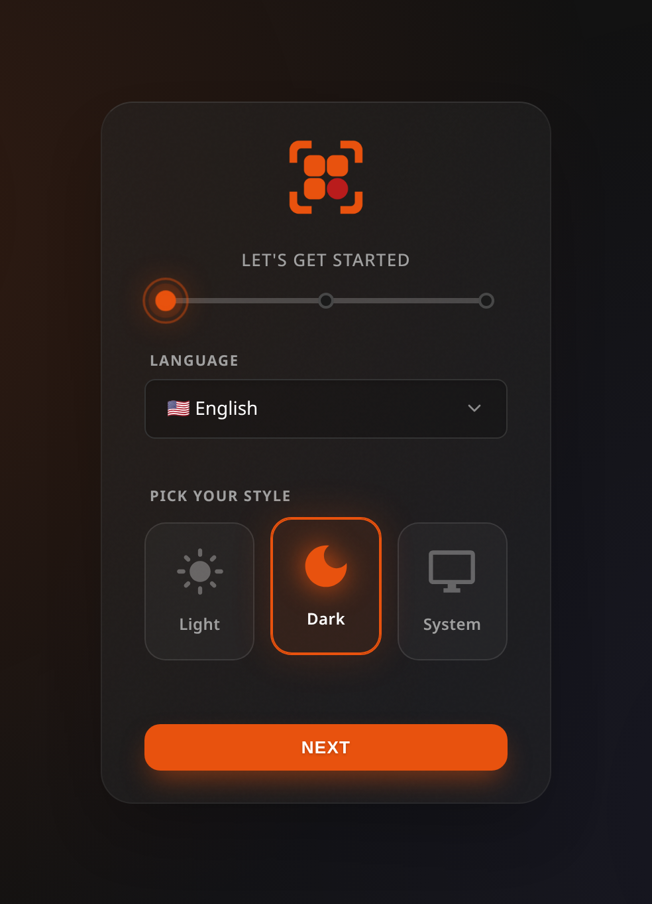

# Installation

Get Lastboard up and running using your preferred method. We officially support Docker and native Linux installations.



The first time you open Lastboard it walks you through three steps: your language and theme, the admin account, and a summary. There is nothing to configure before that — the wizard creates the database on the spot.

## Requirements

- **Docker Method:** Docker and Docker Compose installed.
- **Native Method:** Linux OS (amd64 or arm64).

## Method 1: Docker (Recommended)

The easiest way to install Lastboard is via Docker Compose. Images are published to our self-hosted registry at `git.codigosh.com`.

> **Note:** If your Docker daemon returns an authentication error when pulling the image, log in first:
> ```bash
> docker login git.codigosh.com
> ```

Create a `docker-compose.yml` file with the following content:

```yaml
services:
  lastboard:
    image: git.codigosh.com/codigosh/lastboard:latest
    container_name: lastboard
    ports:
      - "8080:8080"
    environment:
      - TZ=America/New_York
      # - TRUST_PROXY=true   # Uncomment if running behind a reverse proxy
    volumes:
      - ./data:/var/lib/lastboard
    restart: unless-stopped
    logging:
      driver: "json-file"
      options:
        max-size: "10m"
        max-file: "3"
```

Start the container:
```bash
docker compose up -d
```

## Method 2: Native Linux Installation

You can install Lastboard directly on your host machine using our automated script. This sets up a systemd service and runs the application.

Run the following command:
```bash
curl -fsSL https://git.codigosh.com/CodigoSH/Lastboard/raw/branch/main/install.sh | sudo bash
```

### Removing it

```bash
sudo bash install.sh --uninstall
```

Stops and disables the service, removes the unit, the binary and the symlink,
and leaves your database where it is, in `/var/lib/lastboard`.

To delete the data and the service account as well, add `--purge`. It asks you
to type `DELETE` first, and refuses outright when there is no terminal to ask
on — so it cannot erase a database from a script.


## First Run

Once Lastboard is running, it will be available on port `8080` by default. Open your browser and navigate to `http://your-server-ip:8080`.

You will be greeted by the **Setup Wizard**, which walks you through creating your first admin user. Zero configuration files to touch!

## Installing it as an app

Lastboard ships a web app manifest, so a browser can install it to the home screen or the
desktop and open it in its own window with no address bar. Nothing to enable: the manifest is
linked from the dashboard **and** from the login page, which is the page you land on from a
phone with no session.

- **Android (Chrome)** — the menu offers *Install app*. It is minted as a real WebAPK, with
  the Lastboard icon and no browser badge on it.
- **Desktop (Chrome, Edge)** — an install control appears at the end of the address bar.
- **iOS (Safari)** — *Share → Add to Home Screen*.

> **It needs HTTPS with a certificate the device trusts.** Over plain `http://` on the LAN, or
> with a self-signed certificate, no browser will install it — put Lastboard behind a reverse
> proxy with a real certificate first (see below). Browsers that do not mint WebAPKs
> themselves — Brave and Firefox on Android — place a shortcut instead, and their launcher
> stamps their own badge on the icon. That is the browser, not Lastboard.

There is no service worker, so an installed Lastboard is a window onto your server, not an
offline copy: it needs to reach the server the same way the browser tab does.

## Reverse Proxy Setup

If you plan to use a reverse proxy, you must set the `TRUST_PROXY=true` environment variable.

### Nginx Example
```nginx
server {
    listen 80;
    server_name dashboard.example.com;

    location / {
        proxy_pass http://127.0.0.1:8080;
        proxy_set_header Host $host;
        proxy_set_header X-Real-IP $remote_addr;
        proxy_set_header X-Forwarded-For $proxy_add_x_forwarded_for;
        proxy_set_header X-Forwarded-Proto $scheme;
        
        # WebSocket support
        proxy_http_version 1.1;
        proxy_set_header Upgrade $http_upgrade;
        proxy_set_header Connection "upgrade";
    }
}
```

### Caddy Example
```txt
dashboard.example.com {
    reverse_proxy 127.0.0.1:8080
}
```
