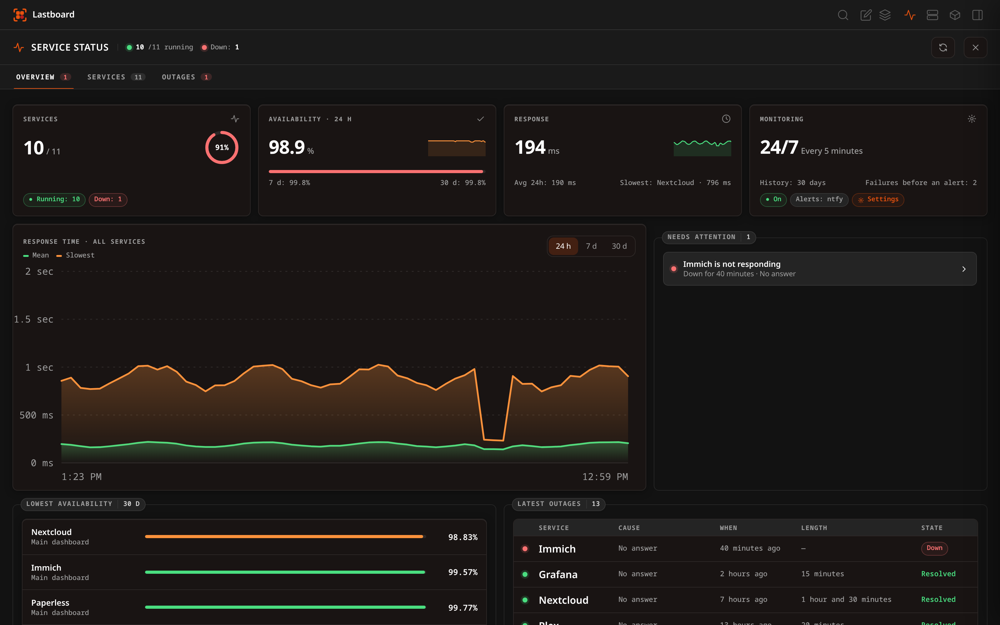
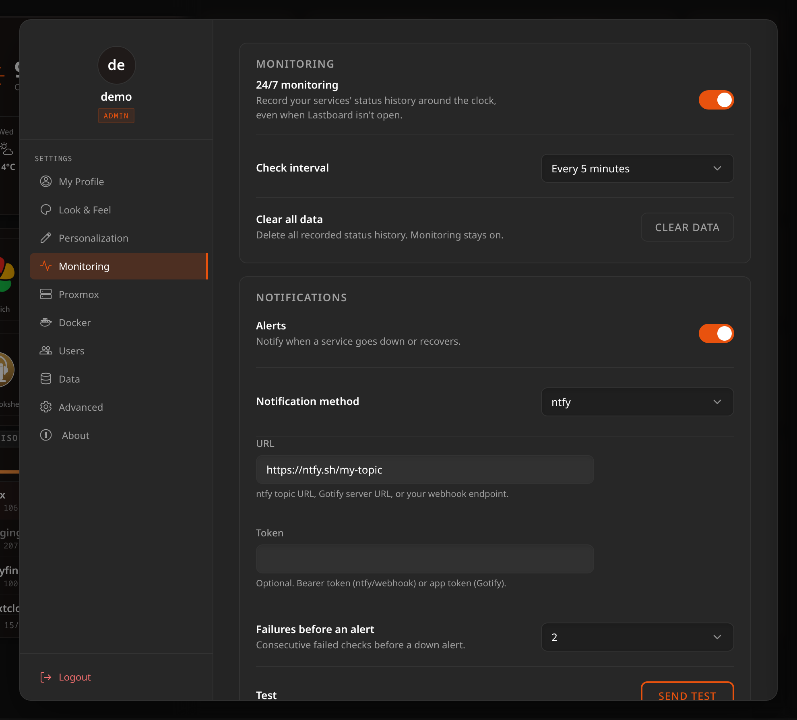
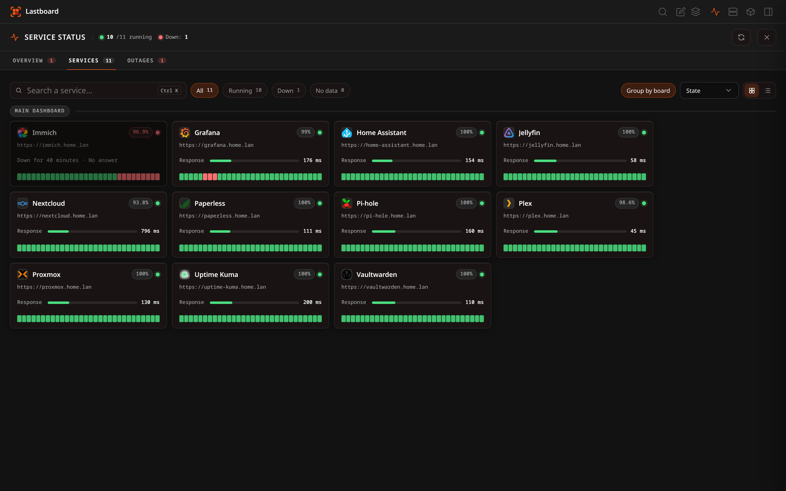
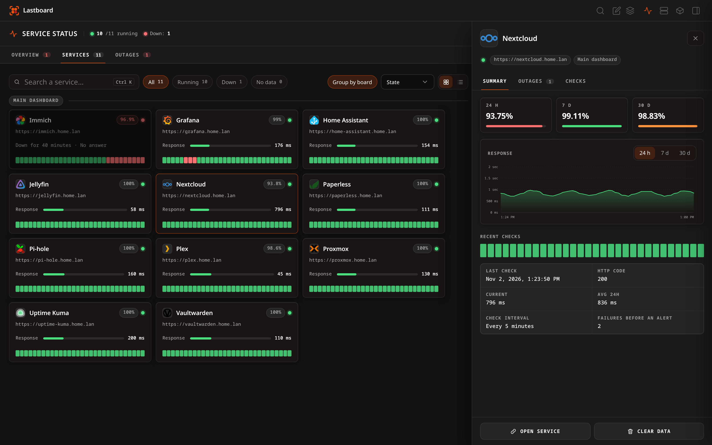
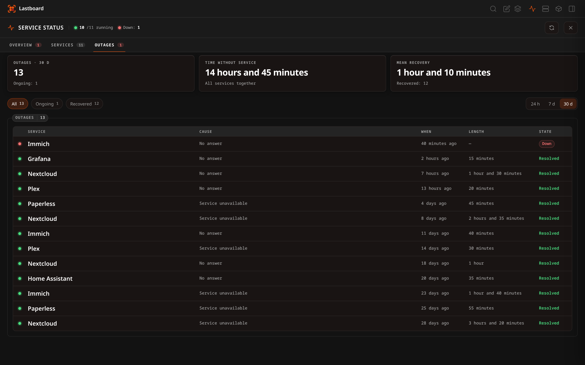

# Monitoring & Uptime

Lastboard can watch your services, record their status over time, and alert you when something goes down. It turns the up/down dot on a bookmark into a full uptime history with latency charts, outage logs, and notifications.



## What Gets Monitored

A service is monitored when its **bookmark has a URL and a Status Position other than Off**. Enable it per bookmark from the bookmark editor (see [Bookmarks](../getting-started/bookmarks.md)). Lastboard then probes that URL and shows an up/down indicator on the tile.

Monitoring adds history and alerting on top of that indicator.

## 24/7 Monitoring

Open **Settings → Monitoring**. Monitoring is **yours**: the **24/7 monitoring** toggle, the check interval and the alerts apply to your own bookmarks, and every account sets them for itself. Someone who has not chosen yet starts from the values the server had when accounts got their own.



- **Off** *(default)* — while Lastboard is open, your browser asks the server to check each service. You get live up/down indicators, but **nothing is recorded**: no history and no alerts.
- **On** — the server probes every monitored service on the check interval, even when nobody has Lastboard open. This records a continuous history and is what enables alerts.

From this section you can also clear all recorded history (**Clear data**). The status page opens from the status icon in the top bar, which appears once 24/7 monitoring is on.

### Check interval

How often the server probes each service: **1, 5, 10, or 30 minutes** (default **5 minutes**). Shorter intervals give finer history at the cost of more requests.

### History retention

Recorded checks are kept for **30 days**; older data is pruned automatically each day.

> **Private services just work.** Probes run from the Lastboard server, so services on private IPs (`10.x`, `192.168.x`, `.local`) and those with self-signed HTTPS certificates are monitored without any extra configuration.

## The Status Page

**Back walks through the page before it leaves it.** Each tab you went to and each service you opened is a step of the browser's history, so Back — the browser's button, the mouse's fourth button, a swipe from the edge of a phone — returns to the tab or the panel you came from, and Forward goes the way you came; only one more Back leaves the status page for your board. Closing the panel with its ✕ takes its step back; closing the page with the ✕ or with Escape takes all of them, so nothing is left behind to press. The [Docker](../docker/overview.md) and [Proxmox](../proxmox/overview.md) pages walk the same way.

The **Service status** page is built from the same pieces as the [Docker](../docker/overview.md) and [Proxmox](../proxmox/overview.md) pages — the same header, tabs, indicators, cards and side panel — because they are views of one product. With 24/7 monitoring on, open it from the **status icon in the top bar**. With more than one board holding monitored services, a selector beside the header limits the page to one of them. The page refreshes every thirty seconds while it is open and visible, and the button beside the ✕ asks for a reading at once.

It has three tabs: **Overview**, **Services** and **Outages**.

### Overview

Four indicators:

- **Services** — a ring with how many are running, and one chip per kind: *Running*, *Down*, *Slow* and *No data*. A service is **slow** when it answers but takes more than two and a half times its own 24-hour mean, and at least 300 ms more; one that has never been checked is *no data*.
- **Availability · 24 h** — the mean of the services that have data, with the 7-day and 30-day figures under it and the last day drawn beside it.
- **Response** — the mean of what the answering services take right now, their own 24-hour mean, and the slowest.
- **Monitoring** — whether anything is being recorded at all. With 24/7 on it says so, how often services are checked, how long the history is kept, how many failures in a row trigger an alert and where alerts go; with it off it says the page is live only, with no history and no alerts. **Settings** opens the section.

Under them, a chart of the response of every service together — the mean and the slowest — for 24 hours, 7 days or 30 days (hover it to read a value), and **Needs attention**: the services that do not answer, since when and what they got back (in words — *Service unavailable*, *No answer*, *Access denied*… — with the HTTP code it comes from as a tooltip), the slow ones, those that answer now but went down inside the last 24 hours (their availability under 99%), a note about services never checked yet and, with 24/7 off, that nothing is being recorded. It shows nine lines and scrolls beyond them. Below, **Lowest availability** (30 days) and **Latest outages**, with **View all** when there are more than the six it lists: it opens every outage in a window of its own, the most pressing first.

### Services



Every monitored service as cards or as a list. A card has the service's icon, its address, its availability over 24 hours, its response and the last thirty checks as a heartbeat strip; the dot in the corner is its state. **Search** filters by name, address or board (**Ctrl+K** or **/** puts the cursor in it from anywhere on the page). The chips — *All*, *Running*, *Down*, *No data* — show how many each would list; services can be grouped by board and sorted by state, name, availability or response. The view, the sort and the grouping are remembered in this browser.



Choosing a service opens a **side panel** with three tabs: **Summary** (availability over 24 hours, 7 days and 30 days, the response chart for the range you pick, the heartbeat and the facts: last check, result, response, 24-hour mean, check interval and alert threshold), **Outages** (that service's, over the 30 days kept: the fifteen most pressing, and **View all** for the rest) and **Checks** (the latest ones, newest first, with when, how fast and how it went — *Correct* or the cause in words, the HTTP code as a tooltip — and **View all** for every one still kept). The panel's footer opens the service and **clears its history** after asking.

### Outages

Three figures to act on: how many outages there were in the range, how many are still going and how many services they touched; **the service that suffered most**, with how many outages and how long it was down; and **the longest outage**, with its service and when it began. Then every outage of every service with the range and the *Ongoing* / *Recovered* chips.



The tab gathers the outages **by service**: one card for each service that had any in the range, with the **number of its outages** where the eye lands first, the time it was without service and when the last one began; a service that is down now says **Ongoing** and comes first, then the ones with the most outages. Choosing a card opens that service's side panel on its **Outages** tab, which is where each outage is listed. The two buttons at the end of the toolbar switch between cards and a table of the same facts (service, outages, time without service, last, state), remembered in this browser together with the choice for the services.

In the panel, each outage is a line with its columns named — **Cause**, **When** and **Length**: the cause is said in words (*Service unavailable*, *No answer*, *Access denied*…) with the HTTP code it comes from as a tooltip, the length is in minutes at the least, never seconds, and one still going says **Ongoing** where its length would be. The panel lists the fifteen most pressing, and **View all** opens the rest in a window of their own. On a phone each line is shown on two lines, without the column heads. **An outage keeps its own start and length whatever range you pick**: one that began before the range still shows when it really began and how long it really lasted — as far back as the 30 days of history kept. Durations are written in words, in your own language, with that language's plural rules.

To keep the same information on the dashboard itself, without opening the page, add the [Monitoring widget](../widgets/monitoring.md).

## Clearing History

From a service's detail view (or **Settings → Monitoring → Clear data**) you can delete recorded history:

- **This service's history** — clears only the selected service.
- **History of every service** — clears every service's history.

Clearing data does not turn monitoring off — new checks start accumulating again immediately. This can't be undone.

## Notifications

When **24/7 monitoring** is on, Lastboard can send an alert when a service goes down and again when it recovers. Configure this in **Settings → Monitoring**, in the Notifications card below the monitoring settings — the screenshot at the top of this page shows both cards.

| Setting | Description |
| :--- | :--- |
| **Alerts** | Turns notifications on. Everything below only appears once it is on. |
| **Notification method** | **None**, **ntfy**, **Gotify**, or **Webhook**. |
| **URL** | The ntfy topic URL, the Gotify server URL, or your webhook endpoint. |
| **Token** | Optional. Bearer token for ntfy/webhook, or the app token for Gotify. Once saved it is never shown: the field holds dots, so you can tell one is there, and has no reveal option. Type a new token to replace it; empty the field to remove it. |
| **Fail threshold** | How many **consecutive** failed checks trigger a down alert: **1, 2, 3, or 5**. A higher value avoids alerts on brief blips. |

Use **Send test** to fire a test notification with the current settings and confirm delivery before relying on it.

### What each method sends

- **ntfy** — a message to your topic, titled with the service name. Outages use a high priority and an alarm tag; recoveries use a normal priority and a check-mark tag.
- **Gotify** — a titled message posted to your Gotify server (`/message`), with the app token sent in the `X-Gotify-Key` header so it never appears in a URL or in the logs of anything between Lastboard and Gotify.
- **Webhook** — a JSON payload to your endpoint:
  ```json
  {
    "service": "My Service",
    "status": "down",
    "message": "…",
    "timestamp": "2026-01-01T12:00:00Z"
  }
  ```
  If a token is set, it is sent as an `Authorization: Bearer …` header.

> Alerts are driven by the server-side scheduler, so they require **24/7 monitoring**. With it off, nothing is running to notice an outage.
