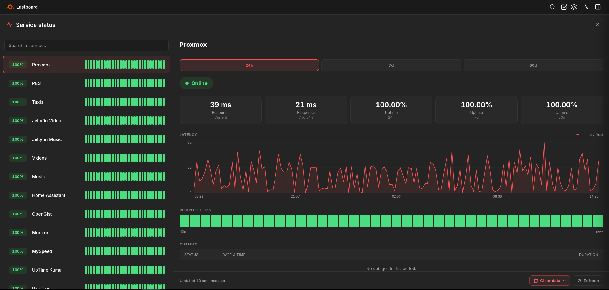
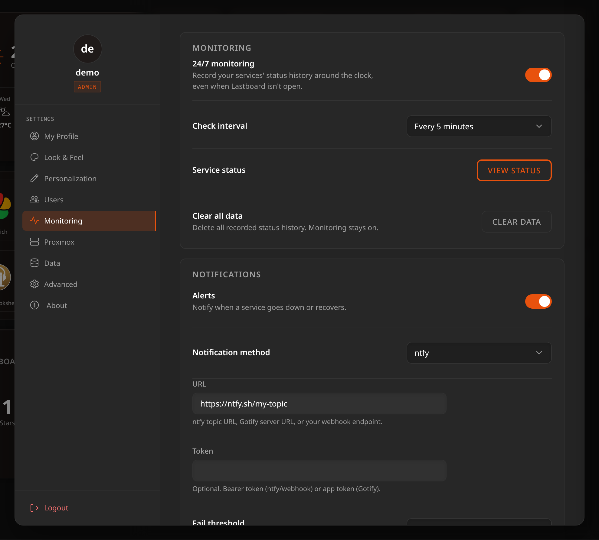
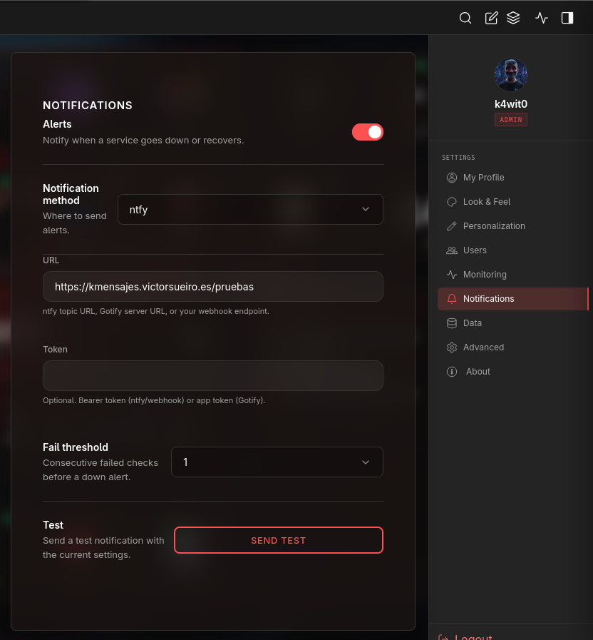

# Monitoring & Uptime

Lastboard can watch your services, record their status over time, and alert you when something goes down. It turns the up/down dot on a bookmark into a full uptime history with latency charts, outage logs, and notifications.



## What Gets Monitored

A service is monitored when its **bookmark has Status Monitor enabled and a URL**. Enable it per bookmark from the bookmark editor (see [Bookmarks](../getting-started/bookmarks.md)). Lastboard then probes that URL and shows an up/down indicator on the tile.

Monitoring adds history and alerting on top of that indicator.

## 24/7 Monitoring

Open **Settings → Monitoring**. The **24/7 monitoring** toggle is a server-wide setting, so only an **admin** can change it.



- **Off** *(default)* — checks run in your browser while Lastboard is open. You get live up/down indicators, but history is only recorded while a tab is open.
- **On** — the server probes every monitored service on the check interval, even when nobody has Lastboard open. This records a continuous history and is what enables alerts.

From this section you can also open the status page (**View status**) and clear all recorded history (**Clear data**).

### Check interval

How often the server probes each service: **1, 5, 10, or 30 minutes** (default **5 minutes**). Shorter intervals give finer history at the cost of more requests.

### History retention

Recorded checks are kept for **30 days**; older data is pruned automatically each day.

> **Private services just work.** Probes run from the Lastboard server, so services on private IPs (`10.x`, `192.168.x`, `.local`) and those with self-signed HTTPS certificates are monitored without any extra configuration.

## The Status Page

The **Service status** page lists every monitored service in one place, each with its current state and a recent-checks strip. Open it from the **status icon in the top bar**, or from **Settings → Monitoring → View status**. Use the search box to filter by name.

Click any service to open its detail view. You can also click the **status indicator on a bookmark tile** to jump straight to that service's history.

To keep the same information on the dashboard itself, without opening the page, add the [Monitoring widget](../widgets/monitoring.md).

## Service Detail

Selecting a service (right-hand panel above) shows its history for a chosen time range (**24 hours, 7 days, or 30 days**):

| Element | Meaning |
| :--- | :--- |
| **Uptime** | Percentage of successful checks — shown for 24h, 7d, and 30d. |
| **Response** | Response time, both **current** and the **24-hour average**. |
| **Latency chart** | Response time plotted across the range, with a hover crosshair. |
| **Recent checks** | A heartbeat strip of the most recent probes (green = up, red = down). Hover a bar for its timestamp and status. |
| **Outages** | A table of down periods: status, date & time, duration, and whether the service recovered. |

Use **Refresh** to re-poll immediately; the view also refreshes itself while open.

## Clearing History

From a service's detail view (or **Settings → Monitoring → Clear data**) you can delete recorded history:

- **This service** — clears only the selected service.
- **All services** — clears every service's history.

Clearing data does not turn monitoring off — new checks start accumulating again immediately. This can't be undone.

## Notifications

When **24/7 monitoring** is on, Lastboard can send an alert when a service goes down and again when it recovers. Configure this in **Settings → Notifications**.



| Setting | Description |
| :--- | :--- |
| **Notification method** | **None**, **ntfy**, **Gotify**, or **Webhook**. |
| **URL** | The ntfy topic URL, the Gotify server URL, or your webhook endpoint. |
| **Token** | Optional. Bearer token for ntfy/webhook, or the app token for Gotify. |
| **Fail threshold** | How many **consecutive** failed checks trigger a down alert: **1, 2, 3, or 5**. A higher value avoids alerts on brief blips. |

Use **Send test** to fire a test notification with the current settings and confirm delivery before relying on it.

### What each method sends

- **ntfy** — a message to your topic, titled with the service name. Outages use a high priority and an alarm tag; recoveries use a normal priority and a check-mark tag.
- **Gotify** — a titled message posted to your Gotify server (`/message`), token passed as a query parameter.
- **Webhook** — a JSON payload to your endpoint:
  ```json
  {
    "service": "My Service",
    "status": "down",
    "message": "…",
    "timestamp": "2026-01-01T12:00:00Z"
  }
  ```
  If a token is set, it is sent as an `Authorization: Bearer …` header.

> Alerts are driven by the server-side scheduler, so they require **24/7 monitoring**. In "While the tab is open" mode there is no server to send them.
