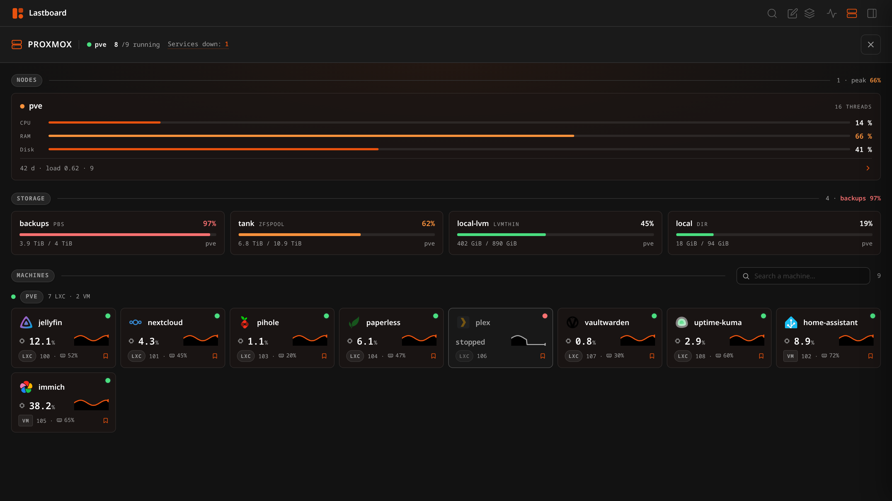
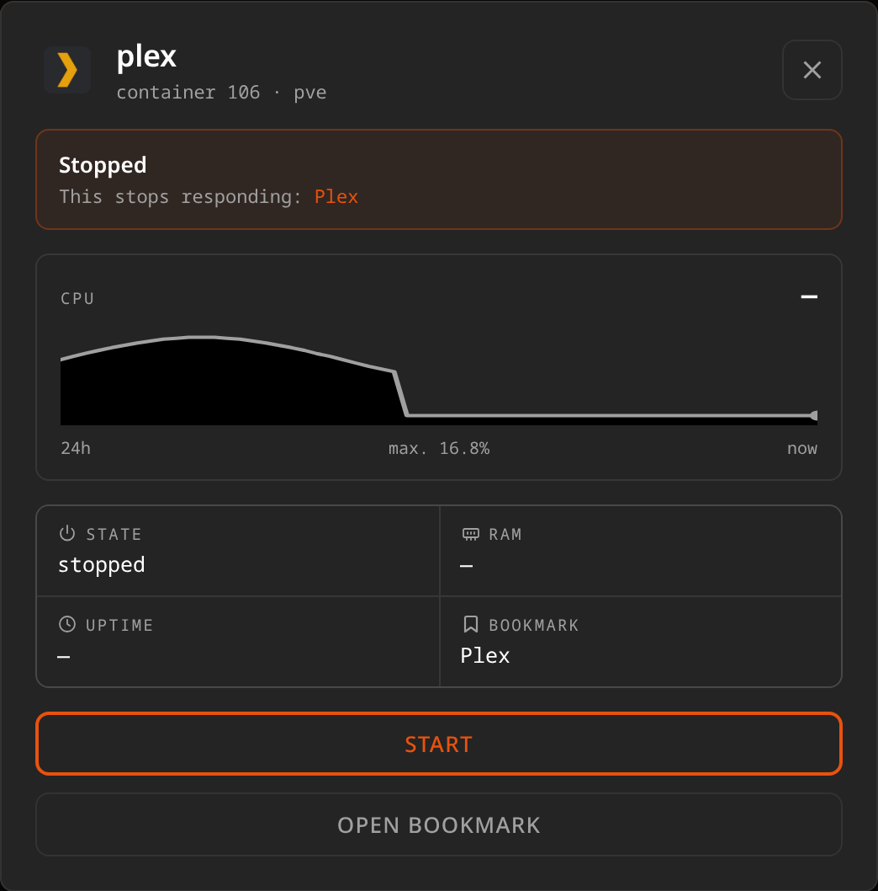

# Proxmox

Lastboard can read your Proxmox VE host and show it beside the services it runs: the nodes and their load, how full each storage is, and every virtual machine and container — with the bookmark each one serves.



That last part is the point. Your Proxmox console at `:8006` already administers the cluster, and it does it better. What it cannot tell you is that *Plex* stopped answering because container 106 is down, because it has never heard of your bookmarks. This page can.

## What Lastboard needs

One API token per hypervisor, read-only if you want them to be. Lastboard never asks for a Proxmox password, keeps nothing about your machines, and stores no history: every figure on the page is read from the host when you open it.

**More than one hypervisor is fine.** A main cluster and an offsite node, a production one and a lab: each is connected on its own terms, with its own token and its own certificate policy, and one being read-only says nothing about the others. What follows describes connecting one; repeat it for each.

### 1. Create the token on your Proxmox host

Run this over SSH on any node, as `root`. It creates a user, a role with the permissions Lastboard actually uses, and a token bound to that user:

```bash
# A role with exactly what Lastboard uses, and nothing else
pveum role add Lastboard --privs "Sys.Audit Datastore.Audit VM.Audit VM.PowerMgmt"

# A user for Lastboard, in Proxmox's own realm (no shell account is created)
pveum user add lastboard@pve
pveum acl modify / --users lastboard@pve --roles Lastboard

# The token. Privilege separation off, so it inherits the user's role.
pveum user token add lastboard@pve lastboard --privsep 0
```

> **Why `--privsep 0`.** With privilege separation on, a token needs its *own*
> ACL entry as well, and what applies is the intersection of the two. That is
> the usual reason a freshly made token "cannot do anything". This user exists
> only for Lastboard, so the token may as well carry the user's role.

The last command prints the **secret once and never again**. Copy it now; if you lose it, delete the token and create it again.

You end up with two values:

| Value | Looks like |
| :--- | :--- |
| **Token id** | `lastboard@pve!lastboard` |
| **Token secret** | `61b6dfca-9f17-4e5a-8a9f-3d1c0b7e5a2f` |

### Read-only, if you prefer

Drop `VM.PowerMgmt` from the role and Lastboard reads everything and **hides the start and stop buttons** — it asks the host what the token may do rather than assuming, so there is nothing to configure twice:

```bash
pveum role add Lastboard --privs "Sys.Audit Datastore.Audit VM.Audit"
```

| Privilege | What it is for |
| :--- | :--- |
| `VM.Audit` | Read virtual machines and containers: state, CPU, memory, uptime |
| `Datastore.Audit` | Read how full each storage is |
| `Sys.Audit` | Read node status: load average, cores, uptime |
| `VM.PowerMgmt` | **Optional.** Start and shut down machines from Lastboard |

Nothing here grants console access, configuration changes, backups, or deletion. There is no privilege in the list that can destroy anything.

### 2. Connect it in Lastboard

Open **Settings → Proxmox**. This is a server-wide setting, so only the **administrator** can see or change it.


Connected hypervisors are a list, one line each: a dot for what it is doing, its name, and what it last answered. **Add hypervisor** opens a dialog for a new one, the pencil opens the same dialog on an existing one, and the bin removes it. Four connections stay four lines rather than four screens of form.

| Field | Notes |
| :--- | :--- |
| **Proxmox integration** | Turns this hypervisor on. At least one on puts the Proxmox icon in the top bar |
| **Name** | What this one is called here — *Home*, *Offsite*, whatever you file it under. It appears wherever its machines do |
| **Address** | The web interface address, port included — `https://192.168.1.10:8006` |
| **Token id** | `user@realm!name`, exactly as Proxmox printed it |
| **Token secret** | Shown once by Proxmox. Stored here and never sent back to your browser |
| **Accept a self-signed certificate** | On by default, because almost every home hypervisor has one |

**Save** closes the dialog and then reads the host with what you gave it, so the line on its row tells you what *that* token can actually see. A mistyped token saves perfectly well — this is how you find out before you need it. One host failing says nothing about the others, so each row answers for itself.

Reopening a host, the secret box is empty and says *Stored*. Leaving it that way keeps the secret saved for that host; you only type it again to replace it.

Removing one asks first. Its machines lose the icons you chose for them, which is the part nothing else can give back.

> **The name is yours to change.** Nothing is stored against it: the icons you choose for machines and the bookmarks you tie to them point at an id Lastboard generates, so renaming a cluster costs nothing.

> **Private addresses just work.** The connection is made by the Lastboard server, so `10.x`, `192.168.x` and `.local` addresses need no extra configuration, and a self-signed certificate is accepted when the switch above is on.

## With more than one: the summary

The Proxmox icon opens a summary when several hypervisors are connected. It is ordered by what you can act on, not by what is easy to count, and the header carries the same figures a cluster page does — for everything at once. **There are no big-number tiles**: five totals with nothing behind them is inventory, not information, so every count lives on the rule of its own section and every list names the machines instead of counting them.

**Needs attention** — drawn only when there is something in it, and split rather than rolled together:

| | |
| :--- | :--- |
| **Services down** | a stopped machine with a bookmark of yours on it. Your service is not answering. |
| **Stopped, not bookmarked** | a machine somebody turned off. Worth seeing, not worth alarm. |
| **Could not connect** | a hypervisor that did not answer. The others are unaffected. |
| **Almost full** | a store past 90%. |

Each entry is a chip you can click to go into the hypervisor it is on.

**Not bookmarked** — every machine no bookmark points at, by name, with where it lives; the rule says how many of your machines *are* tied to one. This is the list of what you have not wired up to your board yet.

**Nodes** — a table with figures rather than three anonymous bars: the node and its hypervisor, CPU, memory used against total, disk, cores against threads, and how long it has been up. You can see which node is hot, and how hot, without going in.

**Hypervisors** — the way in, one card each: machines running, containers against virtual machines, and whether it is a cluster or a single node.

**Storage** — every store, fullest first, with its kind and figures, and a click into the hypervisor it belongs to. **A shared store is counted once**: a Ceph pool is reported by every node of the cluster, so adding them up would triple it.

**Fleet load** — CPU and memory across every node over the last day, and last on the page because it is the least actionable thing on it. **Weighted, not averaged**: a node of 8 cores at 12% and one of 32 at 78% average to a number that describes neither, so CPU is weighted by cores and memory by total bytes. It costs one request per node, which is what the endpoint answers.

> **Two connections to the same address are allowed, and warned about.** A second token with narrower permissions is a reasonable thing to want, but the summary adds every hypervisor up, so the same server connected twice lands in every total twice. Settings says so when you save it and saves anyway.

Click a card to go into that cluster. The header then carries its name and an arrow back.

> **With one hypervisor there is no summary**, and there never was: the icon opens the cluster directly. A page in front of a single thing would be a click that buys nothing.

## The page

The Proxmox icon in the top bar opens it — or the summary above, if you have more than one — and the **×** in its header closes it. While it is open the rest of the top bar is locked, the same way the status page behaves. Top to bottom:

**The header** carries the state of the host beside the title, not on a bar of its own: node name (or *Cluster*, when the host says it is one), how many machines are running out of how many **in green**, and **Stopped** — how many are not — **in red**. It is a headcount of the same machines, counted twice: the two numbers add up to the total, which is the point. Whether one of those stopped machines is serving a bookmark of yours is said where it can be acted on — on the tile itself, and on the summary.

**Nodes** — one card per node with CPU, memory and disk as percentages, and a labelled footer with **uptime** and **load average**. The uptime is spelled out in two units — *6 days and 17 hours*, not *17 d* and not *161 hours* — in your own language and with its own plural rules. The full figures behind those percentages — *15 GiB / 31,1 GiB* — are in the sheet the card opens, because "half full" says nothing about whether another machine, or another backup, fits. The header counts both **cores and threads**, which are not the same number: a chip with 12 cores reports 16 threads, and a card that names only one of them is ambiguous about which. On a cluster the header says so; a single node is never called a cluster.

**Storage** — one card per store, fullest first: how full it is, used and total, the kind (`ZFSPOOL`, `LVMTHIN`, `PBS`, `DIR`) and which node it belongs to. Bars turn amber past 60% and red past 90%.

**Machines** — one tile per virtual machine or container, grouped by node. A tile carries the icon of the bookmark it serves — the one chosen for it if there is one, then the bookmark's (matched by name, or told to it — see below), its name, its CPU with a **trend line over the last 24 hours**, and on the bottom line its type (`LXC` in a capsule, `VM` in a box), its VMID and its memory as a percentage with the figure behind it — *32% (165,6 MiB)*. A chip and a memory stick mark which figure is which. The corner carries the marks rather than figures: the status dot, and a bookmark glyph beside it when a bookmark of yours runs on this machine. Templates are left out: they cannot run, so they have no state to show.

The dot in the corner says one thing, the two colours the header counts: **green** running, **red** stopped. The tile itself says the rest:

| | |
| :--- | :--- |
| Running | full colour |
| Stopped | dimmed, as if switched off, with a grey edge — turning things off is a normal thing to do |
| Stopped **and** serving a bookmark | the same switched-off layer and the same emphasised edge, both in your accent colour: that is an outage, and it is the only thing on the grid wearing the accent |

Tiles keep their place whatever happens to them — by kind, then by VMID. A machine you know where to find stays there, and a stopped one is picked out by how it looks rather than by the grid rearranging itself under your pointer. (The widget is the other way round: it has room for a handful of rows, so what needs attention is lifted into them.)

**Each node folds.** Click a node's heading in the Machines section and its tiles collapse to a single line, keeping the count so you still know what is inside — useful on a cluster, where every node's machines end to end make a very long page. The fold is remembered in your browser, per node, so a cluster stays the way you left it.

A folded node's machines are not asked for either: their trend lines are one request per machine, so folding a node you are not looking at spares your host those calls entirely.

The search box in the **Machines** header filters by name or VMID. When something is stopped, the **Stopped** count becomes a button: click it to show only those machines, and click it again to bring the rest back — it now shows exactly what it counts. **While either is active, folds are ignored** — a search that reported nothing because the answer was folded away would be a lie the page told about its own contents.

## A machine in detail

Click a tile.



The sheet shows the machine's own CPU trend, its state, memory and uptime, the bookmark it serves — and the sentence this page exists for when it is stopped: **This stops responding: Plex**. Move the pointer across the chart and it says what the line was worth at that minute.

From here you can **Start** or **Shut down** the machine (when the token allows it), open the bookmark it serves, and — as an administrator — click its icon to [choose one](#machines-that-will-never-have-a-bookmark).

The node and the storage cards open the same way, with their own charts and figures.

## Starting and stopping

Lastboard offers exactly two actions, on machines only: **start** and **shut down** (the graceful one — the same thing the Proxmox console's *Shutdown* does). Both ask for confirmation first.

**Nodes cannot be powered off or rebooted from Lastboard, deliberately.** A stopped container is one service; a stopped node is all of them, and that decision belongs at the console, not on a dashboard.

Actions are **administrator-only**, and the server checks the token's permissions before relaying anything: with no `VM.PowerMgmt` the buttons are not drawn, and a request made anyway is refused here rather than at the host.

## How a machine is tied to a bookmark

This is what turns a list of containers into something Lastboard can say anything about, and **it happens on its own**: your container `15-myspeed` is matched to your *MySpeed* bookmark without you configuring anything.

The rule is deliberately strict, because naming the wrong service as the one that went down is worse than naming none:

- The leading ordinal machines get filed under is dropped (`15-myspeed` → `myspeed`, `90--haos` → `haos`), then case, spaces and punctuation are ignored.
- The bookmark is matched on its **name** or on the **icon it wears** — so a bookmark labelled *Donetic* still finds the container `08-donetick`.
- A machine is matched only when **exactly one** bookmark fits. Two Jellyfins and one `jellyfin` container: no match, rather than a coin toss.

Measured on a host with twenty-nine containers and a board of fifty-five bookmarks, none of them configured: **sixteen machines matched, none wrongly.**

### Machines that will never have a bookmark

Some never will: the CI runners, the tunnel, the test containers, the machine
Lastboard itself runs on — nobody bookmarks the dashboard they are reading.
Measured on a real host, that is ten machines out of twenty-nine.

For those, **open the machine and click its icon** (administrators only): the
same icon picker the bookmarks use. Whatever you choose is downloaded once by
your instance and served from it afterwards, exactly like a bookmark's icon, so
the page still asks no CDN what you run. **Remove icon**, in the same sheet,
gives it back the plain fallback.

The choice is server-wide, like the connection: one hypervisor, one set of
faces, the same for everyone with an account here.

### When the names don't agree

Some pairs no rule should guess — a container called `23-jellyfin-musica` serving a bookmark called *Jellyfin Music*, or `90--haos` serving *Home Assistant*. For those, edit the bookmark and pick the machine under **Served by**:


Leave it on **Automatic (by name)** and the rule above applies. Pick a machine and **that wins**, always — the guess never overrides something you said.

Once a machine is tied to a bookmark, however it got there:

- its tile on the Proxmox page wears that bookmark's icon and name
- a stopped machine says which service it takes with it
- the widget lifts it above everything else that is merely stopped

A hand-made link lives inside the bookmark itself — no extra table, nothing to keep in step — and it works from **any** board: a bookmark on your *Media* board is found while you are looking at *Servers*.

**With several hypervisors, a link names which one.** It has to: VMIDs restart at 100 in every cluster and `pve` is the name a default install gives its node, so two of them sharing a machine `106` on a node `pve` is ordinary rather than exotic. The same goes for an icon you choose for a machine. Links and icons made before a second hypervisor existed keep working untouched — there was only one for them to have meant.

> A hand-made link is **not** part of the YAML export, which carries the portable shape of a bookmark (name, address, icon, group). A full [backup](../using/import-export.md) of the database keeps it. Matching by name needs nothing kept at all.

## The widget

To keep this on the dashboard itself, add the [Proxmox widget](../widgets/proxmox.md). It shows the busiest node's health and the machines that need attention, and links through to this page. With several hypervisors connected it draws from all of them at once: a tile that showed only the first would go quiet about the machine that actually went down.

## What Lastboard reads, and how often

Per hypervisor, and only for the one you are looking at — the summary reads one
call from each, a cluster's page polls only its own.

| When | Request |
| :--- | :--- |
| Page open or widget tick | `GET /cluster/resources` — one call for nodes, machines and storage |
| Page open | `GET /nodes/{node}/status` — one per node, for load and cores |
| Page open | `GET .../rrddata` — one per machine, for the trend line on its tile. Proxmox has no endpoint that returns history for more than one machine, so these are spread out, three at a time, and each is asked for once while the page stays open |
| Opening a machine | the history it already has, or a request for it |
| Pressing a button | `POST .../status/start` or `.../status/shutdown` |

Choosing an icon for a machine asks Proxmox nothing at all: it is stored here,
beside the connection.

The page refreshes every 15 seconds while it is open and the widget on its own interval; neither polls when it is closed. Nothing is written to your database: no machine names, no figures, no history. The only things Lastboard stores are the connections themselves and the icons you chose.
