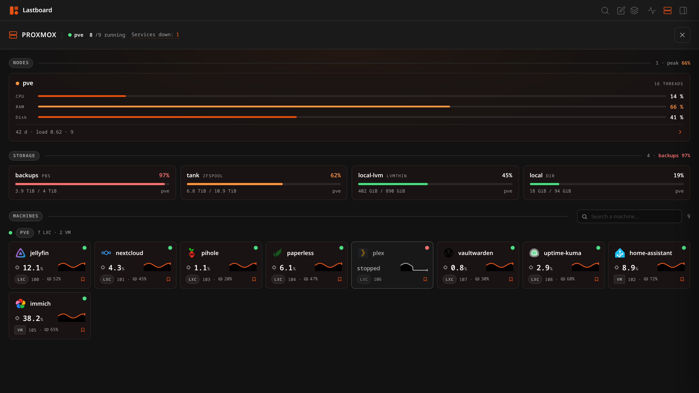
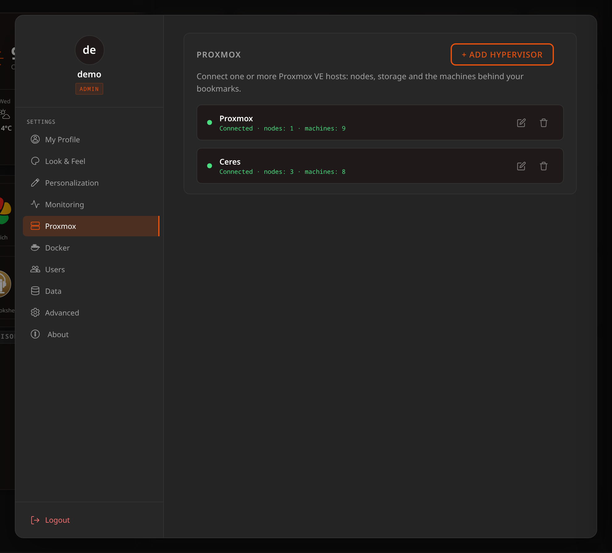
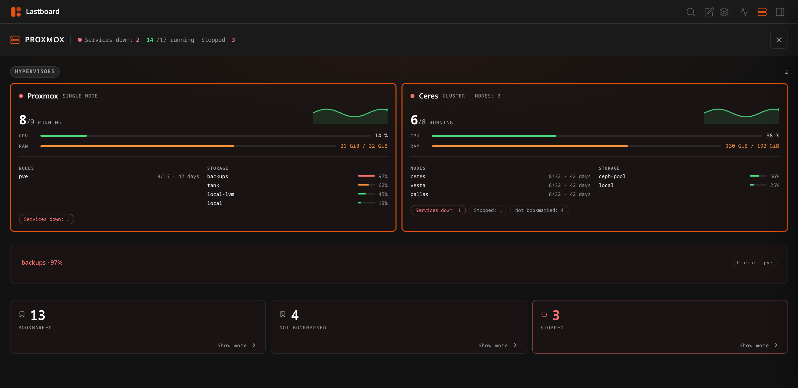
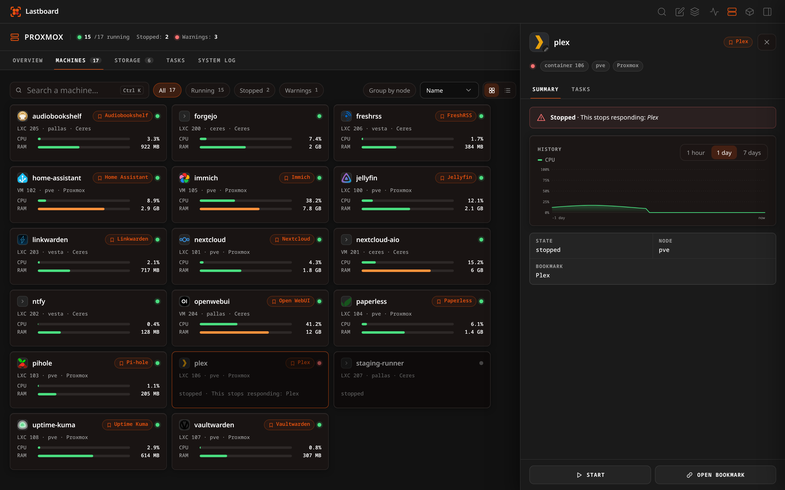
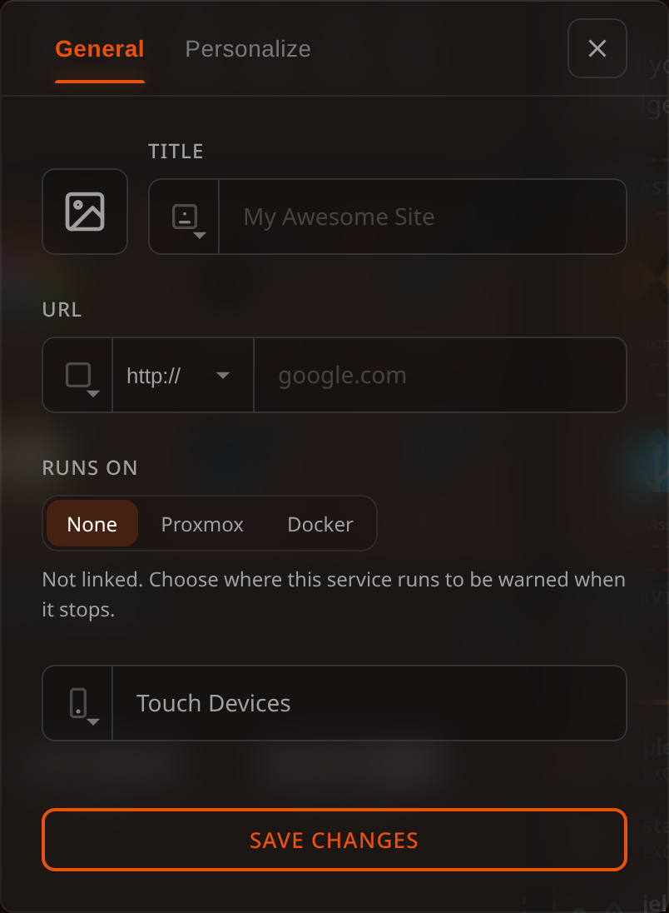

# Proxmox

Lastboard can read your Proxmox VE host and show it beside the services it runs: the nodes and their load, how full each storage is, and every virtual machine and container — with the bookmark each one serves.



That last part is the point. Your Proxmox console at `:8006` already administers the cluster, and it does it better. What it cannot tell you is that *Plex* stopped answering because container 106 is down, because it has never heard of your bookmarks. This page can.

## What Lastboard needs

One API token per hypervisor, read-only if you want them to be. Lastboard never asks for a Proxmox password, keeps nothing about your machines, and stores no history: every figure on the page is read from the host when you open it.

**More than one hypervisor is fine.** A main cluster and an offsite node, a production one and a lab: each is connected on its own terms, with its own token and its own certificate policy, and one being read-only says nothing about the others. What follows describes connecting one; repeat it for each.

### 1. Create the token on your Proxmox host

Run this over SSH on any node, as `root`. It creates a user, a role with the permissions Lastboard actually uses, and a token bound to that user:

```bash
# A role with exactly what Lastboard uses, and nothing else
pveum role add Lastboard --privs "Sys.Audit Datastore.Audit VM.Audit VM.PowerMgmt"

# A user for Lastboard, in Proxmox's own realm (no shell account is created)
pveum user add lastboard@pve
pveum acl modify / --users lastboard@pve --roles Lastboard

# The token. Privilege separation off, so it inherits the user's role.
pveum user token add lastboard@pve lastboard --privsep 0
```

> **Why `--privsep 0`.** With privilege separation on, a token needs its *own*
> ACL entry as well, and what applies is the intersection of the two. That is
> the usual reason a freshly made token "cannot do anything". This user exists
> only for Lastboard, so the token may as well carry the user's role.

The last command prints the **secret once and never again**. Copy it now; if you lose it, delete the token and create it again.

You end up with two values:

| Value | Looks like |
| :--- | :--- |
| **Token id** | `lastboard@pve!lastboard` |
| **Token secret** | `61b6dfca-9f17-4e5a-8a9f-3d1c0b7e5a2f` |

### Read-only, if you prefer

Drop `VM.PowerMgmt` from the role and Lastboard reads everything and **hides the start and stop buttons** — it asks the host what the token may do rather than assuming, so there is nothing to configure twice:

```bash
pveum role add Lastboard --privs "Sys.Audit Datastore.Audit VM.Audit"
```

| Privilege | What it is for |
| :--- | :--- |
| `VM.Audit` | Read virtual machines and containers: state, CPU, memory, uptime |
| `Datastore.Audit` | Read how full each storage is |
| `Sys.Audit` | Read node status: load average, cores, uptime |
| `VM.PowerMgmt` | **Optional.** Start and shut down machines from Lastboard |
| `Sys.Syslog` | **Optional.** Read a node's system log. Not in the role above; [tasks](#tasks) do not need it |

Nothing here grants console access, configuration changes, backups, or deletion. There is no privilege in the list that can destroy anything.

### 2. Connect it in Lastboard

Open **Settings → Proxmox**. The connections are **yours**: every account adds its own hypervisors and tokens, sees only those, and cannot use anyone else's. If the instance was set up before accounts had their own, the administrator's existing connections are theirs now.



Connected hypervisors are a list, one line each: a dot for what it is doing, its name, and what it last answered. **Add hypervisor** opens a dialog for a new one, the pencil opens the same dialog on an existing one, and the bin removes it. Four connections stay four lines rather than four screens of form.

| Field | Notes |
| :--- | :--- |
| **Proxmox integration** | Turns this hypervisor on. At least one on puts the Proxmox icon in the top bar |
| **Name** | What this one is called here — *Home*, *Offsite*, whatever you file it under. It appears wherever its machines do |
| **Address** | The web interface address, port included — `https://192.168.1.10:8006` |
| **Token id** | `user@realm!name`, exactly as Proxmox printed it |
| **Token secret** | Shown once by Proxmox. Stored here and never sent back to your browser |
| **Accept a self-signed certificate** | On by default, because almost every home hypervisor has one |

**Save** closes the dialog and then reads the host with what you gave it, so the line on its row tells you what *that* token can actually see. A mistyped token saves perfectly well — this is how you find out before you need it. One host failing says nothing about the others, so each row answers for itself.

Reopening a host, the secret box is empty and says *Stored*. Leaving it that way keeps the secret saved for that host; you only type it again to replace it.

Removing one asks first. Its machines lose the icons you chose for them, which is the part nothing else can give back.

> **The name is yours to change.** Nothing is stored against it: the icons you choose for machines and the bookmarks you tie to them point at an id Lastboard generates, so renaming a cluster costs nothing.

> **Private addresses just work.** The connection is made by the Lastboard server, so `10.x`, `192.168.x` and `.local` addresses need no extra configuration, and a self-signed certificate is accepted when the switch above is on.

## The page

The Proxmox icon in the top bar opens it, and the **×** in its header closes it. The page also has an address of its own, `/?view=proxmox`, which opens it straight away — in a new tab, or from a bookmark — and **See all** on the [widget](../widgets/proxmox.md) opens it the same way without reloading the board. You still sign in first, and the request is taken out of the address once the page is open. While it is open the rest of the top bar is locked, the same way the status page behaves, and **Esc**, the **×** or the browser's Back button close it.

The header says how many machines are running, how many are stopped and how many have warnings. **With more than one hypervisor** connected there is a filter beside it: *All* and one button per hypervisor when there are two, a selector when there are more, so every figure on the page can be read for all of them at once or for one. A button asks for a fresh reading at once; otherwise everything refreshes every 15 seconds while the page is open and the browser tab is visible. The page has five tabs: **Overview**, **Machines**, **Storage**, **Tasks** and **System log**.

### Overview



Four indicators:

- **Machines** — a ring with the share that is running, and chips for how many are containers (`LXC`), how many are virtual machines (`VM`) and how many are stopped.
- **CPU** — the CPU of all the nodes in view, **weighted by cores**, with its curve.
- **RAM** — what the nodes use together against what they have, and what is free.
- **Storage** — the fullest store, with how many there are and how much space is free in all of them.

Under them, a chart of the CPU over the last day (move the pointer over it to read a value), and **Needs attention**, worst first:

- a hypervisor that did not answer;
- a stopped machine that serves a bookmark of yours, which is an outage — your service is not answering — and is named: **This stops responding: Plex**;
- a store at 90% or more (red from 95%);
- a machine whose CPU is at 90% or more;
- a node whose memory is at 85% or more.

A machine somebody turned off, with no bookmark depending on it, is not an alarm: it is under **Stopped** in the Machines tab. Choosing an item opens it. When there is nothing to list the box says everything is running as it should.

Below, a box for the **Nodes** (CPU and memory of each), one for the five fullest **Storage** and one with the **latest tasks** of the first node in view. With several hypervisors, a box lists them with whether each is a cluster or a single node, and which did not answer.

Two figures are weighted rather than averaged, and deliberately: a node of 8 cores at 12% and one of 32 at 78% average to a number that describes neither, so the CPU — the figure and the curve alike — is weighted by cores. The curve costs one request per node, which is what the endpoint answers; it is kept for five minutes.

**A shared store is counted once.** A Ceph pool is reported by every node of the cluster, so adding them up would triple it.

> **Two connections to the same address are allowed, and warned about.** A second token with narrower permissions is a reasonable thing to want, but every total on this page adds the hypervisors up, so the same server connected twice lands in each of them twice. Settings says so when you save it, and saves anyway.

**Every bar on the page reads the same way**, whether it measures a node's CPU, a hypervisor's memory or how full a store is: **green** while the figure is comfortable, **amber from 60%** and **red from 90%**. They are deliberately not your accent colour — an accent belongs to you and may itself be red, and a healthy bar has to look healthy to someone who has never seen your palette. The widget follows the same rule, so a board with both reads one way rather than two.

### Machines

One card per virtual machine or container (or a list, with the two buttons at the end of the toolbar). A card carries the icon of the bookmark it serves — the one chosen for it if there is one, then the bookmark's (matched by name, or told to it — see below) — its name, its type and VMID, its node, the bookmark it serves as a chip, and CPU and memory. A stopped machine is dimmed and says so; if a bookmark of yours runs on it, it says which service it takes with it and its dot is red. Templates are left out: they cannot run, so they have no state to show.

- **Search** filters by name, VMID, node, hypervisor or bookmark. **Ctrl+K** (**Cmd+K** on macOS) puts the cursor in it from anywhere on the page.
- **Chips** — *All*, *Running*, *Stopped* and *Warnings* — each with how many it would show. *Warnings* are the stopped machines a bookmark depends on and the ones at 90% CPU or more.
- **Group by node** gathers the machines of each node under its name.
- **Sort by** name, state, CPU or memory. The view, the sort and the grouping are remembered in this browser.

### Storage

Every store, fullest first: how full it is, used and total, the kind (`ZFSPOOL`, `LVMTHIN`, `PBS`, `DIR`) and which node it belongs to. Choosing one opens its figures.

## The side panel

Choosing a machine, a node or a store opens it in a **side panel**. On a wide window it pushes the page aside so the list stays in view; on a narrower one it covers the page, and **Esc**, the **×** or the browser's Back button closes it. On a phone it takes the screen and Back returns to the page.



**A machine** has two tabs. **Summary** shows its state, CPU, memory and uptime, the bookmark it serves, its CPU over the last day, and the sentence this page exists for when it is stopped. **Tasks** lists what the hypervisor has done to it. At the foot: **Start** or **Shut down** (when the token allows it), **Open bookmark**, and **Remove icon**. Click its icon to [choose one](#machines-that-will-never-have-a-bookmark).

**A node** has **Summary** (CPU, memory and disk now, the figures behind those percentages — *15 GiB / 31,1 GiB* — cores and threads, uptime and load, and its CPU and memory over the last day), **Tasks** and **System log**. The header counts both **cores and threads**, which are not the same number: a chip with 12 cores reports 16 threads.

**A store** shows how full it is and how much is left, with a warning from 90%.

### Tasks

The **Tasks** tab, and the Tasks tab of a node or a machine, list what the hypervisor has recently done there, newest first, up to 50: backups, starts and shutdowns, migrations, clones, snapshots and package updates. The tab asks which node to read. Each row shows a dot (green for success, amber for warnings or a task still running, red for failure), what it was, the machine it concerned, who started it, when, how long it took, and the message it ended with when it did not end cleanly. On a machine only that machine's tasks are listed. The list refreshes every 15 seconds while it is open.

Click a task to read its log, up to its first 1,000 lines, with a button to copy it. While the task is still running the log is read again every 3 seconds, and it stops as soon as the task finishes. Tasks need nothing new: they are read with `Sys.Audit`, which the role above already has. If the token lacks it, the list says so instead of staying empty.

### System log

The **System log** tab, and a node's panel, show the last 200 lines of the node's own log, with **Refresh** and copy buttons. The system log is optional and needs one more privilege: add `Sys.Syslog` to the token's role (`pveum role modify Lastboard --privs "Sys.Audit Sys.Syslog Datastore.Audit VM.Audit VM.PowerMgmt"`, leaving out `VM.PowerMgmt` if your role does not have it). Without it the tab shows a note saying so, and nothing else is affected.

## Starting and stopping

Lastboard offers exactly two actions, on machines only: **start** and **shut down** (the graceful one — the same thing the Proxmox console's *Shutdown* does). Both ask for confirmation first.

**Nodes cannot be powered off or rebooted from Lastboard, deliberately.** A stopped container is one service; a stopped node is all of them, and that decision belongs at the console, not on a dashboard.

Actions are only offered for your own hypervisors, and the server checks the token's permissions before relaying anything: with no `VM.PowerMgmt` the buttons are not drawn, and a request made anyway is refused here rather than at the host.

## How a machine is tied to a bookmark

This is what turns a list of containers into something Lastboard can say anything about, and **it happens on its own**: your container `15-myspeed` is matched to your *MySpeed* bookmark without you configuring anything.

The rule is deliberately strict, because naming the wrong service as the one that went down is worse than naming none:

- The leading ordinal machines get filed under is dropped (`15-myspeed` → `myspeed`, `90--haos` → `haos`), then case, spaces and punctuation are ignored.
- The bookmark is matched on its **name** or on the **icon it wears** — so a bookmark labelled *Donetic* still finds the container `08-donetick`.
- A machine is matched only when **exactly one** bookmark fits. Two Jellyfins and one `jellyfin` container: no match, rather than a coin toss.

Measured on a host with twenty-nine containers and a board of fifty-five bookmarks, none of them configured: **sixteen machines matched, none wrongly.**

### Machines that will never have a bookmark

Some never will: the CI runners, the tunnel, the test containers, the machine
Lastboard itself runs on — nobody bookmarks the dashboard they are reading.
Measured on a real host, that is ten machines out of twenty-nine.

For those, **open the machine and click its icon**: the
same icon picker the bookmarks use. Whatever you choose is downloaded once by
your instance and served from it afterwards, exactly like a bookmark's icon, so
the page still asks no CDN what you run. **Remove icon**, in the same sheet,
gives it back the plain fallback.

The choice is yours, like the connection: your hypervisors, your faces. Another
account that connects the same Proxmox picks its own.

### When the names don't agree

Some pairs no rule should guess — a container called `23-jellyfin-musica` serving a bookmark called *Jellyfin Music*, or `90--haos` serving *Home Assistant*. For those, edit the bookmark and pick the machine under **Served by**:



Leave it on **Automatic (by name)** and the rule above applies. Pick a machine and **that wins**, always — the guess never overrides something you said.

Once a machine is tied to a bookmark, however it got there:

- its tile on the Proxmox page wears that bookmark's icon and name
- a stopped machine says which service it takes with it
- the widget lifts it above everything else that is merely stopped

A hand-made link lives inside the bookmark itself — no extra table, nothing to keep in step — and it works from **any** board: a bookmark on your *Media* board is found while you are looking at *Servers*.

**With several hypervisors, a link names which one.** It has to: VMIDs restart at 100 in every cluster and `pve` is the name a default install gives its node, so two of them sharing a machine `106` on a node `pve` is ordinary rather than exotic. The same goes for an icon you choose for a machine. Links and icons made before a second hypervisor existed keep working untouched — there was only one for them to have meant.

> A hand-made link is **not** part of the YAML export, which carries the portable shape of a bookmark (name, address, icon, group). A full [backup](../using/import-export.md) of the database keeps it. Matching by name needs nothing kept at all.

## The widget

To keep this on the dashboard itself, add the [Proxmox widget](../widgets/proxmox.md). It shows the busiest node's health and the machines that need attention, and links through to this page. With several hypervisors connected it draws from all of them at once: a tile that showed only the first would go quiet about the machine that actually went down.

## What Lastboard reads, and how often

Per hypervisor. The page reads every connected one at once, and the widget reads them all too.

| When | Request |
| :--- | :--- |
| Page open or widget tick | `GET /cluster/resources` — one call for nodes, machines and storage |
| Page open | `GET /nodes/{node}/status` — one per node, for load and cores |
| Overview open | `GET .../rrddata` — one per node, for the CPU curve. Proxmox has no endpoint that returns history for more than one node, so these are spread out, and the curve is kept for five minutes |
| Opening a machine or a node | `GET .../rrddata` for that one, for the charts in its panel |
| Pressing a button | `POST .../status/start` or `.../status/shutdown` |
| Tasks open | `GET /nodes/{node}/tasks` every 15 seconds, and for an open log `GET .../tasks/{id}/log` and `.../status` every 3 seconds while the task runs |
| System log open | `GET /nodes/{node}/journal`, once, and again when you press Refresh |

Choosing an icon for a machine asks Proxmox nothing at all: it is stored here,
beside the connection.

The page refreshes every 15 seconds while it is open and the widget on its own interval; neither polls when it is closed. Nothing is written to your database: no machine names, no figures, no history. The only things Lastboard stores are the connections themselves and the icons you chose.
