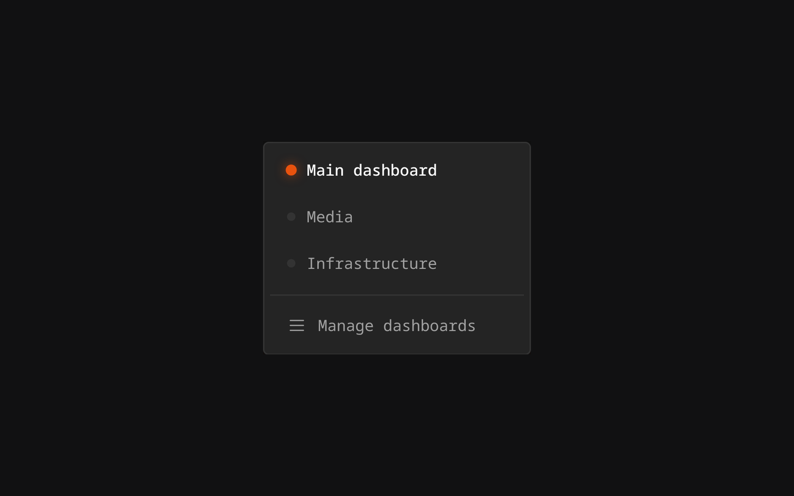
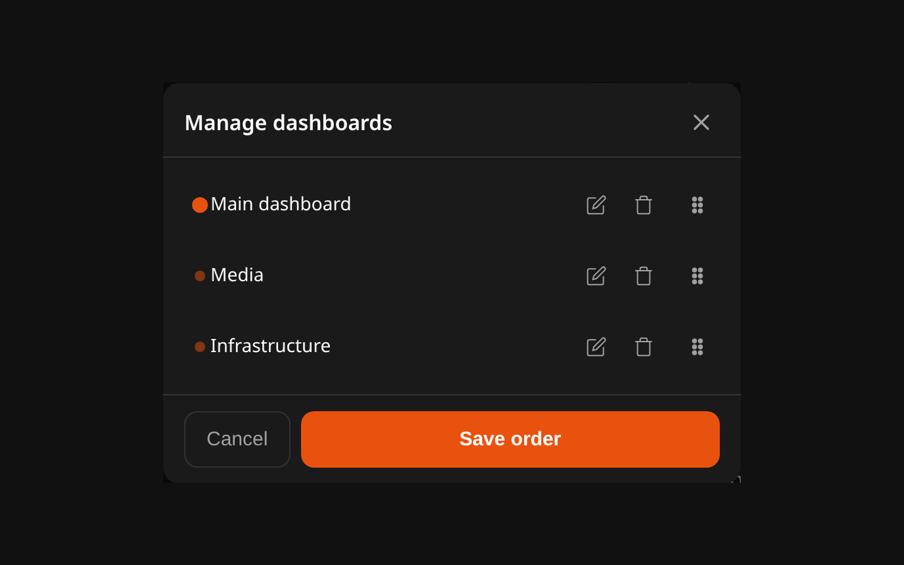

# Dashboards

Lastboard gives each user **multiple independent dashboards**. Every dashboard has its own layout and its own items — useful for separating, say, a media stack from home-automation or work tools. There is no limit on how many you create beyond the per-user item ceiling (`MAX_ITEMS_PER_USER`, 500 by default).

## Creating a Dashboard

New dashboards are **not** created from the switcher. Enter **Edit Mode**, open the **Add (+) menu** in the top bar, and choose **New dashboard** — the same menu you use to add bookmarks, sections, and widgets.

## Managing Dashboards

Use the **dashboard switcher** in the top bar. **Switch** — click any dashboard to open it instantly.

Everything else is in **Manage dashboards**, at the bottom of the switcher.

 Each dashboard is a row with its own buttons beside the drag handle, always visible (so a finger on a tablet never hits one by accident):

- **Rename** — the pencil.
- **Delete** — the bin: it asks first, removes the dashboard and everything on it, and is switched off for the last one, since you always keep at least one.
- **Order** — drag a row by its handle, then **Save order**. Renaming and deleting take effect at once; only the order waits for the button.

## Moving Items Between Dashboards

You can move bookmarks, widgets, and whole sections from one dashboard to another without recreating them.

### Move a single item

1. Enter **Edit Mode**.
2. Open the item's **⋮ (kebab) menu** and choose **Move**.
3. Pick the destination dashboard.

The item is placed automatically on the target dashboard's grid — you don't have to position it by hand. Moving a **section** takes all of its nested items along with it.

After the move, a toast appears with a **Go** action that jumps you to the destination dashboard, where the arrived item is briefly highlighted so you can spot where it landed.

### Move several items at once

1. In **Edit Mode**, start a **selection** from the top bar.
2. Tick the items you want to move.
3. Use the move action in the top bar and choose the destination.

All selected items move together and are auto-placed on the target dashboard.

> **On mobile**, dashboards can be switched and reordered, but moving items between dashboards is a desktop editing action.

## What is shared and what is not

| | Scope |
| :--- | :--- |
| Layout, items, sections, widgets | **Per dashboard** |
| Which dashboard opens first | Per dashboard (the one marked default) |
| Order in the switcher | Per dashboard |
| Background image, accent colour, theme, language, units, grid columns | **Per user** — one setting, every dashboard |
| Monitoring settings, alert channel, Proxmox connections | **Per user** — each account has its own |
| Users, backups, updates | **Server-wide**, administrator only |

So a background you set in **Settings → Look & Feel** applies to all of your dashboards at once, not only the one that was open. See [Preferences](preferences.md) for the appearance options.

## Deleting a dashboard

Deleting takes every item on it with it, and it cannot be undone — take a [backup](import-export.md) first if the layout matters. You always keep at least one dashboard: the last one cannot be deleted.
