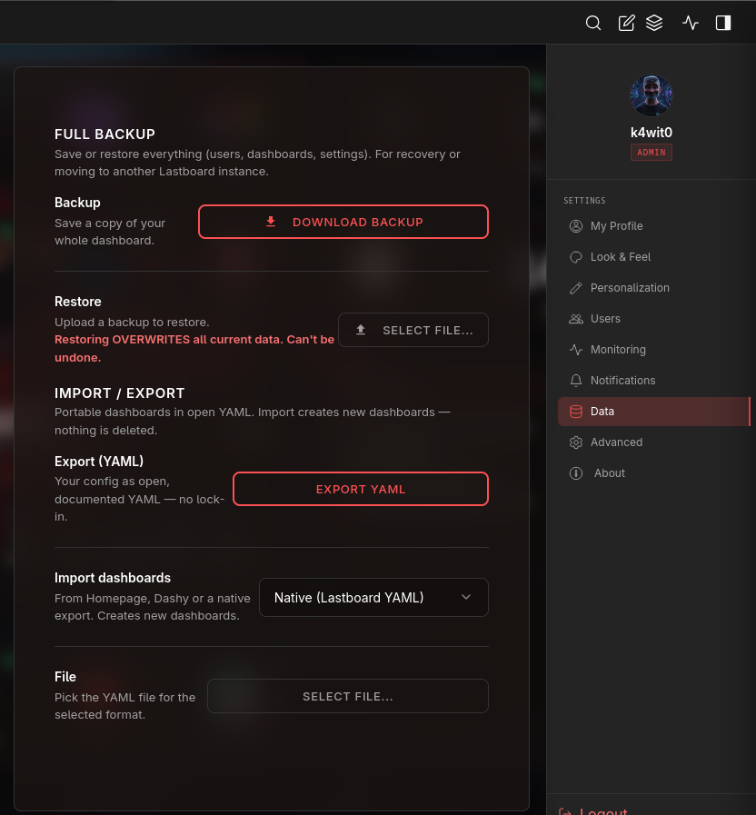

# Import, Export & Backup

Lastboard has **two separate features** that are easy to confuse. This page explains when to use each. Both live under **Settings → Data**.

| | **Full backup** | **Import / Export dashboards** |
| :--- | :--- | :--- |
| Scope | Everything: users, all dashboards, settings | Just dashboards and their items |
| Format | Backup file (complete snapshot) | Open, documented **YAML** |
| Restoring | **Overwrites** your current data | **Adds** new dashboards; deletes nothing |
| Use it for | Disaster recovery, moving to another instance | Sharing a layout, migrating from another app, keeping a portable copy |

> Rule of thumb: **Full backup** is for *recovering or relocating your whole instance*. **Import/Export** is for *moving dashboards around* without touching anything else.

Both live in the same **Settings → Data** panel:



## Full Backup

Saves or restores **everything** — every user, every dashboard, and all settings — as a single snapshot.

- **Backup** — download a complete copy of your instance.
- **Restore** — upload a backup to bring an instance back to that exact state.

> **Warning:** Restoring **overwrites all current data** and cannot be undone. Use it for recovery, or to move a full setup to another Lastboard instance — not to merge dashboards.

## Export (YAML)

Downloads your configuration as **open, documented YAML** — no lock-in, easy to read, edit, and version-control. The file lists each dashboard and its items:

```yaml
version: 1
dashboards:
  - name: Home
    items:
      - type: bookmark
        title: Jellyfin
        url: http://10.0.0.7:8096
        icon: jellyfin
        group: Media
```

Each item has a `type`, `title`, and `url`, plus an optional `icon` and `group` (the section it belongs to).

## Import Dashboards

Bring dashboards in from another tool or a native export. **Import always creates new dashboards — it never deletes or overwrites what you already have.**

1. Choose the **format** of your file.
2. Pick the **file**.
3. Confirm — Lastboard tells you how many items it will import before creating anything.

### Supported formats

| Format | Source file |
| :--- | :--- |
| **Native (Lastboard YAML)** | A file produced by *Export (YAML)* above |
| **Homepage — services.yaml** | Homepage's services configuration |
| **Homepage — bookmarks.yaml** | Homepage's bookmarks configuration |
| **Dashy — conf.yml** | A Dashy configuration file |

Items that don't belong to a named group are placed under an **Ungrouped** section. After importing, you're switched to the first new dashboard so you can review and rearrange it.
