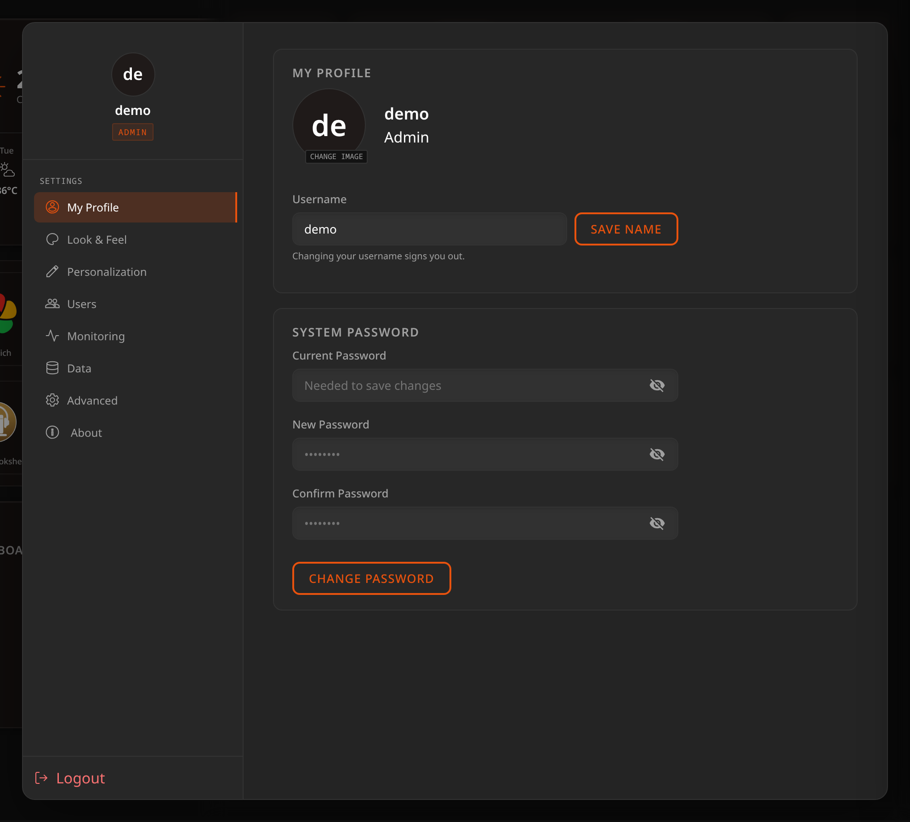
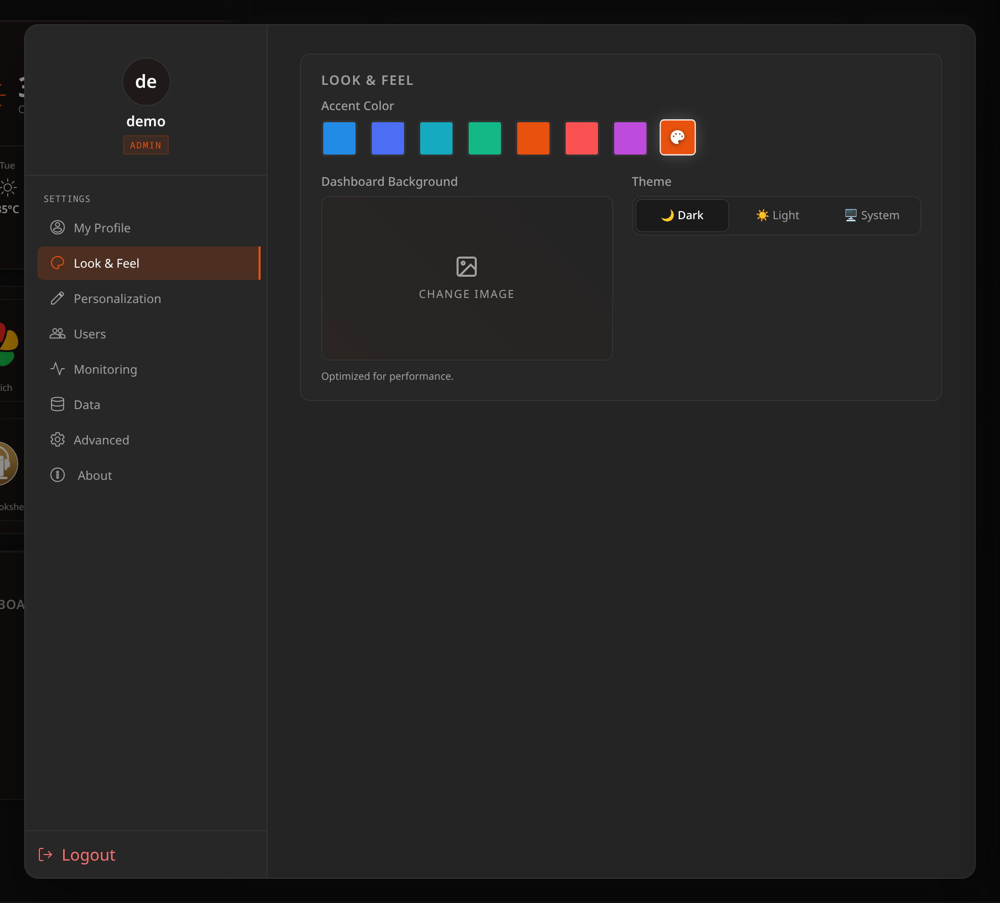
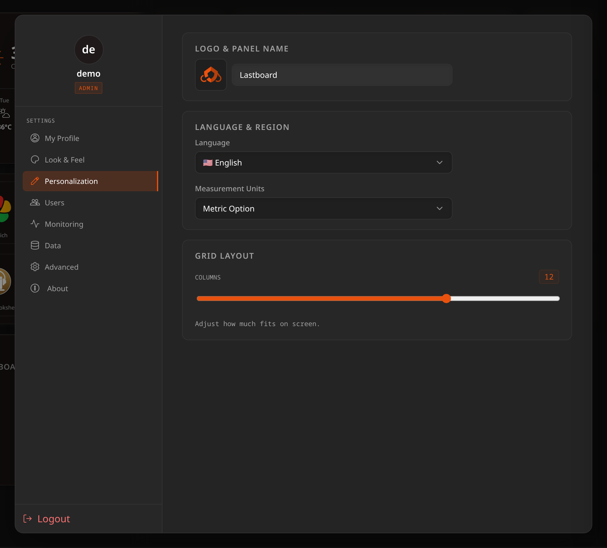
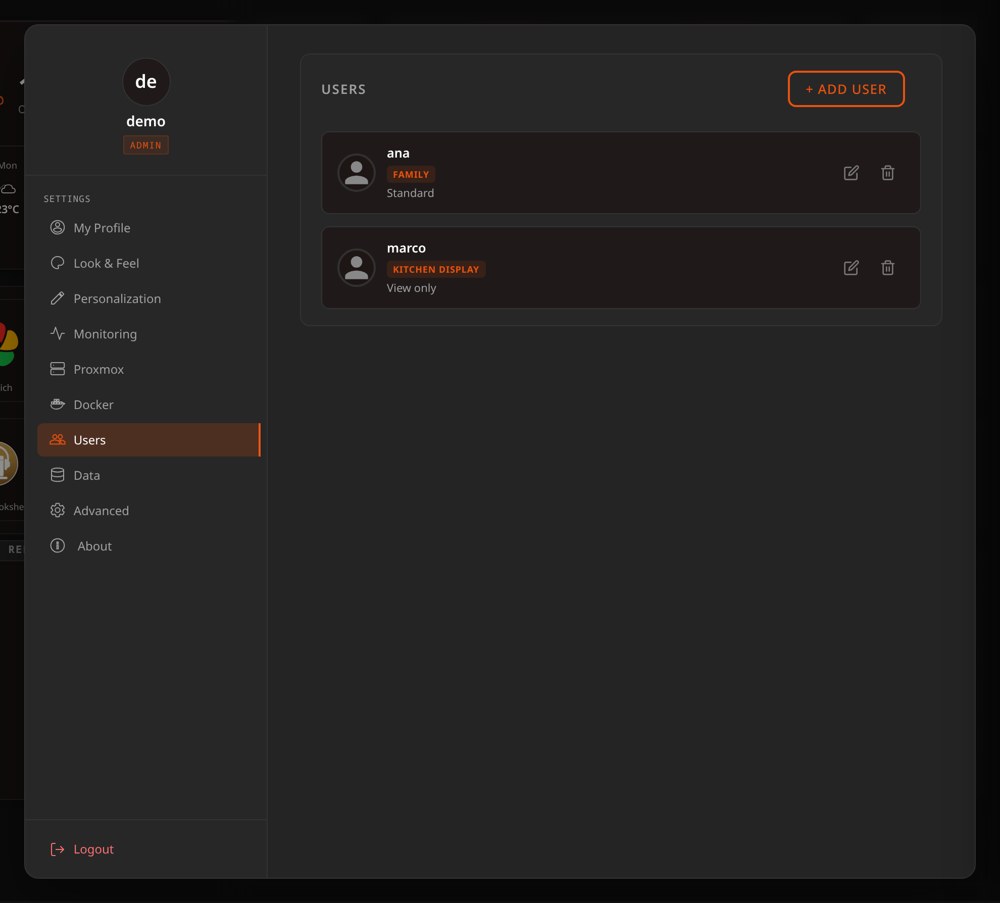
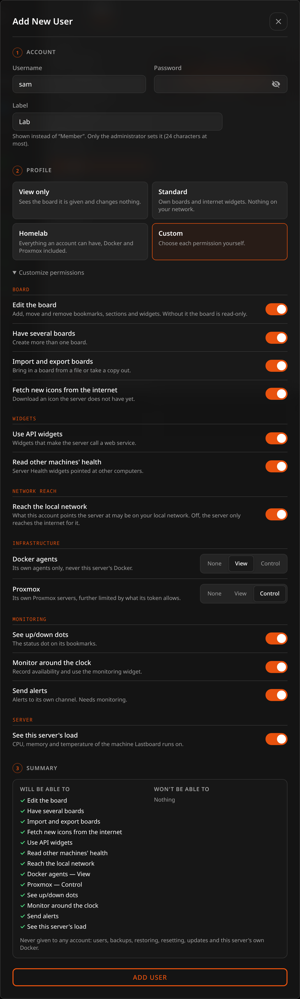
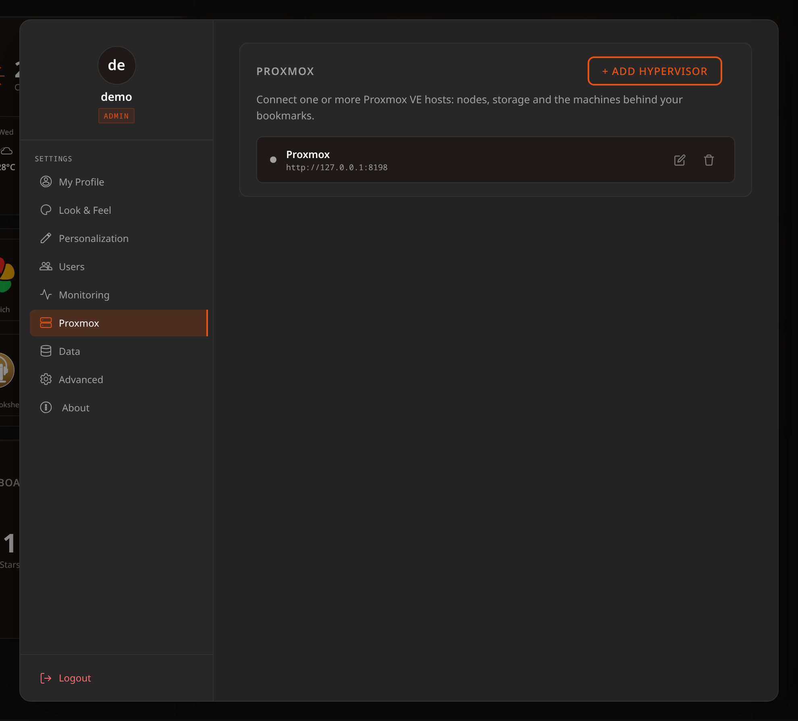
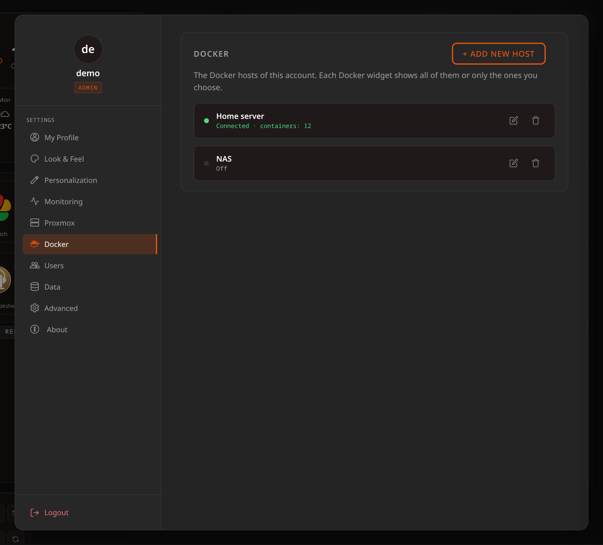
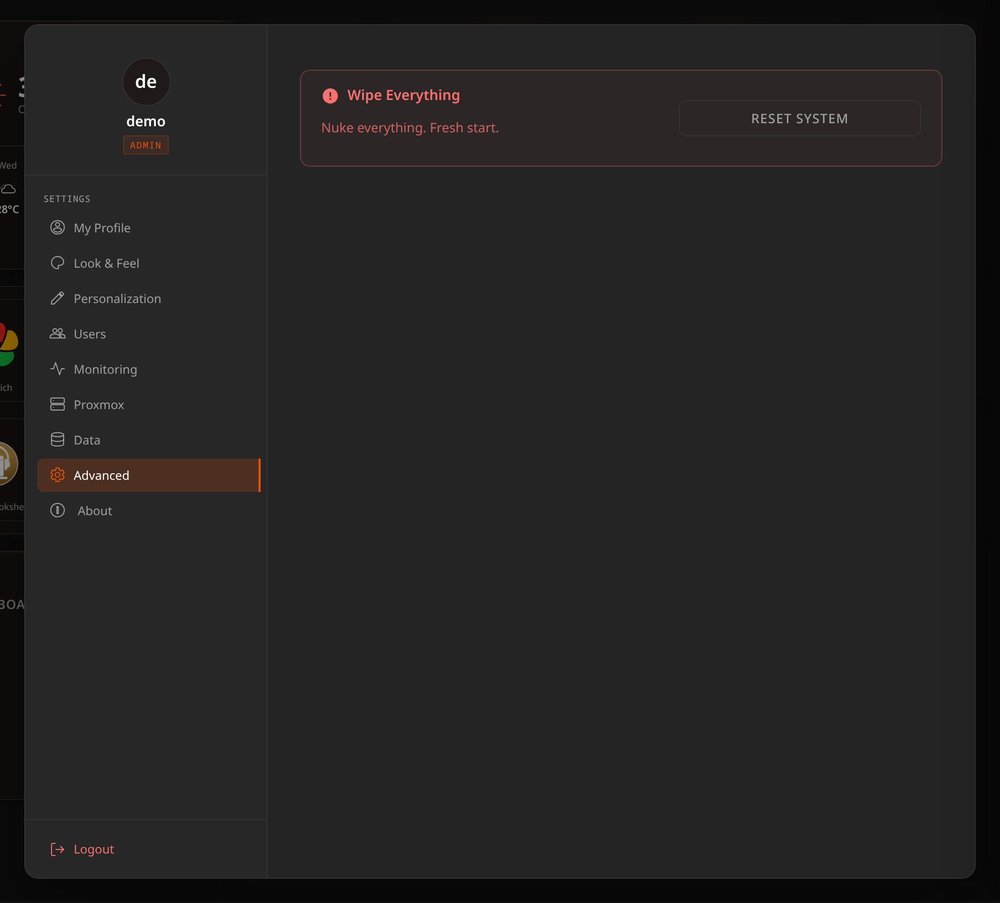
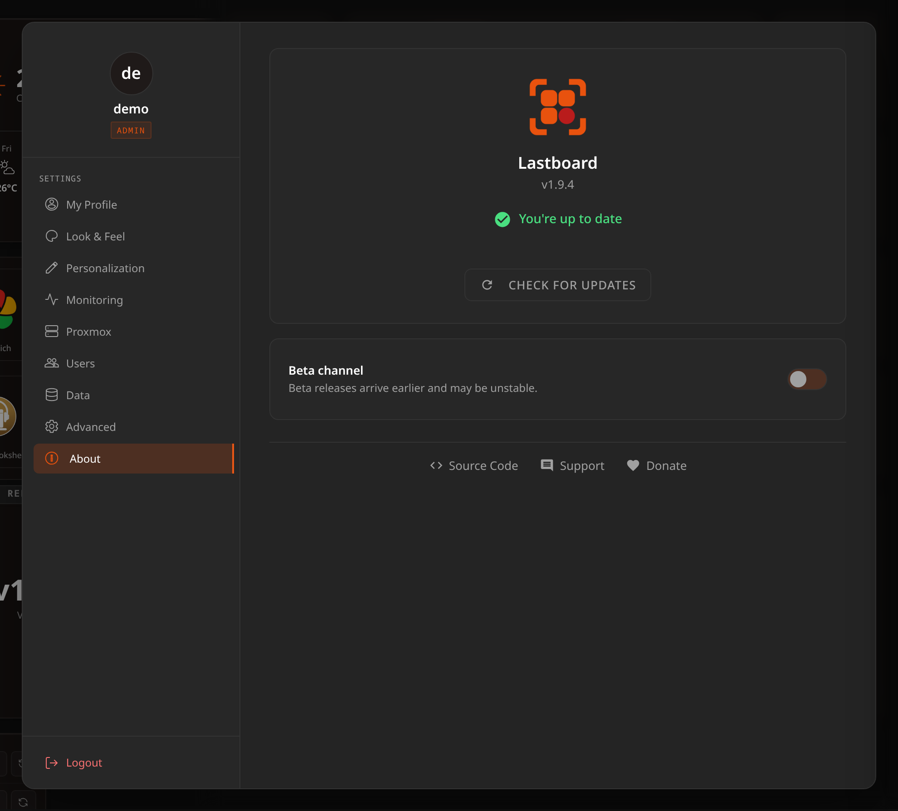

# Preferences

All personalization and system options live in the **Settings** panel, opened from the icon in the top navigation bar.

Two of the sections — **Users** and **Advanced** — belong to the administrator and are not drawn at all for anybody else. **Monitoring**, **Proxmox** and **Docker** are every account's own: each one sees its own, never anyone else's. A Member account sees **My Profile**, **Look & Feel**, **Personalization**, **Monitoring**, **Proxmox**, **Docker**, **Data** and **About** — the ones its permissions allow — and nothing hints that the rest exist.

**Preferences save the moment you change them** — there is no "Save" button. Only actions with a real consequence (changing your password or username, managing users, backup/restore, updates) keep an explicit button.

## My Profile

Manage your personal profile and security.

- **Avatar** — upload a custom profile picture (use **Change Image**).
- **Label** — shown under your name in place of **Admin** or **Member**. The administrator types its own here and saves it with **Save label**; a member sees the label the administrator gave it and has no field to change it. See [Labels](#labels).
- **Username** — change your display name, then **Save Name**. This signs you out on this browser, and you sign in again with the new name.
- **System Password** — update your login credentials. Enter your current password, then the new one twice (up to 256 characters), and **Change Password**. Every open session of the account ends, this one included, so you sign in again with the new password. A wrong current password counts toward a lockout: after 5 failures the account waits 5 minutes before it accepts another try.
- **Two-step sign-in** — after your password, ask for a six-digit code from an authenticator app (any app that takes a QR code: Google Authenticator, Microsoft Authenticator, Aegis, 2FAS, 1Password, Bitwarden…). **Turn on** shows a QR code and the same key as text; scan it, type the code the app shows and **Confirm**. You then get ten **recovery codes**, shown only once: **Copy** or **Download** them and keep them somewhere safe — each one signs you in once if you lose the phone. **New recovery codes** replaces them all, and **Turn off** removes the second step; both ask for your password. On the sign-in page, **Use a recovery code** switches the field. Lost the phone and the codes? See [Troubleshooting](../help/troubleshooting.md#i-lost-the-phone-with-my-sign-in-codes).
- **Passkeys** — sign in with your fingerprint, face or screen lock instead of your password. **Add a passkey** asks your device to make one (a phone, a laptop with a fingerprint reader, a security key, or a password manager that keeps passkeys); from then on, **Use a passkey** on the sign-in page needs nothing typed, and no two-step code. Each one is listed with when it was added and last used, and **Remove** deletes it. The password keeps working. Passkeys need Lastboard to be opened over **https with its name** (or as `localhost`): browsers do not offer them on `http://` to another machine or on an IP address, and the card says so.
- **Active sessions** — every browser and device signed in to your account, with the browser and system, the address it came from and when it was last used. This one is marked **This device**. **Close** signs another one out at once, and **Close all other sessions** signs out every one but this, after asking. Signing out with **Logout** ends this session on the server too, so a copy of its cookie stops working.

## Look & Feel

Everything that changes how the dashboard looks.

- **Accent Color** — pick a preset or set a custom color with the picker.
- **Dashboard Background** — upload any image (only images are accepted); it is resized in your browser before it is stored, and it fills the screen without distortion. It is a **per-user** setting: one background, behind every one of your dashboards. The **×** on the preview removes it.
- **Theme** — **Dark**, **Light**, or **System**. *System* follows the device you are reading on and changes with it, so a phone that turns dark at sunset turns Lastboard dark with it.

## Personalization

- **Logo & Panel Name** — customize the title and logo shown in the browser tab and top bar. In the top bar they are a link home: clicking them leaves whatever is open — a full-screen page, the settings — and loads the start page.
- **Language** — choose from **20 supported languages**.
- **Measurement Units** — **Metric** (°C, km/h) or **Imperial** (°F, mph). Applies to all compatible widgets (Weather, Telemetry, …).
- **Grid Layout** — the **Columns** slider sets how many columns the desktop grid uses, from **3 to 16** (default **12**). Fewer, wider columns give larger tiles; more columns let you place things precisely. It does not affect the mobile layout, which has an order of its own — see [Bookmarks](../getting-started/bookmarks.md#mobile-visibility-and-ordering).

## Users (Administrator Only)

The administrator manages who can access the instance, and what each account may do.

Each row shows the account's name, its **label** (or its role, when it has none) and, in small type, the name of its permission profile.

- **Add User** — opens one window to create an account. **Edit** on a row opens the same window filled with that account's current choices. Editing changes the name and, if you type one, the password, which ends the account's open sessions. Your own account is changed from **My Profile**, never from here. **Delete** asks for your password.
- **Roles** — an instance has exactly one **Admin**: the account created by the Setup Wizard. Every account added afterwards is a **Member**, and there is no way to promote one. If you need to hand the instance over, change the admin account's own username and password rather than creating a second administrator.

An account that signs in with a second step shows a **2FA** tag in the list. If somebody lost both their phone and their recovery codes, open their account and choose **Remove two-step sign-in**: they sign in with the password alone until they turn it on again.

### The account window

The window has three steps, one under the other:

1. **Account** — username, password and an optional **label**.
2. **Profile** — four cards. **Standard** is selected when you create an account. Under them, **Customize permissions** unfolds the full list.
3. **Summary** — what the account **will** and **won't** be able to do, as it stands now, so you read the consequence before you press **Add User**.

A profile is a starting point, not a link: choosing one copies its values onto the account, and the account keeps them if a later version changes what the profile contains. Touching any permission switches the card to **Custom** (unless the result happens to match one of the three profiles exactly).

| Profile | What it is for |
|---|---|
| **View only** | A wall screen or a guest: sees the board it is given, changes nothing, and makes the server reach nothing on its behalf. It can still see this server's load. |
| **Standard** | A household member: boards of its own (several, importable and exportable), new icons from the internet, widgets that call web services, and the up/down dot on its bookmarks. Nothing on your local network and no infrastructure. |
| **Homelab** | Somebody trusted with equipment of their own: every permission below, with Docker and Proxmox at **Control**. |
| **Custom** | Whatever you pick. |

The permissions, by area:

- **Board** — edit the board; have several boards (needs *edit the board*); import and export boards; fetch new icons from the internet. Without *edit the board* the account sees the board prepared for it and changes nothing.
- **Widgets** — use API widgets; read the health of other machines with Server Health. Clock, weather, notes and Markdown widgets are always available.
- **Network reach** — **reach the local network**. What the account points the server at may be on your LAN only if this is on. Off, the server reaches only the internet on its behalf.
- **Infrastructure** — **Docker** and **Proxmox**, each at **None**, **View** or **Control**. They are the account's *own* Docker agents and Proxmox servers (see [Docker](#docker) and [Proxmox](#proxmox)); Proxmox is further limited by what its API token allows.
- **Monitoring** — see the up/down dots; monitor around the clock; send alerts (needs monitoring).
- **Server** — see the load (CPU, memory, temperature) of the machine Lastboard runs on.

A permission that depends on another is shown switched off and cannot be touched while the one it needs is off. Changes apply from the account's next request; nobody has to sign in again.

What an account may not do is left out of its screens rather than greyed out: without *edit the board* there is no pencil, no **+** and no way to drag or resize; without *several boards* the new-board entry is gone; without *monitoring* or *Proxmox* their icons and their sections of this window disappear, and without *Docker* its section; **Data** shows a member only what it may use — importing and exporting boards, and storing icons — and never the backup; without *the up/down dots* a bookmark shows none and the form does not offer them; without *fetch new icons* the icon picker says so and only uploading remains; and a widget the account may not use is not offered when adding one. A widget that is already on the board stays there, and says in one line that the administrator has not turned it on for the account. The screens follow the permissions the account had when the page was loaded, so a change made while somebody has Lastboard open shows up the next time they reload.

Some things are never given to a member, whatever its profile: managing accounts, backups, restoring, resetting, updating, and the Docker of the server Lastboard itself runs on. A member can only use its own Docker agents.

An account that existed before permissions were introduced was given the **Homelab** set when you updated, so nothing it could do stopped working; edit it to narrow it down.

### Labels

A **label** is a short text of your choosing (24 characters at most) shown where the role would be: in the user list, in **My Profile**, and under the name at the top of the Settings menu — for every account, not only the administrator. Empty, the role (**Admin** or **Member**) is shown, as before. It is only a name: it changes nothing about what the account can do.

Only the administrator sets labels. A member sees its own label but cannot change it. The administrator names its own account from **My Profile**.

## Monitoring

Turn service monitoring on for your own bookmarks, choose how often the server checks them, and configure down/up alerts via ntfy, Gotify or a webhook. Every account has its own settings and its own alert channel. See **[Monitoring & Uptime](../monitoring/overview.md)** for the full guide.

## Proxmox

Connect Lastboard to one or more Proxmox VE hosts — one card each, with a name, address, API token and certificate policy. Saving reads every host straight away and says, per card, what that token can see and whether it may start and stop machines. Each account connects its own hypervisors: yours are never listed to, and never used by, anybody else. See **[Proxmox](../proxmox/overview.md)** for the token recipe and the page it unlocks.

## Docker

The Docker hosts of your account — a local socket, a Lastboard Agent with its token, or a daemon reached over TCP or TLS — each with a row that says whether it answers and how many containers it has. Every Docker widget reads this one list; a widget only chooses which of them it shows. A member connects through a Lastboard Agent; the other types are the administrator's. See **[Docker](../docker/overview.md#docker-hosts)** for each type and the token.

## Data

Full backup & restore, and importing/exporting dashboards. See **[Import, Export & Backup](import-export.md)**.

The backup and its restore are the whole server's, so only the administrator sees them. A member sees the import and export of its own boards if it may *import and export boards*, and the icons below if it may *fetch new icons*; with neither, the section is not there.

It also says where your icons come from — how many of your bookmarks this server serves, and how many still fetch theirs from outside, with a button to bring those in. See **[Where icons are stored](../getting-started/bookmarks.md#boards-made-before-this-existed)**.

## Advanced

- **Reset System** — a safe-guarded "wipe everything" that asks for your password, erases all data and returns the instance to a fresh start (the Setup Wizard). This cannot be undone.

## About

- **Version** — the running version, with an at-a-glance up-to-date indicator.
- **Check for Updates** — manually check for a newer release. See **[Updating](../getting-started/updating.md)** for how updates are applied.
- **Beta channel** — opt in to beta releases, which arrive earlier and may be unstable.
- **Source Code / Report Issue** — links to the Forgejo repository and its issue tracker.
