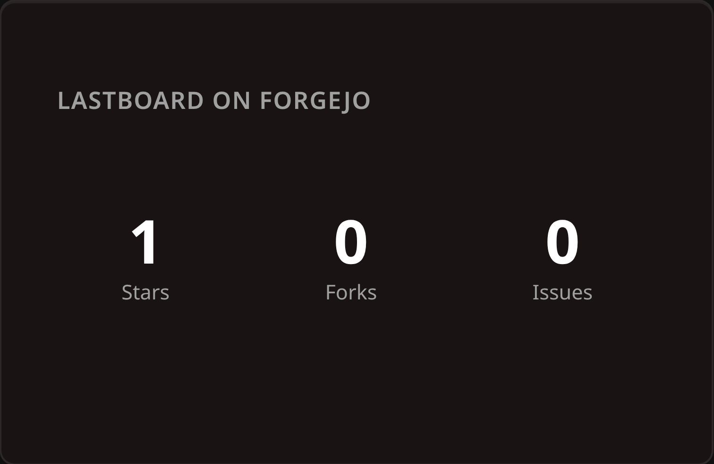
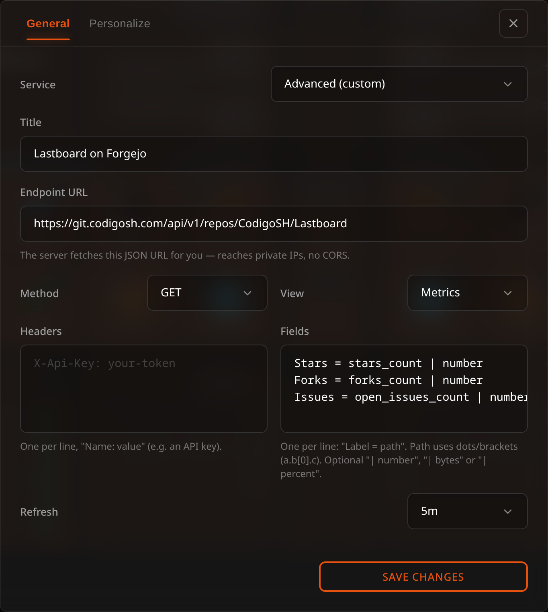

# API Widget

The API widget turns any JSON HTTP endpoint into a live tile on your dashboard. Point it at a service's API, tell it which values to show, and it keeps them refreshed — no plugin per service, no code.



## Description

Most self-hosted apps expose a JSON API. The API widget fetches one and renders selected fields, either as **big metric numbers** or as a **scrolling list**. The request runs **on the Lastboard server**, not in your browser — so it can reach services on private IPs and accept self-signed certificates, which a browser can't do because of CORS and network isolation.

Typical uses: AdGuard blocked-queries, Paperless document counts, Immich photo/video totals, Sonarr/Radarr queue size, a Home Assistant sensor reading, a Forgejo repo list, and anything else with a JSON endpoint.

## Two Ways to Configure It

When you add an API widget, its configuration offers two approaches:

### 1. Service preset (guided)

Pick a known service from the list and you only fill **one to three fields** — the base URL, usually an API key or token, and for a few services one extra detail. Lastboard composes the full request (endpoint path, auth header, field mappings) for you. The picker has a search box: start typing the service name instead of scrolling the list.

| Field | Example |
| :--- | :--- |
| **Base URL** | `http://10.0.0.5:8000` (host and port, no trailing path) |
| **Credential** | An API key, token, or `user:password`, depending on the service. Shown as dots once saved and never shown again — type a new one to replace it, or empty the box to remove it. |
| **Extra detail** *(a few services)* | The specific node, entity or status page to read — see [Supported Service Presets](#supported-service-presets) |

### 2. Advanced (manual)

Full control for any endpoint that has no preset. Set the **Service** selector to *Advanced (custom)* and configure the request yourself.



| Field | Description |
| :--- | :--- |
| **Endpoint URL** | The full endpoint, including path and any query string. `http://` or `https://`. |
| **Method** | `GET` (default) or `POST`. |
| **Headers** | Custom request headers: a **name** and, beside it, a **value** (three rows; leave a name empty to skip it) — typically for authentication, e.g. `Authorization` with `Bearer …` or `X-Api-Key`. Every value is a secret: shown as dots once saved, never shown again; type a new one to replace it, or empty the box to remove it. |
| **List array** *(optional)* | A path to an array in the response. Fill it to render a **list**; leave it empty for **metrics**. See [Display Modes](#display-modes). |
| **Fields** | The values to show, **one per line** — see [Field Mappings](#field-mappings). |
| **Refresh** | How often to re-fetch: 30s, 1m, 5m or 10m. |

> Services that authenticate with a login session rather than a token or API key (for example qBittorrent, Deluge, or UniFi) are not offered as presets and must be configured in Advanced mode if their API supports header/token auth.

> **List mode needs a nested array.** The **List array** field takes a path to an array *inside* the response object, so an endpoint that answers with a **top-level array** (Portainer's `/api/endpoints`, for example) can't be shown as a list — there is no path to point at. If the API offers an alternative endpoint that wraps its array in an object, use that one; otherwise the endpoint only works in metric mode with indexed paths such as `[0].name`.

## Display Modes

### Metric mode (default)

Each mapping becomes a large number with a caption. Great for counts and totals. If you map two or three fields, they sit side by side.

### List mode

Set an **array path** — the location of a JSON array in the response (e.g. `data`, `response.results`). The widget renders one **row per array item**, and each mapping becomes a **column** within the row. The first column is emphasized as the primary label. Up to **50 rows** are shown, scrolling if needed.

## Field Mappings

The **Fields** box holds one mapping per line, in the form:

```
Label = path | format
```

- **Label** — the caption shown under a metric, or the column heading in a list. In list mode the label can be left empty (write `= path`).
- **Path** — where the value lives in the JSON, using dot and bracket notation:
  - `num_dns_queries` — a top-level field
  - `queue.speed` — a nested field
  - `response.data.stream_count` — deeper nesting
  - `results[0].title` — the first element of an array

  In **metric mode** the path is read from the whole response. In **list mode** it is read from **each array item**, relative to that item.
- **`| format`** *(optional)* — how the raw value is displayed:

| Format | Effect | Example |
| :--- | :--- | :--- |
| *(omit)* | Shown as-is | `online` |
| `\| number` | Thousands separators | `1,240,533` |
| `\| bytes` | Human-readable size | `4.2 GB` |
| `\| percent` | Rounded percentage | `73%` |

Example:

```
Queries = num_dns_queries | number
Blocked = num_blocked_filtering | number
```

A missing value renders as `—`.

## Supported Service Presets

Presets fill in the endpoint and authentication for you.

| Service | Category | Credential | Shows |
| :--- | :--- | :--- | :--- |
| **AdGuard Home** | Network | `user:password` | DNS queries, blocked |
| **Paperless-ngx** | Files | API token | Documents, inbox |
| **Immich** | Media | API key | Photos, videos |
| **Jellyfin** | Media | API key | Movies, series |
| **Sonarr** | Media | API key | Queue size |
| **Radarr** | Media | API key | Queue size |
| **SABnzbd** | Downloads | API key | Queue, speed |
| **Tautulli** | Media | API key | Active streams |
| **Overseerr / Jellyseerr** | Media | API key | Pending, total requests |
| **Bazarr** | Media | API key | Episodes, movies missing subtitles |
| **Home Assistant** | Infrastructure | Access token + entity | Entity state |
| **Uptime Kuma** | Infrastructure | None + status page | Monitor list |
| **Forgejo / Gitea** | Dev | Access token | Repository list |
| **Speedtest Tracker** | Network | Bearer token | Download, upload |
| **Nextcloud** | Files | `user:password` | Files, free space |
| **Prowlarr** | Downloads | API key | Indexer list with query counts |

> **Proxmox VE is not here on purpose.** It used to be a preset that read one node and showed
> two figures. Lastboard now speaks to Proxmox itself — every hypervisor you run, their nodes,
> storage and machines, tied to the bookmarks they serve, with start and shutdown. Use the
> [Proxmox widget](proxmox.md) and [the Proxmox page](../proxmox/overview.md) instead.
> Widgets already configured with the old preset keep working; they are plain API widgets now.

> Where to find the credential varies per service — usually under Settings → API / Access Tokens. For AdGuard and Nextcloud, use the same username and password you log in with.

Two presets need one extra detail because they read a specific thing rather than the whole server:

- **Home Assistant** — the **entity ID** to display, found under *Developer tools → States*.
- **Uptime Kuma** — the **status page** slug, the last part of that page's address. Status pages are public, so no credential is needed.

## How the Fetch Works

- **Server-side.** Lastboard's backend makes the request, so the target can be a **private IP** (`10.x`, `192.168.x`, `.local`) unreachable from your browser.
- **Self-signed certificates are accepted.** Internal HTTPS services with their own certificate work without extra setup.
- **Limits.** Each request times out after **8 seconds** and reads at most **512 KiB** of the response. Keep endpoints lightweight (many APIs accept a `limit` or `pageSize` query parameter).
- **Failure is graceful.** If the service is down or the request fails, the tile shows an **Unreachable** state instead of an error, and retries on the next refresh.

> **Security note:** Reaching private IPs and skipping TLS verification are intentional for a self-hosted, single-tenant instance. Any credential you enter — the preset's key, or an advanced header's value — is kept on the Lastboard server apart from the widget's configuration, so the board your browser loads never contains it. The server adds it to the request, which is sent only to the URL you configured. A dashboard export leaves credentials out; a full [backup](../using/import-export.md) carries them, so give it a password if it will leave your server.

## Troubleshooting

| Symptom | Likely cause |
| :--- | :--- |
| **Unreachable** | Wrong host/port, service down, or the credential is missing/invalid. Confirm the URL works with `curl` from the Lastboard host. |
| **All values show `—`** | The **path** doesn't match the JSON. Check the real response shape and adjust the path. |
| **Empty list** | The **array path** doesn't point at an array, or the array is empty. |
| **A list is impossible to configure** | The response is a **top-level array** rather than an object, so there is no path to give the **List array** field. See the note in [Advanced](#2-advanced-manual). |
| **A number looks wrong** | The field isn't numeric — remove the **Number/Bytes/Percent** format, or pick the correct one. |
