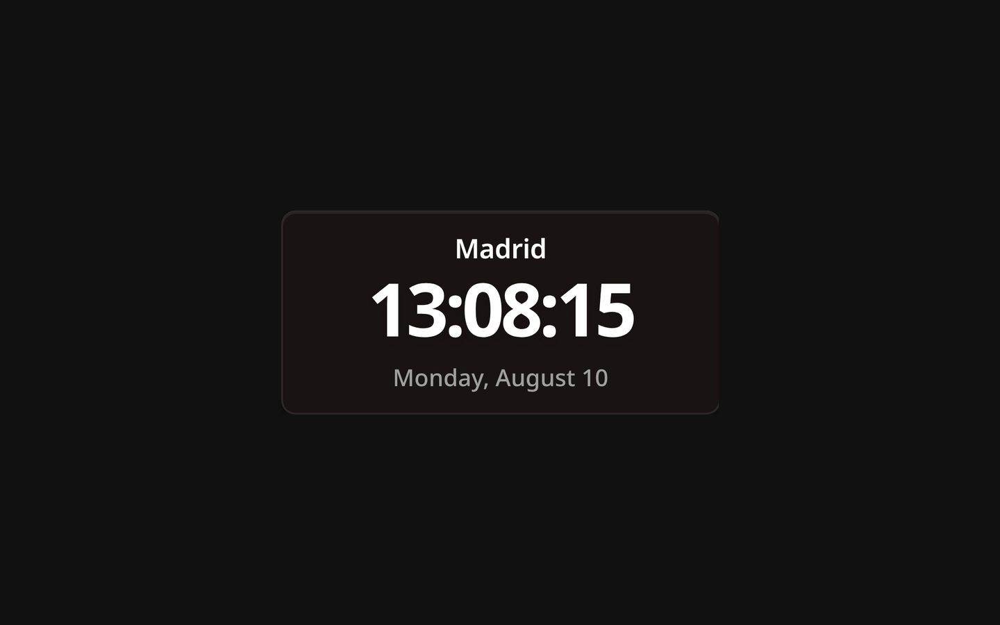

# Clock Widget

The Clock widget shows the current time and date for a city you choose. It is listed as **Time** in the widget picker.

## Description

You pick a location and the widget keeps its clock on that city's time zone, so one dashboard can hold several clocks for the places you care about. The time, the date and the city name follow the language Lastboard is set to, and all three scale to the size of the widget.

## Choosing a location

The settings open on their own the first time you add the widget. Type a city, press **Search**, and pick one of the results: the matching time zone is worked out for you, so there is no time zone list to scan.

**Until you pick a location the widget shows "Choose Location" and no clock at all.** Without a location there is no zone to show, and a clock silently running on someone else's time is worse than no clock.

The search uses one online service (Open-Meteo, the same one the Weather widget uses), and it gives the time zone along with the city, so your browser needs internet access at that moment. After that the clock runs on its own and needs no network to keep time.

If you type a city name and save without picking a result, Lastboard still tries to resolve it. When that fails the widget falls back to the time zone of the device you are reading it on. Saving again without changing the city — to show seconds, say — keeps the time zone the clock already has.

## Configuration Options

| Option | Default | Description |
| :--- | :--- | :--- |
| **Location** | Empty | The city whose time is shown. Search for it and pick from the results. |
| **12-Hour Clock** | Off | 12-hour time with AM/PM instead of 24-hour. |
| **Show Date** | On | Weekday, day and month, under the time. |
| **Show City** | On | The city name, above the time. |
| **Show Seconds** | Off | Add seconds to the time. |

The **Personalize** tab adds a border color and a border width (Thin, Regular or Thick) for the widget's card. The **General** tab begins with the **Title** — a name shown on the tile's top border, like the one a section wears (leave it empty for none).

## Notes

- The clock is redrawn every second, whether or not seconds are shown.
- The date is the weekday, the day and the month. There is no year.
- This widget has no resize handle in Edit Mode: it keeps the size it was added at and fits its text to it.
