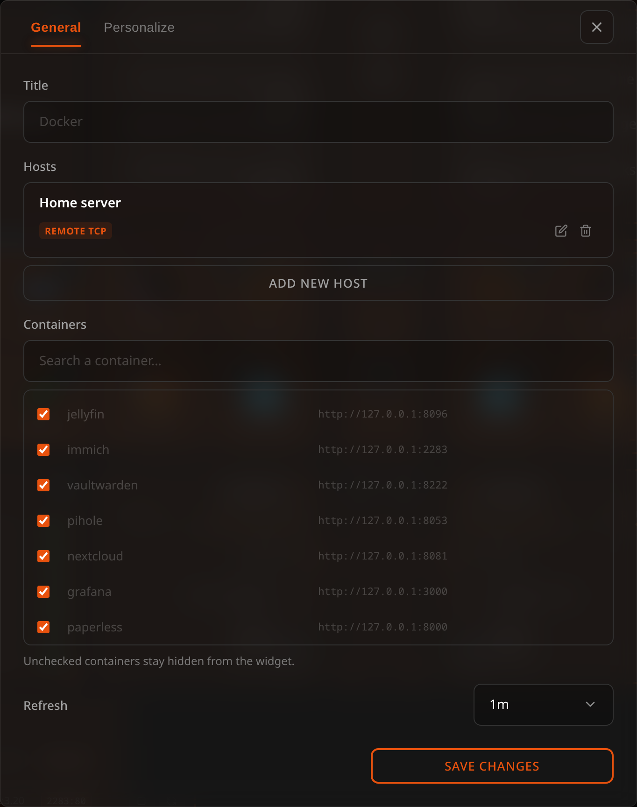

# Docker Widget

The Docker widget provides live monitoring and basic management of your Docker containers directly from Lastboard.

## Description

This widget lists containers, shows their running state, exposes port mappings, and provides real-time CPU/RAM stats. It also lets the administrator control container lifecycles (Start, Stop, Restart).


## Prerequisites

To monitor Docker instances, Lastboard needs access to the Docker daemon.

## Connection Modes

You can connect the widget to Docker environments via three distinct modes:

### 1. Local Socket (Native Install)
When running Lastboard natively on Linux, it can access `/var/run/docker.sock` directly (ensure the `lastboard` user has permission to read the socket, often by adding it to the `docker` group).

### 2. Local Socket (Docker Install)
When running Lastboard as a Docker container, uncomment the socket volume mount in the `docker-compose.yml` file to grant it access.
```yaml
    volumes:
      - ./data:/var/lib/lastboard
      - /var/run/docker.sock:/var/run/docker.sock:ro
```

`:ro` makes the socket file read-only, not what is said through it: Lastboard can still start, stop and restart containers over a socket mounted this way, and so can anything else that reaches it. Access to the Docker socket is control over Docker — and, through it, over the host. That is the same whether Lastboard is installed natively in the `docker` group or runs as a container with the socket mounted. For a Docker on another machine, use the Lastboard Agent: it answers only the few calls the widget makes.

### 3. Remote via Lastboard Agent
For remote servers, you can use the official Lastboard Agent to securely proxy Docker API calls with an authorization token, over HTTP or — behind a reverse proxy — HTTPS.

## Lastboard Agent

The Lastboard Agent is a lightweight proxy that exposes specific Docker endpoints.

### Quick Start

**Using Docker Compose (Recommended):**
```yaml
services:
  lastboard-agent:
    image: git.codigosh.com/codigosh/lastboard-agent:latest
    container_name: lastboard-agent
    ports:
      - "2375:2375"
    environment:
      - TOKEN=your_secure_random_token
    volumes:
      - /var/run/docker.sock:/var/run/docker.sock:ro
    restart: unless-stopped
```

**Using Docker CLI:**
```bash
docker run -d \
  --name lastboard-agent \
  -p 2375:2375 \
  -e TOKEN=your_secure_random_token \
  -v /var/run/docker.sock:/var/run/docker.sock:ro \
  --restart unless-stopped \
  git.codigosh.com/codigosh/lastboard-agent:latest
```

### Environment Variables
| Variable | Description |
| :--- | :--- |
| `TOKEN` | Required: The Bearer token used to authenticate requests. |
| `PORT` | The port the agent binds to (default: `2375`). |
| `SOCKET_PATH` | Path to Docker socket (default: `/var/run/docker.sock`). |

### Health Check Endpoint
The agent provides a public, unauthenticated `/health` endpoint to verify connectivity. Since v1.1.0 it also reports the agent's version there, and the widget's settings show it next to each agent host — so you can tell which release each machine runs without logging into it. An agent older than v1.1.0 reports none and is shown as `< v1.1.0`; one that does not answer shows nothing.

### Using with a Reverse Proxy
If securing the agent behind a reverse proxy (like Pangolin or Cloudflare Zero Trust), enter its address in the widget **with `https://`** — `https://agent.example.com` — and Lastboard reaches the agent over HTTPS. Without the scheme it speaks plain HTTP, which is what an agent on your own network answers.

The proxy must forward the `Authorization` header containing the Bearer token intact. As with the Remote TLS type, the certificate is not checked, so a self-signed one or an internal CA works; the connection is still encrypted, and the token no longer crosses the network in the clear.

## Podman

Podman answers the same API through a socket of its own, so the widget, the Docker page and the agent work with it unchanged. What follows is for rootless Podman, the way it is normally run.

**1. Turn the socket on**, once, as the user that runs your containers:

```bash
systemctl --user enable --now podman.socket
```

It lives at `$XDG_RUNTIME_DIR/podman/podman.sock` — `/run/user/1000/podman/podman.sock` for the user with id 1000.

**2. Mount it where Docker's would be**, and turn SELinux labelling off for that one container:

```bash
podman run -d --name lastboard -p 8080:8080 \
  -v lastboard-data:/var/lib/lastboard \
  -v $XDG_RUNTIME_DIR/podman/podman.sock:/var/run/docker.sock \
  --security-opt label=disable \
  git.codigosh.com/codigosh/lastboard:latest
```

Then add a host of type **Local (socket)**. Two things are easy to get wrong here:

- **Without `--security-opt label=disable`**, on a system where SELinux is enforcing (Fedora, RHEL and their relatives), the container is not allowed to open the socket, and the host shows *Could not connect to Docker host*.
- **Leave `PUID` and `PGID` unset.** In rootless Podman the container's root is your own user on the host — the user that owns the socket — so it gives nothing away. With `PUID` set, Lastboard switches to an id that cannot read the socket, and the host shows *Could not connect to Docker host* again.

The agent is the same, with the same two rules:

```bash
podman run -d --name lastboard-agent -p 2375:2375 \
  -e TOKEN=your_secure_random_token \
  -v $XDG_RUNTIME_DIR/podman/podman.sock:/var/run/docker.sock \
  --security-opt label=disable \
  git.codigosh.com/codigosh/lastboard-agent:latest
```

### As a service, with Quadlet

Quadlet is how Podman runs a container as a systemd service. Save this as `~/.config/containers/systemd/lastboard.container`:

```ini
[Unit]
Description=Lastboard
Requires=podman.socket
After=podman.socket

[Container]
Image=git.codigosh.com/codigosh/lastboard:latest
ContainerName=lastboard
PublishPort=8080:8080
Volume=lastboard-data:/var/lib/lastboard
Volume=%t/podman/podman.sock:/var/run/docker.sock
SecurityLabelDisable=true

[Service]
Restart=always

[Install]
WantedBy=default.target
```

`%t` is the same runtime folder as `$XDG_RUNTIME_DIR`. For the agent, the same file as `lastboard-agent.container`, with `Image=git.codigosh.com/codigosh/lastboard-agent:latest`, `ContainerName=lastboard-agent`, `PublishPort=2375:2375`, `Environment=TOKEN=…` and no data volume. Then:

```bash
systemctl --user daemon-reload
systemctl --user start lastboard
```

A user's services stop when that user logs out unless lingering is on for them: `loginctl enable-linger $USER` keeps them running, and starting at boot.

### A native install

A native install reads Docker at `/var/run/docker.sock` and nowhere else. To watch Podman from it, run the agent as above on the same machine and add it as a **Lastboard Agent** host at `127.0.0.1:2375`.

## Docker hosts

Hosts belong to your account, as Proxmox hypervisors do: you set them up once in **Preferences → Docker**, and every Docker widget reads the same list. Each row says how the host is doing (*Connected · containers: 12*, or why it isn't), and the version for an agent. Add a host with **Add new host**, change one with the pencil, remove it with the bin, and switch one off to keep it without any widget showing it.


Each host has a name, a **Type**, and — for everything except the local socket — an address. Pick the type first; the fields below it change to match.

| Type | Address to enter | Default port |
| :--- | :--- | :--- |
| **Local socket** | nothing — the address field disappears | — |
| **Lastboard Agent** | `192.168.1.100:2375`, plus the agent's token in its own field | `2375`, or whatever you set in the agent's `PORT` |
| **Remote TCP** | `192.168.1.100:2375` | `2375` — an unencrypted Docker daemon |
| **Remote TLS** | `192.168.1.100:2376` | `2376` — a TLS Docker daemon |

Enter the host and port on their own — Lastboard adds the scheme the type needs. The one scheme kept is `https://` on an agent, which means *reach it over HTTPS* (see the reverse proxy section above). An address pasted with a scheme already on it, such as `tcp://10.0.0.5:2375` from `DOCKER_HOST`, is understood as written.


There is no `?token=` to type: the token has its own field, which appears only for the agent. It is a secret: once saved it shows as dots and is never shown again — type a new one to replace it, or empty the box to remove it. The token is kept on the Lastboard server with your account and never travels to your browser, and a dashboard export leaves it out; a full [backup](../using/import-export.md) does carry it, so give the backup a password if it will leave your server.

### Who can use which kind of host

- **The administrator** can use every type.
- **A member** connects to Docker through a **Lastboard Agent**, with the agent's token. The local socket, Remote TCP and Remote TLS reach Docker by being the server, without any credential, so they are the administrator's: a member's account doesn't offer them. To let someone see the server's own containers, run an agent on it and give them its token.
- Whether a member has Docker at all, and whether it may start and stop containers, is one of the permissions the administrator sets for that account.

### Coming from an earlier version

Hosts used to be set up inside each widget. The first time the new version starts, they move to the account that owns the widget: the same host configured in two widgets becomes one host, agent tokens come with it, and what each widget had set on its containers — hidden, names, addresses, order — follows the host. A widget that showed every host keeps showing every host. A member who had the server's own socket in a widget keeps it in the list, marked as one only the administrator can use.

## Widget Configuration

Everything the widget shows is set from its configuration screen: enter the dashboard's edit mode and open the widget's settings.



### Hosts

The hosts of your account are listed with a **Show** box each. Leave them all ticked and the widget shows every host, including the ones you add later; untick one to leave it out of this widget. To add, change or remove a host, go to Preferences → Docker.

### Containers

Each host's containers are listed with a search box for long lists. For each one you can:

- **Show or hide it** with the checkbox. Unchecked containers stay out of the widget.
- **Rename it**, if the container name isn't what you want to read on your dashboard.
- **Set the address it opens**. See [Opening a container's service](#opening-a-containers-service).

Hosts that don't answer say so in their own section, and their containers keep whatever you had already set for them.

**The widget shows what you ticked, from every host at once** — it is one list of the containers you care about, not one host at a time. With more than one host configured, each row names the host it runs on, under the image.

Each row opens with a coloured dot for the container's state — the same dot the Monitoring widget uses for a service, so a board with both reads one way rather than two. Green is running, grey is stopped, amber is paused, and restarting uses your accent colour; hovering it spells the state out.

### When a host stops answering

Its containers don't disappear from the widget. They stay where they are, greyed out, and the line that normally names the host says it isn't responding instead — so you can see at a glance which services you've lost and which are fine. Their action buttons go away, since there is nothing there to receive the command.

A host that was already down when the dashboard loaded listed nothing, so there are no rows of its to grey out. That one gets a single line naming it and saying it doesn't answer.

### Opening a container's service

A container's name in the widget is a link: click it and its web interface opens in a new tab. No bookmark to create by hand for something the widget already lists.

Lastboard works the address out for you, in this order:

1. **What you typed** in the container's address field, if anything.
2. **A label on the container.** `lastboard.url` is read first, then `homepage.href` — so a container already labelled for another dashboard works here without changes, and you can override it with ours. Only `http://` and `https://` addresses are used.
3. **The first published port**, combined with the host's address. For a local host that's whatever address you're using to read the dashboard; for a remote one it's that host's own address.

A container that publishes no port and carries no label simply isn't a link — the field shows *No published port* and its name stays plain text.

The address field is left **empty** on purpose when the derived one is right: the placeholder shows what will be used, and leaving it alone means the widget keeps following the container. Type something only when you want to override it — a reverse-proxy hostname, for example, or a container reachable on a path.

Example of labelling a container so it advertises its own address:

```yaml
services:
  jellyfin:
    image: jellyfin/jellyfin
    labels:
      lastboard.url: https://jellyfin.example.home
```

### Arranging the list

Each container in the settings has a grip on its left. Drag a row by it to put the container where you want it, or focus the grip and use the up and down arrow keys. The widget shows the containers in that order. The order is kept for each host, so with several hosts you arrange each one's list on its own. A container the order doesn't know yet — a new one — goes after the others until you place it.

### New containers

By default a container that appears on a host is shown straight away, and you hide the ones you don't want. If you only want a few on the widget, turn **Show new containers automatically** off: from then on a new container stays hidden until you tick it in the settings. Turning it off keeps what is on the widget now; only containers that appear afterwards are held back. Do it while all your hosts are answering: a host that is down can't be listed, so its containers are not kept.

### Updating a container

What you set on a container — hidden, a name, an address — is kept under the container's **name** on its host, not its ID. Updating a container recreates it with a new ID, and the settings follow it. (Settings saved by an earlier version were kept by ID and are read as they were until you next save the widget's settings; a container recreated before that one save had already lost them, and has to be hidden once more.)

### Title and refresh

The title is the name on the tile's top border, the same as on every widget; leave it empty for none. A widget that had no title keeps the name it showed, "Docker". You can also choose how often the container list is refreshed (30 seconds to 10 minutes). Resource usage for running containers updates continuously regardless of this setting.

## The Docker page

The widget is a list you glance at. For one container in detail — how it is set up and what it prints — open the **Docker page**: the Docker icon in the top bar, beside the Proxmox one. It is there for an account that may look at Docker and has at least one host that is switched on and that it can use; with none, there is no icon. While the page is open the rest of the top bar is locked and the same icon (or **Esc**, or the browser's Back button) closes it, as with the Proxmox and status pages.

The list on the left holds every container of every host that is on, running ones first, then by name. With more than one host each has its own heading; a host that doesn't answer says why in its own place and the others still draw. Running containers show their CPU and memory use. Everything refreshes every ten seconds while the page is open and the browser tab is visible. **Ctrl+K** (**Cmd+K** on macOS) puts the cursor in the search box, which filters by name, image or the start of the container id.

Choose a container to see it on the right, under two tabs.

### Overview

State, health (only for an image that defines a health check), when it started, how it ended (the end time and the exit code for a container that is not running, and the exit code alone when it is running again after a non-zero one), its restart policy and how many times it has restarted, when it was created, and its image. Below that: the published ports, the mounts (each marked read-only or read-write), the networks with the container's address on each, and the **names** of its environment variables.

**The values of environment variables are never shown.** They often hold passwords and tokens, so only the names leave the server: the values are removed before the answer is sent to your browser.

### Logs

The last 100 lines when you open the tab, with **Load more lines** to read the last 1,000. Lines the container wrote to its error output are marked with a red tint and a bar; a container started with a terminal (`docker run -t`) does not separate the two, so none of its lines are marked. Colour and cursor codes are removed from the text, so a container that paints its output reads as plain text, and what it prints is only ever shown as text, never as markup.

- **Follow** asks for the lines after the last one you have every three seconds, only while the Logs tab and the browser tab are visible, and keeps the view at the end only if you were already there — scroll up to read and it stays where you left it. Turn it off to stop asking.
- **Timestamps** shows or hides the time before each line, in your language's format and your browser's time zone. This choice and *Follow* are remembered in this browser.
- **Copy** puts the lines you see on the clipboard as plain text, with the times if they are showing.
- The page keeps at most 2,000 lines; when more arrive, the oldest are dropped. If the log was larger than Lastboard reads at once, or a line was very long, a note says part of it was cut.

### Permissions and agents

Seeing the page and its logs needs permission to **view** Docker. **Start**, **Restart** and **Stop** in the container's header need permission to **control** it; an account without it sees no buttons. Restart and stop ask for confirmation first, and Stop is switched off for the Lastboard Agent's own container, as in the widget.

Details and logs of a container on an agent host need **Lastboard Agent v1.3.0 or later** on that host. With an older agent the list works as before, and the page names the host and says its agent needs updating, instead of reporting that it could not connect. Hosts of the other types (local socket, TCP, TLS) need nothing.

On a phone the list takes the screen; choosing a container opens it in its place and the Back button returns to the list.

## Starting and stopping

Containers can be started, stopped or restarted directly from the widget rows by an account allowed to control Docker: the administrator on any of its hosts, a member on its own agents. An account that may only look at Docker sees the same containers and their state, without the controls. An agent only accepts the calls it allows, so what it lets through still applies.
