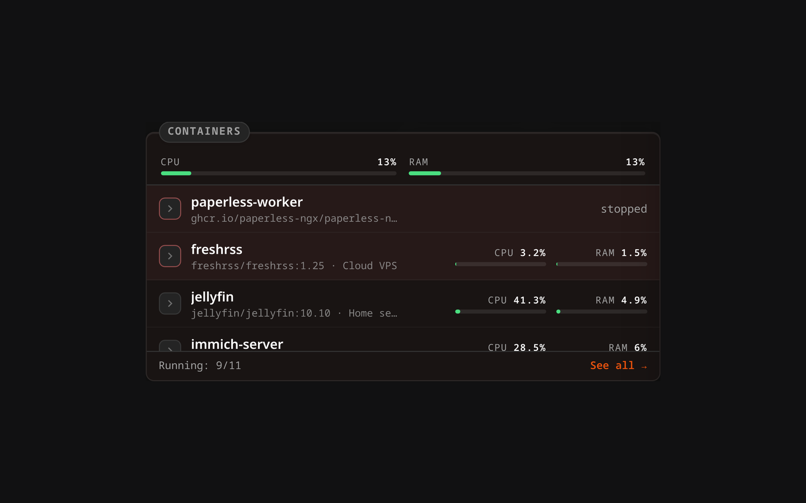
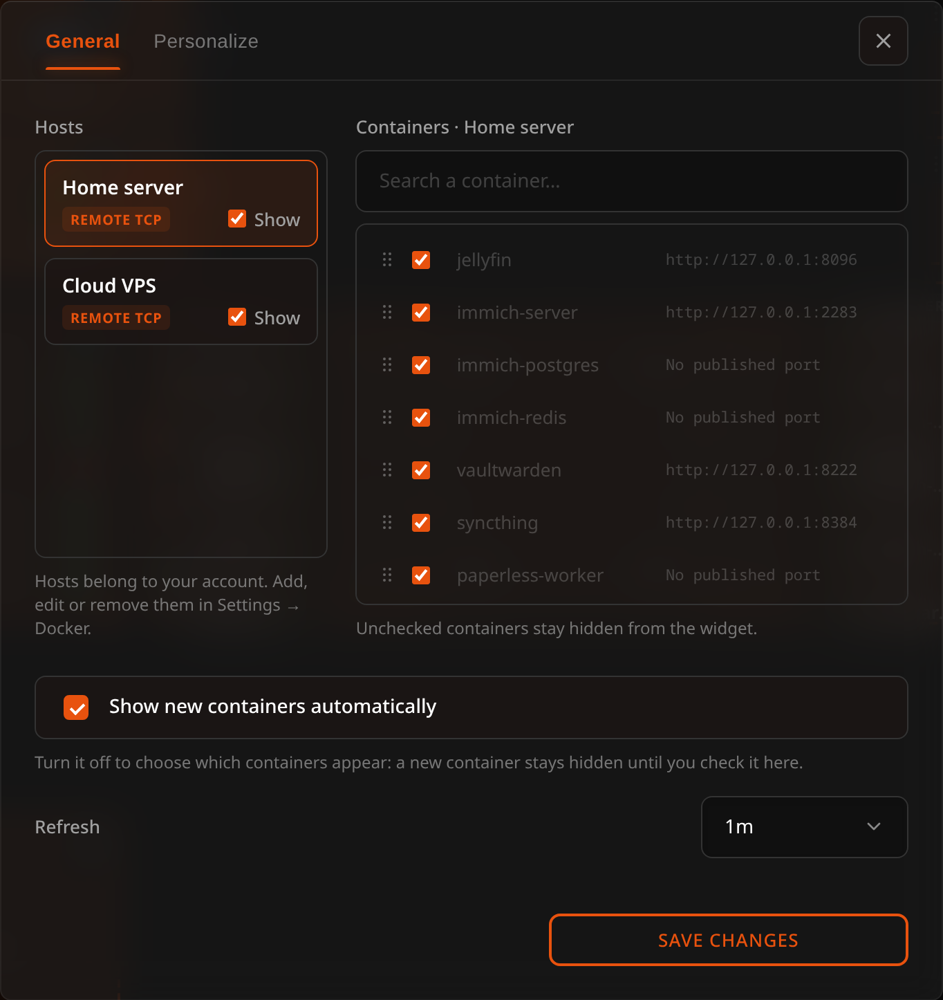

# Docker Widget

The Docker widget provides live monitoring and basic management of your Docker containers directly from Lastboard.

## Description

This widget lists your containers, shows how each one is doing and reads its CPU and memory live. It only reads: starting, stopping and restarting a container is done on the Docker page, and one click on a row takes you there.



Connecting a host, the Lastboard Agent, who can use which kind of host and the Docker page are in the [Docker guide](../docker/overview.md); this page is about the widget itself.

## What the widget shows

- **Under the title**, a line with the load of your hosts: the share of CPU and memory that the running containers use of what the host has. With several hosts it speaks for the busiest one. It appears once a host has said how big it is.
- **A row for each container**: its icon, its name, the image it runs (and the host, when there is more than one), and its CPU and memory with a bar each. A container that is stopped says so instead of showing readings.
- **A foot** that counts how many are running and leads to the page. Turn the link off and the foot goes with it.

The icon is the one you chose for the container on the Docker page, or else the icon of the bookmark that serves it. A container with neither wears the board's own default.

Rows are coloured by what needs saying: a container that fails its health check, ended with an error, or uses almost all its memory is red; a restarting or paused one is amber. A container that a bookmark of yours depends on and that is stopped is an outage, and its row carries a mark on its leading edge. Until you [arrange the list yourself](#arranging-the-list), what needs attention comes first.

### Opening the page

Click a row and the Docker page opens on the **Containers** tab with that container in its side panel. **See all** opens the same tab without choosing one. The browser's Back button closes the panel first and then the page, so you land back on the board.



## Widget Configuration

Everything the widget shows is set from its configuration screen: enter the dashboard's edit mode and open the widget's settings.

### Hosts

The hosts of your account are listed with a **Show** box each. Leave them all ticked and the widget shows every host, including the ones you add later; untick one to leave it out of this widget. To add, change or remove a host, go to Preferences → Docker (see [Docker hosts](../docker/overview.md#docker-hosts)).

### Containers

Each host's containers are listed with a search box for long lists. For each one you can:

- **Show or hide it** with the checkbox. Unchecked containers stay out of the widget.
- **Rename it**, if the container name isn't what you want to read on your dashboard. The name is the widget's own; the Docker page keeps showing the container's.

Hosts that don't answer say so in their own section, and their containers keep whatever you had already set for them.

**The widget shows what you ticked, from every host at once** — it is one list of the containers you care about, not one host at a time.

### Readings and the link to the page

- **Readings shown**: CPU and RAM, each on its own. A reading you turn off disappears from the line under the title and from every row, and when both are off the widget stops asking the hosts for them.
- **Show the link to the page**: turn it off to hide the foot, the count with it. Clicking a row still opens the page.

### When a host stops answering

Its containers don't disappear from the widget. They stay where they are and the line under their name says the host isn't responding instead — so you can see at a glance which services you've lost and which are fine.

A host that was already down when the dashboard loaded listed nothing, so there are no rows of its to grey out. That one gets a single line naming it and saying it doesn't answer.

### Opening a container's service

The widget doesn't link to a container's web interface any more: a click opens the page. The page does: its side panel has an **Open bookmark** button when a bookmark of yours serves the container, and **Open service** when only the container says where it answers. Lastboard works that address out in this order:

1. **A label on the container.** `lastboard.url` is read first, then `homepage.href` — so a container already labelled for another dashboard works here without changes, and you can override it with ours. Only `http://` and `https://` addresses are used.
2. **The first published port**, combined with the host's address. For a local host that's whatever address you're using to read the dashboard; for a remote one it's that host's own address.

A container that publishes no port and carries no label has no such button.

Example of labelling a container so it advertises its own address:

```yaml
services:
  jellyfin:
    image: jellyfin/jellyfin
    labels:
      lastboard.url: https://jellyfin.example.home
```

An address you typed for a container in an earlier version is kept in the widget's settings but is no longer used: add a bookmark for it, or the label above.

### Arranging the list

Each container in the settings has a grip on its left. Drag a row by it to put the container where you want it, or focus the grip and use the up and down arrow keys. The widget shows the containers in that order. The order is kept for each host, so with several hosts you arrange each one's list on its own. A container the order doesn't know yet — a new one — goes after the others until you place it.

### New containers

By default a container that appears on a host is shown straight away, and you hide the ones you don't want. If you only want a few on the widget, turn **Show new containers automatically** off: from then on a new container stays hidden until you tick it in the settings. Turning it off keeps what is on the widget now; only containers that appear afterwards are held back. Do it while all your hosts are answering: a host that is down can't be listed, so its containers are not kept.

### Updating a container

What you set on a container — hidden, a name — is kept under the container's **name** on its host, not its ID. Updating a container recreates it with a new ID, and the settings follow it. (Settings saved by an earlier version were kept by ID and are read as they were until you next save the widget's settings; a container recreated before that one save had already lost them, and has to be hidden once more.)

### Title and refresh

The title is the name on the tile's top border, the same as on every widget; leave it empty for none. A widget that had no title keeps the name it showed, "Docker". You can also choose how often the container list is refreshed (30 seconds to 10 minutes). Resource usage for running containers updates every few seconds regardless of this setting.
