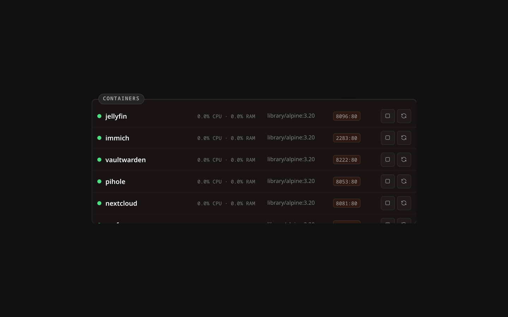

# Docker Widget

The Docker widget provides live monitoring and basic management of your Docker containers directly from Lastboard.

## Description

This widget lists containers, shows their running state, exposes port mappings, and provides real-time CPU/RAM stats. It also allows admin users to control container lifecycles (Start, Stop, Restart).



## Prerequisites

To monitor Docker instances, Lastboard needs access to the Docker daemon.

## Connection Modes

You can connect the widget to Docker environments via three distinct modes:

### 1. Local Socket (Native Install)
When running Lastboard natively on Linux, it can access `/var/run/docker.sock` directly (ensure the `lastboard` user has permission to read the socket, often by adding it to the `docker` group).

### 2. Local Socket (Docker Install)
When running Lastboard as a Docker container, uncomment the socket volume mount in the `docker-compose.yml` file to grant it access.
```yaml
    volumes:
      - ./data:/var/lib/lastboard
      - /var/run/docker.sock:/var/run/docker.sock:ro  # Read-only access
```

### 3. Remote via Lastboard Agent
For remote servers, you can use the official Lastboard Agent to securely proxy Docker API calls over HTTP with an authorization token.

## Lastboard Agent

The Lastboard Agent is a lightweight proxy that exposes specific Docker endpoints.

### Quick Start

**Using Docker Compose (Recommended):**
```yaml
services:
  lastboard-agent:
    image: git.codigosh.com/codigosh/lastboard-agent:latest
    container_name: lastboard-agent
    ports:
      - "2375:2375"
    environment:
      - TOKEN=your_secure_random_token
    volumes:
      - /var/run/docker.sock:/var/run/docker.sock:ro
    restart: unless-stopped
```

**Using Docker CLI:**
```bash
docker run -d \
  --name lastboard-agent \
  -p 2375:2375 \
  -e TOKEN=your_secure_random_token \
  -v /var/run/docker.sock:/var/run/docker.sock:ro \
  --restart unless-stopped \
  git.codigosh.com/codigosh/lastboard-agent:latest
```

### Environment Variables
| Variable | Description |
| :--- | :--- |
| `TOKEN` | Required: The Bearer token used to authenticate requests. |
| `PORT` | The port the agent binds to (default: `2375`). |
| `SOCKET_PATH` | Path to Docker socket (default: `/var/run/docker.sock`). |

### Health Check Endpoint
The agent provides a public, unauthenticated `/health` endpoint to verify connectivity.

### Using with a Reverse Proxy
If securing the agent behind a reverse proxy (like Pangolin or Cloudflare Zero Trust), ensure your proxy forwards the `Authorization` header containing the Bearer token intact.

## Widget Configuration

Everything the widget shows is set from its configuration screen: enter the dashboard's edit mode and open the widget's settings.

### Hosts

You can add multiple hosts. Supported URL formats include:
- **Local:** `local` or empty string.
- **Agent Server:** `agent://IP_OR_DOMAIN:PORT?token=YOUR_TOKEN`
- **TLS/TCP:** `https://...` or `http://...`

With more than one host configured, the widget header gets a selector to switch between them.

### Containers

Every container from every host is listed, grouped by host, with a search box for long lists. For each one you can:

- **Show or hide it** with the checkbox. Unchecked containers stay out of the widget.
- **Set an icon**, from the same picker used for bookmarks.
- **Rename it**, if the container name isn't what you want to read on your dashboard.

Hosts that don't answer say so in their own section, and their containers keep whatever you had already set for them.

### Title and refresh

You can give the widget a title of your own instead of "Docker", and choose how often the container list is refreshed (30 seconds to 10 minutes). Resource usage for running containers updates continuously regardless of this setting.

## Admin Controls

Users with the `admin` role can start, stop, or restart containers directly from the widget rows.
