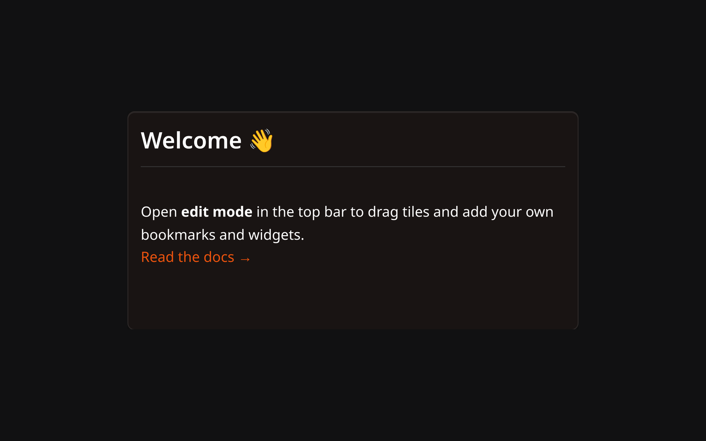

# Markdown Widget

The Markdown widget renders a block of Markdown on the dashboard: a welcome note, a list of links, the steps you always forget.

## Description

Two modes in one widget. Locked, it shows the rendered result. Unlocked, it shows the source you type, with a button to preview it as you go.

## Locked and unlocked

The widget starts **locked**, showing the rendered text and nothing else.

Hover the widget and a lock button appears in its top-right corner. Click it to unlock: the source appears in an editor, the lock button turns red, and a second button appears next to it that switches between the source and the rendered preview. Click the lock again to go back to the rendered view, which also saves.

The lock button is hidden while the dashboard is in **Edit Mode** — move and resize the widget there, and write in it outside.

## Saving

There is no auto-save. Your text is written to the server when you:

- **lock the widget**, if you changed anything, or
- press **Ctrl+S** (**Cmd+S** on macOS) while it is unlocked.

## Supported Syntax

Lastboard renders Markdown with its own small parser, not a full Markdown implementation. What it understands:

| Syntax | Result |
| :--- | :--- |
| `# `, `## `, `### ` | Headings, three levels. |
| `**bold**`, `__bold__` | Bold. |
| `*italic*`, `_italic_` | Italic. |
| `` `code` `` | Inline code. |
| Three backticks around a block | A fenced code block, with an optional language name after the opening fence. |
| `- item`, `* item` | A bullet list. |
| `1. item` | A numbered list. |
| `[ ] task`, `[x] task` | A task box, ticked or not. Written at the start of the line, **without** a leading `-`. |
| `[text](https://…)` | A link. Links open in a new tab. |
| `` | An image, scaled to the width of the widget. |
| `> text` | A quote. |
| `---` on its own line | A horizontal rule. |

Line breaks are kept as you type them: a single Enter is a new line.

Link and image addresses have to be `http`, `https` or `mailto`. Anything else is dropped.

## Configuration Options

The widget's settings screen has no options of its own — the text is written in the widget itself. Its **Personalize** tab has the settings every widget has, plus a title:

| Option | Default | Description |
| :--- | :--- | :--- |
| **Border Color** | None | Border color for the widget's card. |
| **Border Width** | Thin | Thin, Regular or Thick. |
| **Title** | None | A name shown on the tile's top border. Leave it empty for none. |

## Notes

- **Tab** inserts two spaces rather than moving the focus out of the editor.
- Task boxes are for reading. They are drawn from your text and cannot be ticked in the rendered view; edit the `[ ]` into an `[x]` to change one.
- HTML you write is shown as text, not rendered as HTML.
- Anything outside the table above comes out as you typed it. In particular there are no headings past `###` and no `~~strikethrough~~`.
