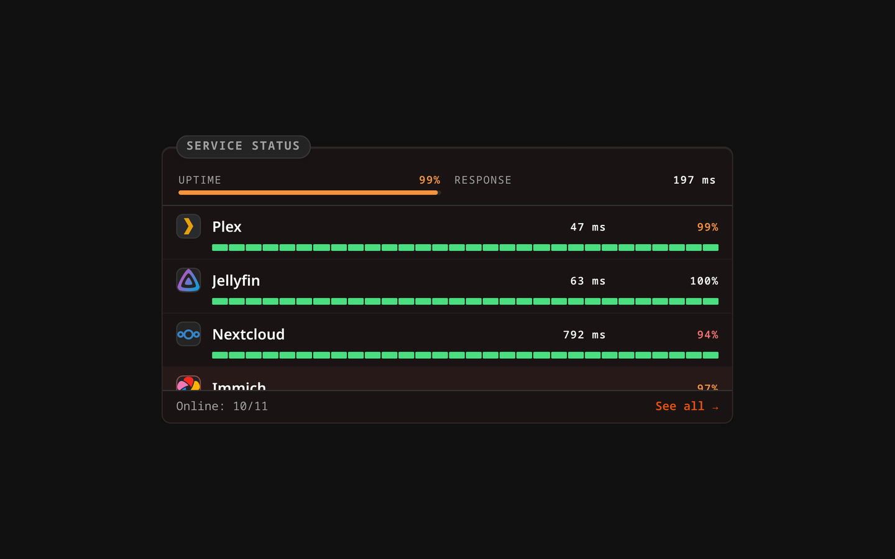
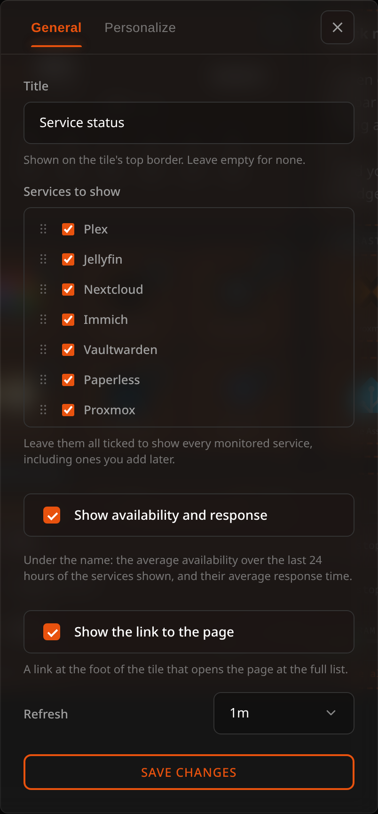

# Monitoring Widget

The Monitoring widget puts the status page on your dashboard: which of your services are up, how they have behaved over the last 24 hours, and how long the last check took.

## Description

It reads the same data as the full [Monitoring & Uptime](../monitoring/overview.md) page, so it shows a service as soon as that service is being monitored — you don't configure anything twice.

Under the title, a line with the **uptime** of the services shown (the average over the last 24 hours, with a bar) and their average **response**. Then a row for each service, reading from left to right:

- the **icon** of the bookmark being monitored, or the one you chose for it in this widget
- its **name** — the bookmark's, or the one you gave it in this widget
- the **latency** of the last check and the **uptime** over the last 24 hours, coloured green from 99%, amber from 95% and red below
- under them, the **heartbeat** of the most recent checks, oldest on the left

A service that is down has its row in red; one that has not been checked yet is grey and has no figures. The foot counts how many are online — *Online: 5/6* — and, unless you turn it off, links to the status page.

Clicking a row opens the status page on the **Services** tab with that service in its side panel — the same panel as when you choose it there, with its outages, checks and latency chart. **See all** opens the same tab without choosing one. The browser's Back button closes the panel first and then the page.

> **Requires monitoring to be on.** The widget lists services that are already being monitored. Enable 24/7 monitoring and give the bookmarks you care about a **Status Position** other than Off — see [Monitoring & Uptime](../monitoring/overview.md).

## Choosing which services to show

By default every monitored service is shown, including ones you add later. Untick the ones you don't want in the widget's configuration.

Each service has a grip on its left. Drag a row by it to put the service where you want it on the widget, or focus the grip and use the up and down arrow keys. The order is kept apart from the selection, so arranging a list you left fully ticked does not stop it taking new services: one that appears later is shown after the ones you arranged.

Each service also has an **icon** and a **name** field. The icon button opens the icon picker: choose one and this widget draws it for that service, or clear it to go back to the bookmark's own. The name field is empty by default and shows the service's name as a hint; type one and the widget shows that instead. Neither changes the bookmark nor the status page, and both are kept under the service's id, so renaming the bookmark does not undo them.

Leaving them all ticked is not the same as ticking them one by one: the widget stores "show everything", so new services appear on their own. If you pick a subset and later stop monitoring one of them, it simply drops out of the list.

## Configuration Options

| Option | Default | Description |
| --- | --- | --- |
| Title | None | A name shown on the tile's top border. Leave it empty for none. A widget that had no title keeps the name it showed: "Monitoring", or its name in your language |
| Services to show | All | Which monitored services appear in the widget, in what order, under what name and icon |
| Show the link to the page | On | The link in the foot. Clicking a row still opens the status page |
| Refresh | 1 min | How often the widget asks the server for fresh data |

## Sizing

The rows adapt to the width you give the widget, not the window: on a narrow one the figures drop their labels' bars and then all but the first, so the name stays readable; the heartbeat always has its own line under the row.
