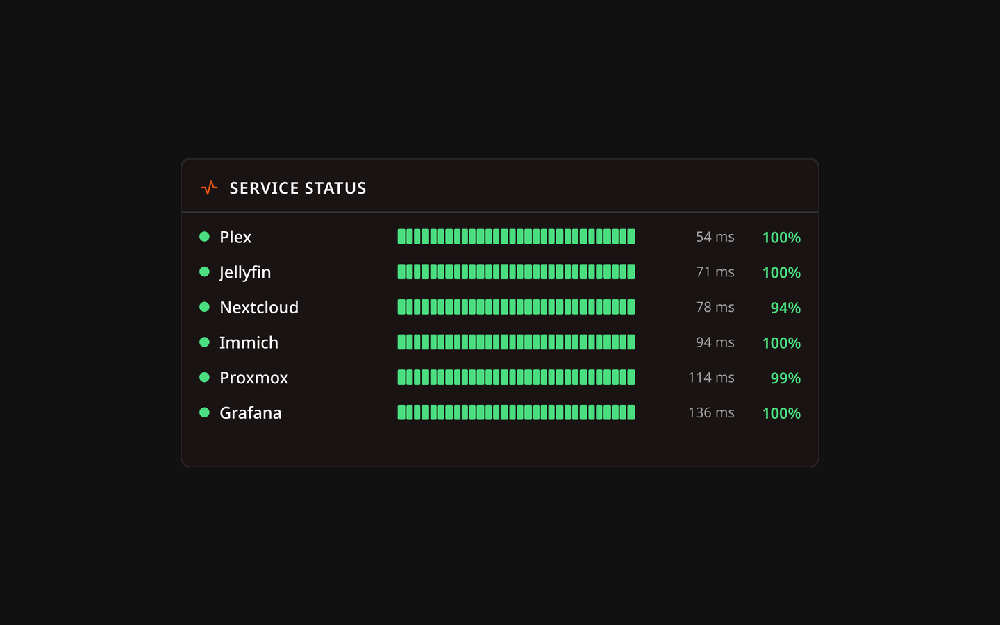
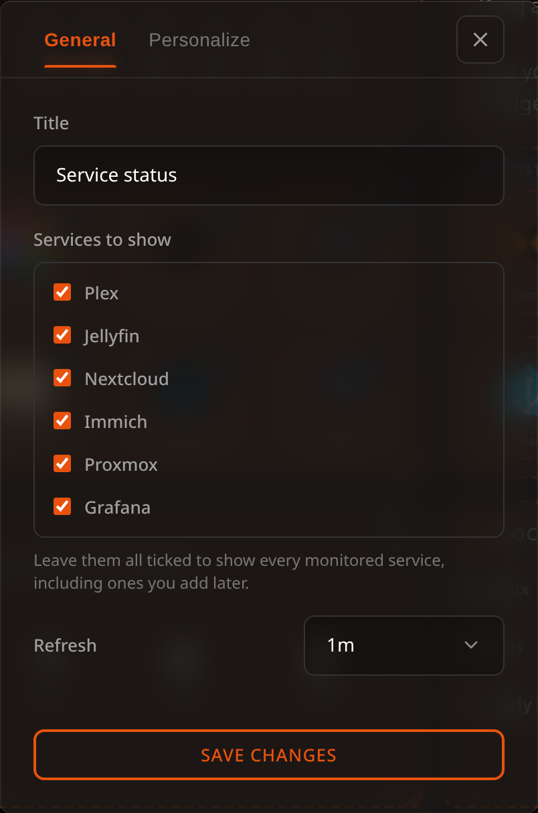

# Monitoring Widget

The Monitoring widget puts the status page on your dashboard: which of your services are up, how they have behaved over the last 24 hours, and how long the last check took.

## Description

It reads the same data as the full [Monitoring & Uptime](../monitoring/overview.md) page, so it shows a service as soon as that service is being monitored — you don't configure anything twice. Reading a row from left to right:

- a status dot: **up**, **down**, or grey when there is no data yet
- the **name** of the bookmark being monitored
- a **heartbeat** of the most recent checks, oldest on the left
- the **latency** of the last successful check
- the **uptime** over the last 24 hours

Clicking a row opens the same history drawer as the status page, with the outage list and the latency chart.

> **Requires monitoring to be on.** The widget lists services that are already being monitored. Enable 24/7 monitoring and give the bookmarks you care about a **Status Position** other than Off — see [Monitoring & Uptime](../monitoring/overview.md).

## Choosing which services to show

By default every monitored service is shown, including ones you add later. Untick the ones you don't want in the widget's configuration.

Leaving them all ticked is not the same as ticking them one by one: the widget stores "show everything", so new services appear on their own. If you pick a subset and later stop monitoring one of them, it simply drops out of the list.

## Configuration Options

| Option | Default | Description |
| --- | --- | --- |
| Services to show | All | Which monitored services appear in the widget |
| Refresh | 1 min | How often the widget asks the server for fresh data |

## Sizing

The rows adapt to the width you give the widget: on a narrow one the heartbeat moves to its own line so the name stays readable, and on a wider one everything sits on a single line, which fits roughly twice as many services in the same height.
