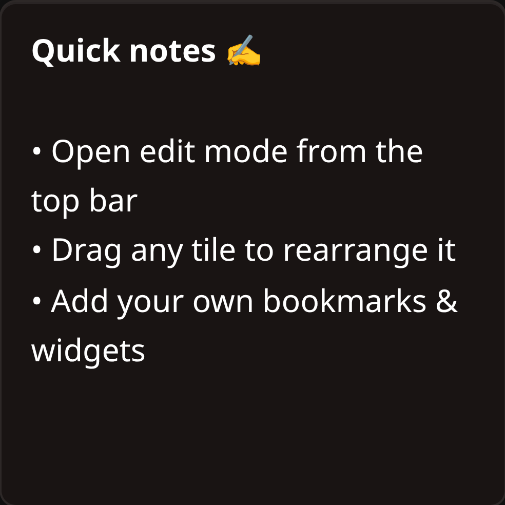

# Notepad Widget

The Notepad widget is a formatted scratchpad that lives on the dashboard: shopping lists, credentials you keep meaning to rotate, the command you always forget.

## Description

A rich-text editor with a toolbar — headings, bold and italic, colors, lists, checklists, links and images. What you write is stored with the dashboard, so it is there from any browser you sign in on.

## Locked and unlocked

The widget starts **locked**: you can read the note and scroll it, but not change it by accident.

Hover the widget and a small lock button appears in its top-right corner. Click it to unlock: the toolbar appears along the bottom edge, the cursor lands in the text, and the button turns red to remind you the note is open. Click it again to lock, which also saves.

The lock button is hidden while the dashboard is in **Edit Mode** — move and resize the widget there, and write in it outside.

## Saving

There is no auto-save. Your note is written to the server when you:

- **lock the widget**, if you changed anything, or
- press **Ctrl+S** (**Cmd+S** on macOS) while it is unlocked.

If you try to leave the page with unsaved changes, the browser asks you to confirm first.

## The toolbar

From left to right, in groups: undo and redo; heading 1, 2 and 3; bold, italic, underline, strikethrough and text color; align left, center, right and justify; insert link and insert image; bullet list, numbered list and checklist; quote, code block and clear formatting.

The chevron in the widget's bottom corner collapses the whole toolbar, which is worth doing on a small notepad — the editor takes the space back. It stays in that same corner whether the toolbar is open or collapsed, so the control that brings the tools back is exactly where the one that hid them was. That choice is remembered per widget, in the browser you made it in.

## Writing

- **Formatting as you type.** At the start of a line, `# `, `## ` and `### ` make headings, `> ` makes a quote, `- ` and `* ` start a bullet list, `1. ` starts a numbered list, `[] ` starts a checklist, and `--- ` draws a horizontal rule.
- **Checklists.** Press Enter on a checklist line and the next one starts with a fresh box; press Enter on a box you left empty and the list ends. Backspace removes a box. Click a box to tick or untick it — that works while the note is unlocked.
- **Tab** inserts two spaces rather than moving the focus out of the note.
- **Pasting** drops the formatting and inserts plain text, so a paste from a web page doesn't bring a stylesheet with it.
- **Links** apply to the text you have selected: select it first, then use the link button and give the address.
- **Images** are inserted by address, with an optional width (`100%`, `300px`). Click an image afterwards and a button appears over it to change the address or the width.

## Configuration Options

The widget's settings screen has no options of its own — the note is written in the widget itself. Its **Personalize** tab has the two settings every widget has:

| Option | Default | Description |
| :--- | :--- | :--- |
| **Border Color** | None | Border color for the widget's card. |
| **Border Width** | Thin | Thin, Regular or Thick. |

## Notes

- Notes are stored as formatted text and filtered when they are loaded, so only formatting, links and images survive. Link and image addresses have to be `http`, `https` or `mailto`.
- Locking hides the toolbar; the shortcuts and the checkbox clicking only do anything while the note is unlocked.
