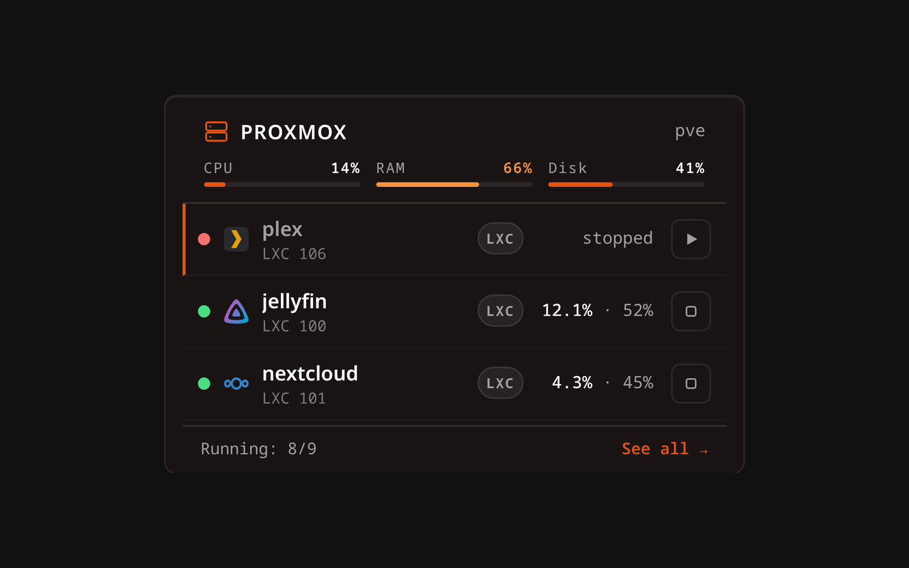
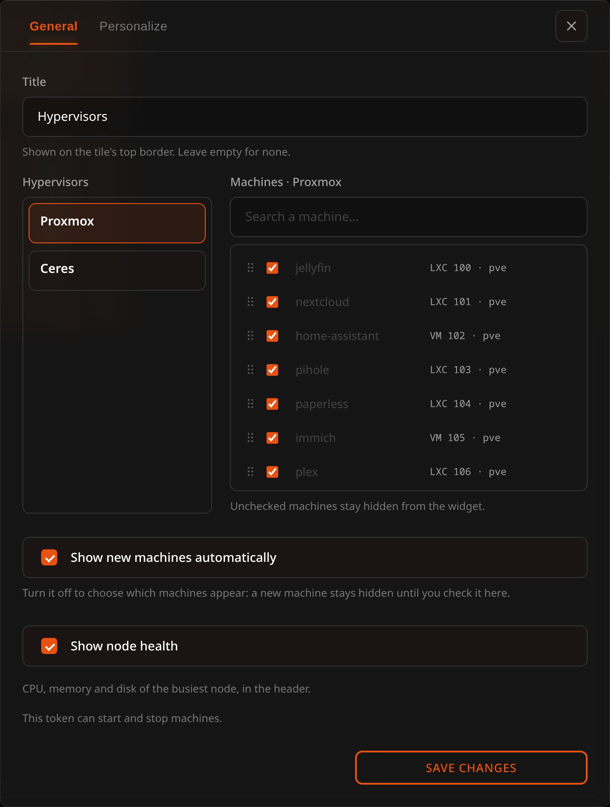

# Proxmox Widget

The Proxmox widget puts the machine underneath your services on the dashboard itself: how hard the node is working, and which of the things it runs need attention.

## Description

What this adds over the [Docker widget](docker.md) is the line of node health at the top of the tile. Docker can tell you a container stopped; only this can tell you the machine it lived on is at 90% memory.

Reading a row from left to right:

- a status dot: **green** running, **red** stopped — the same two colours the page uses. A machine that is stopped **and** serves a bookmark says so with an accent bar down its leading edge, not with a third colour in the dot
- the **icon** of the bookmark that machine serves — [matched by name](../proxmox/overview.md#how-a-machine-is-tied-to-a-bookmark) or chosen by hand — or the board's own fallback
- the machine's **name** and its type and id (`LXC 106`, `VM 105`)
- its **CPU** and **memory**, or *stopped*
- a **start** or **shut down** button, when the token allows it

A machine that is stopped **and** serves a bookmark sorts to the top. A stopped machine nobody linked stays where it is: turning things off is a normal thing to do, and a tile that shouts about it is a tile you learn to ignore.

The footer counts what did not fit — *Running: 8/9* — and links to the full [Proxmox page](../proxmox/overview.md).

> **Requires a connection.** The widget reads whatever hosts are configured in **Settings → Proxmox**; without one it says so. See [Proxmox](../proxmox/overview.md) for the token and the four commands that create it.

**With several hypervisors connected it draws from all of them**, in one list ordered by what needs saying. A tile that showed only the first would go quiet about the machine that actually went down, which is the one thing it is on the board to say. Each row's start and shutdown button follows the token of the hypervisor *that* machine is on, so one being read-only does not take the buttons away from the other.

## Why it is not a list

A tile shows the first few machines and the footer counts the rest, because a real host has more machines than a tile has room — measured on one with twenty-nine on a single node. So the order is by how much each one needs saying, and anything that needs attention is at the top where it can be seen — until you [arrange the machines yourself](#choosing-and-arranging-the-machines), which puts them in the order you chose. To go through all of them, open the page: **See all** on the tile opens it without leaving the board, and the same page has its own address, `/?view=proxmox`, so it can be opened in a new tab or kept as a bookmark.

## Configuration

| Option | Default | Description |
| --- | --- | --- |
| Title | None | A name shown on the tile's top border. A widget that had no title keeps the name it showed: "Proxmox" |
| Machines | All | Which machines are on the tile, in what order, and what each is called there. See [below](#choosing-and-arranging-the-machines) |
| Show new machines automatically | On | Whether a machine that appears after you saved is shown straight away |
| Show node health | On | CPU, memory and disk of the busiest node, in a strip at the top of the tile |
| Refresh | 30s | How often the widget asks the server for fresh data |

The configuration panel also says, plainly, whether the token this instance holds can start and stop machines or only watch them — the same answer the settings screen gives, so you are never guessing why a button is missing.

## Choosing and arranging the machines

The list of machines in the settings works the same way as the one in the [Docker widget](docker.md). With more than one hypervisor connected the screen splits in two, hypervisors on the left and the selected one's machines on the right, with a search box for long lists. For each machine you can:

- **Show or hide it** with the checkbox. Unchecked machines stay off the tile; the page still lists all of them.
- **Rename it**, if the name the hypervisor gives it isn't what you want to read on your board. The new name is only the tile's: the page keeps the real one.
- **Arrange it.** Each row has a grip on its left: drag the row by it, or focus the grip and use the up and down arrow keys. The order is kept for each hypervisor, so you arrange each one's list on its own. A machine the order doesn't know yet — a new one — goes after the others.

Until you arrange something, the tile keeps putting what needs attention first. Once you have, your order is the order: the tile shows the machines as you placed them. Hiding or renaming a machine does not count as arranging.

### New machines

By default a machine that appears on a hypervisor is shown straight away, and you hide the ones you don't want. If you only want a few on the tile, turn **Show new machines automatically** off: from then on a new machine stays hidden until you tick it in the settings. Turning it off keeps what is on the tile now; only machines that appear afterwards are held back. Do it while every hypervisor is answering: one that is down can't be listed, so its machines are not kept.

### What the settings follow

What you set on a machine — hidden, a name, its place in the order — is kept under the machine's **ID** on its hypervisor, not under the node it runs on, so moving a machine to another node of the cluster does not undo it. A restored machine that Proxmox gives a new ID is a new machine to the tile.

## Starting and stopping

Same rules as the page: **start** and **shut down** only, both with a confirmation, never a node, only on your own hypervisors, and the buttons are only drawn when the token carries `VM.PowerMgmt`. A machine takes a few seconds to come up; the dot turns green on the following refresh rather than pretending it already has.

## Sizing

The widget adapts to the width of the tile, not of the window: on a narrow one the type pill and the memory figure drop away so the name and the button stay readable — the type is already in the line under the name. Its default size is 3x2, which fits everything; with node health on, the strip at the top carries three meters and wants that width.
