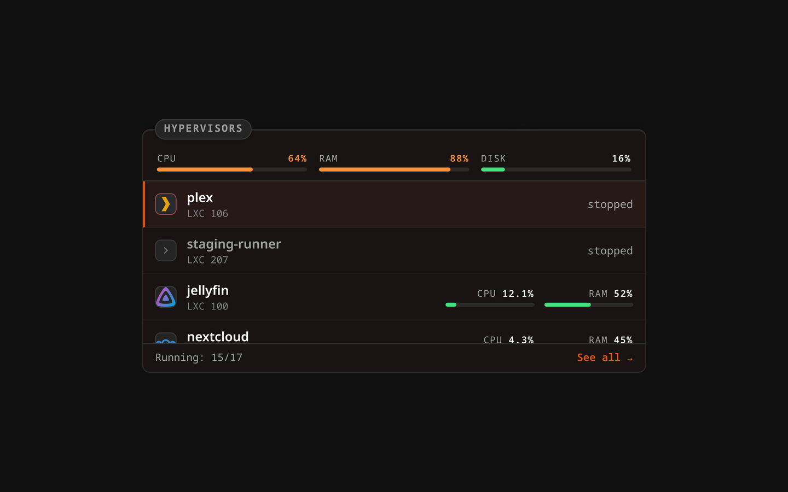
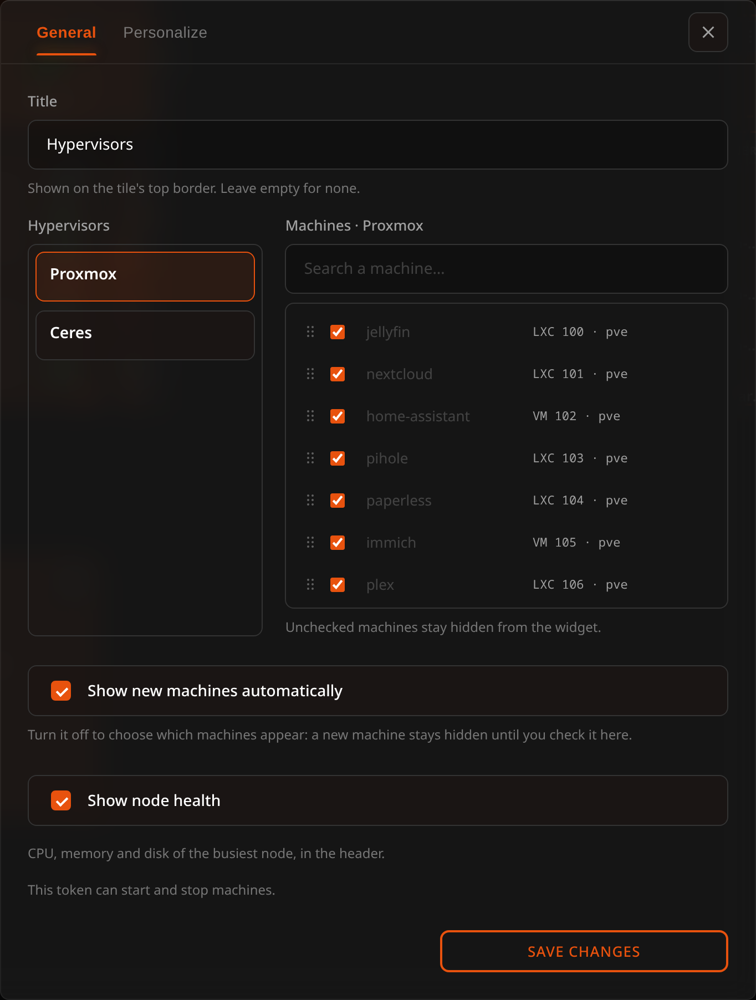

# Proxmox Widget

The Proxmox widget puts the machine underneath your services on the dashboard itself: how hard the node is working, and which of the things it runs need attention.

## Description

What this adds over the [Docker widget](docker.md) is the line of node health under the title. Docker can tell you a container stopped; only this can tell you the machine it lived on is at 90% memory.

Under the title, a line with **CPU**, **memory** and **disk** of the node under most pressure, each with a bar that turns amber from 60% and red from 90%. The node's name is not written: the title of the tile is yours to choose.

Then a row for each machine, reading from left to right:

- the **icon** of the bookmark that machine serves — [matched by name](../proxmox/overview.md#how-a-machine-is-tied-to-a-bookmark) or chosen by hand on the page — or the board's own fallback
- the machine's **name** and its type and id (`LXC 106`, `VM 105`)
- its **CPU**, **memory** and **disk**, each with a bar, or *stopped*

A running machine has a green icon frame, a stopped one is grey. A machine that is stopped **and** serves a bookmark is an outage: its row is red and carries a mark on its leading edge. A stopped machine nobody linked stays grey: turning things off is a normal thing to do, and a tile that shouts about it is a tile you learn to ignore.

A virtual machine reports the size of its disk only when it runs the guest agent; one that does not say has no disk figure rather than a zero. Containers always report it.

The foot counts how many are running — *Running: 23/26* — and, unless you turn it off, links to the full [Proxmox page](../proxmox/overview.md).

> **Requires a connection.** The widget reads whatever hosts are configured in **Settings → Proxmox**; without one it says so. See [Proxmox](../proxmox/overview.md) for the token and the four commands that create it.

**With several hypervisors connected it draws from all of them**, in one list ordered by what needs saying. A tile that showed only the first would go quiet about the machine that actually went down, which is the one thing it is on the board to say.

The widget only reads. Starting and shutting a machine down is done on the page, which a click on its row opens.

## Opening the page

Click a row and the Proxmox page opens on the **Machines** tab with that machine in its side panel, where its tasks and its start and shut down buttons are. **See all** opens the same tab without choosing one. The browser's Back button closes the panel first and then the page, so you land back on the board. The page also has its own address, `/?view=proxmox`, to open it in a new tab or keep it as a bookmark.

## Why it is a list you scroll

A real host has more machines than a tile has room — measured on one with twenty-nine on a single node — so the list scrolls inside the tile. The order is by how much each one needs saying, and anything that needs attention is at the top where it can be seen — until you [arrange the machines yourself](#choosing-and-arranging-the-machines), which puts them in the order you chose.

## Configuration

| Option | Default | Description |
| --- | --- | --- |
| Title | None | A name shown on the tile's top border. A widget that had no title keeps the name it showed: "Proxmox" |
| Machines | All | Which machines are on the tile, in what order, and what each is called there. See [below](#choosing-and-arranging-the-machines) |
| Show new machines automatically | On | Whether a machine that appears after you saved is shown straight away |
| Show node health | On | The line under the title with the CPU, memory and disk of the busiest node |
| Readings shown | All three | CPU, RAM and disk, each on its own. A reading you turn off disappears from the line under the title and from every row |
| Show the link to the page | On | The link in the foot. Clicking a row still opens the page |
| Refresh | 30s | How often the widget asks the server for fresh data |

## Choosing and arranging the machines

The list of machines in the settings works the same way as the one in the [Docker widget](docker.md). With more than one hypervisor connected the screen splits in two, hypervisors on the left and the selected one's machines on the right, with a search box for long lists. For each machine you can:

- **Show or hide it** with the checkbox. Unchecked machines stay off the tile; the page still lists all of them.
- **Rename it**, if the name the hypervisor gives it isn't what you want to read on your board. The new name is only the tile's: the page keeps the real one.
- **Arrange it.** Each row has a grip on its left: drag the row by it, or focus the grip and use the up and down arrow keys. The order is kept for each hypervisor, so you arrange each one's list on its own. A machine the order doesn't know yet — a new one — goes after the others.

Until you arrange something, the tile keeps putting what needs attention first. Once you have, your order is the order: the tile shows the machines as you placed them. Hiding or renaming a machine does not count as arranging.

### New machines

By default a machine that appears on a hypervisor is shown straight away, and you hide the ones you don't want. If you only want a few on the tile, turn **Show new machines automatically** off: from then on a new machine stays hidden until you tick it in the settings. Turning it off keeps what is on the tile now; only machines that appear afterwards are held back. Do it while every hypervisor is answering: one that is down can't be listed, so its machines are not kept.

### What the settings follow

What you set on a machine — hidden, a name, its place in the order — is kept under the machine's **ID** on its hypervisor, not under the node it runs on, so moving a machine to another node of the cluster does not undo it. A restored machine that Proxmox gives a new ID is a new machine to the tile.

## Sizing

The widget adapts to the width of the tile, not of the window: on a narrow one the bars drop away and only the figures stay, and on a very narrow one only the first reading does, so the name stays readable. Its default size is 3x2, which fits everything; the line under the title carries up to three meters and wants that width.
