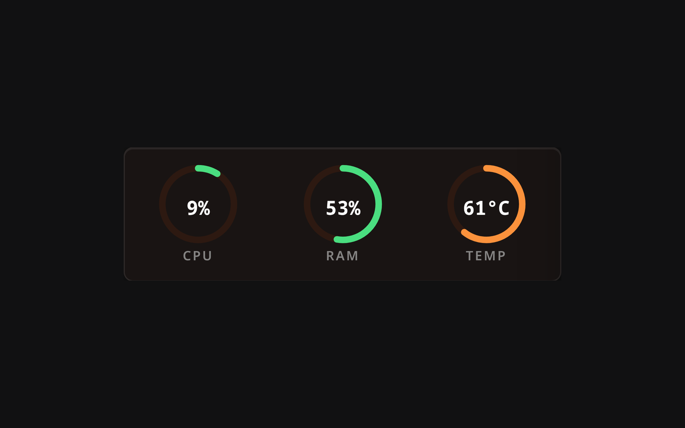

# Telemetry Widget

The Telemetry widget provides real-time monitoring of your server's hardware performance.

## Description

This widget connects directly to the Lastboard backend via WebSockets to stream live system metrics without needing external agents or exporters.

## Metrics Displayed

The widget can display the following metrics:
- **CPU:** Current processor utilization percentage.
- **RAM:** Memory usage percentage.
- **Temperature:** CPU thermal readings (in °C/°F depending on the global unit setting).

> **Note:** Temperature monitoring relies on system sensors and is currently supported on Linux hosts only. The units (°C/°F) are determined by the **Global Unit System** in the dashboard settings.

## Configuration Options

| Option | Default | Description |
| :--- | :--- | :--- |
| **Update Interval** | 5s | How often the widget updates the displayed data. |
| **Metrics to Show** | All | Choose which specific metrics (CPU, RAM, Temp) to render. |
