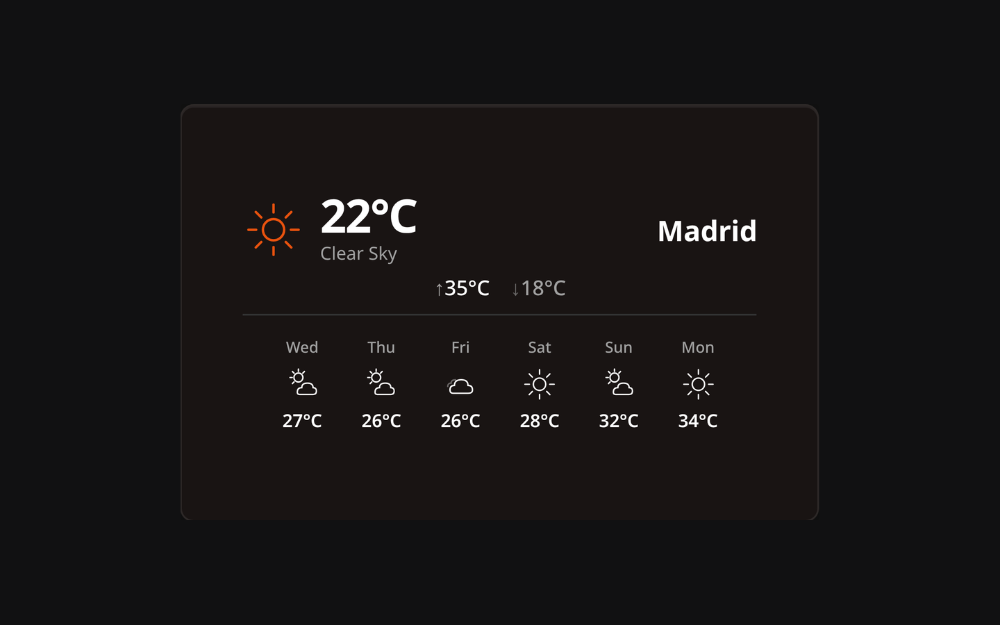

# Weather Widget

The Weather widget displays current meteorological conditions and future forecasts based on a chosen location.

## Description

A dynamic weather display that automatically maps WMO weather codes to beautiful SVG icons and respects your dashboard's theme.

## Data Source

This widget is powered by [Open-Meteo](https://open-meteo.com/). It resolves coordinates dynamically and does not require any API keys or registration.

## Configuration Options

| Option | Default | Description |
| :--- | :--- | :--- |
| **Location** | Empty | Search for a city; its coordinates are resolved automatically. |
| **Show Forecast** | Disabled | Display a multi-day forecast below the current conditions. |
| **Forecast Days** | 5 | Number of forecast days to show when the forecast is enabled. |

> **Note:** Weather data is cached and refreshed automatically every **15 minutes**; this interval is fixed and not user-configurable.

> **Note:** Temperature and wind speed units are determined by the **Global Unit System** in the dashboard settings (Celsius/Metric vs Fahrenheit/Imperial).
